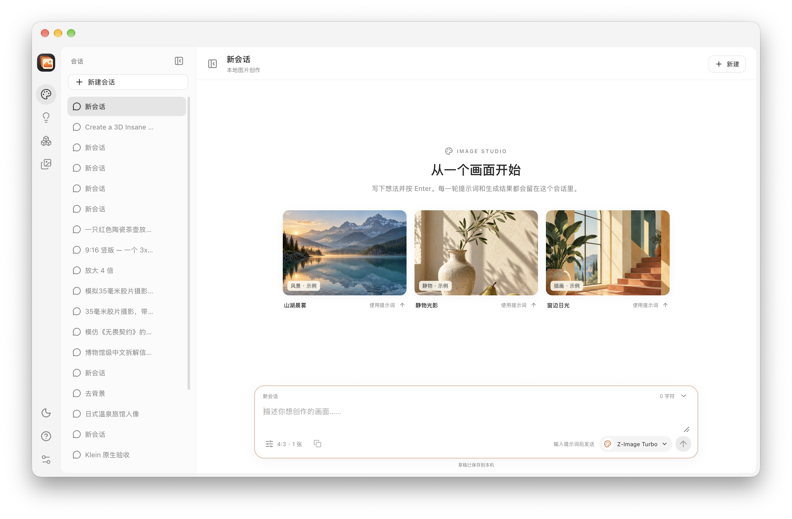
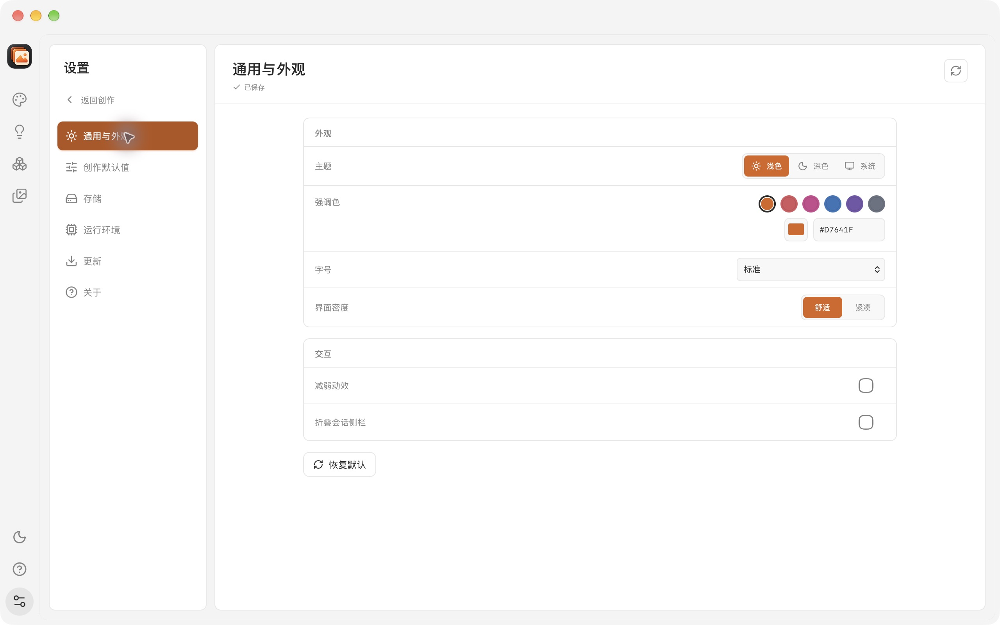
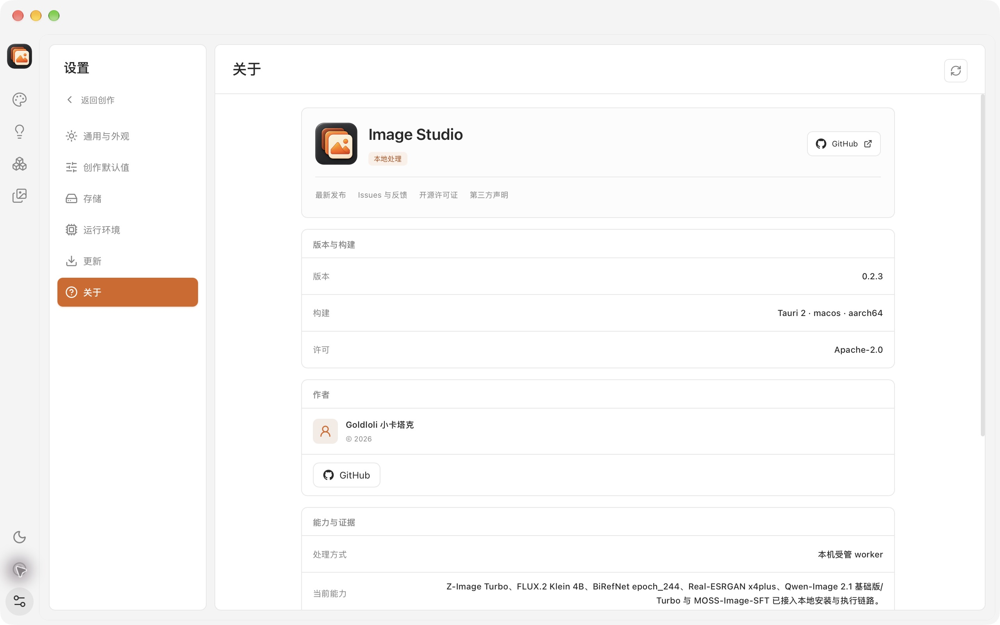
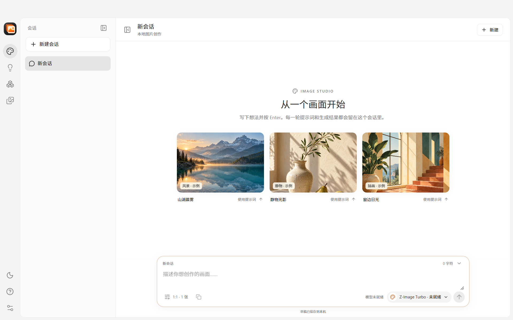
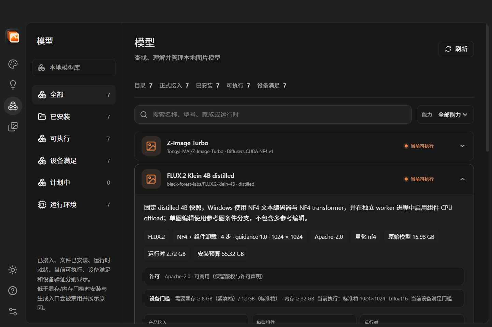
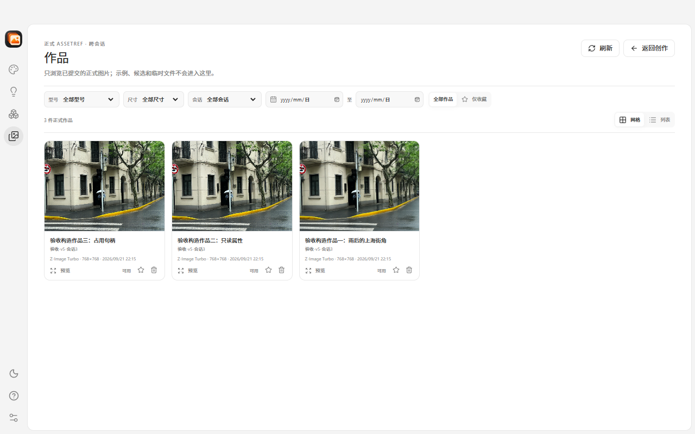

# Image Studio

**English** | [简体中文](README.zh-CN.md)

[](https://github.com/Goldloli/image-studio/actions/workflows/quality.yml)
[](https://github.com/Goldloli/image-studio/releases/latest)
[](LICENSE)

Image Studio is a local-first desktop image creation studio for Apple Silicon
macOS and Windows x64, built with Rust, Tauri 2, and React. Generate, edit,
remove backgrounds, and upscale images with seven pinned local models while
keeping model execution, conversations, and works on your machine.



## Latest Release: v0.2.3

Version `0.2.3` focuses on a clearer preferences center and a verified stable-update
flow:

- **Six-group settings center**: General & Appearance, Creation Defaults,
  Storage, Runtime, Updates, and About share a two-panel layout with row-based
  controls instead of repeated form cards.
- **Persistent accent color**: choose from six non-green presets or a validated
  custom `#RRGGBB` value; semantic success, warning, and danger colors remain
  fixed.
- **Verified stable updates**: the app checks the official
  `Goldloli/image-studio` stable GitHub Releases about 10 seconds after startup,
  at most once every 24 hours. It never downloads or installs automatically.
- **Controlled package handling**: downloads show real progress, speed and ETA,
  support cancellation, and require the matching SHA-256 before installation.
  Windows can install and restart when no task is active; macOS opens the verified
  DMG for manual installation.
- **No model or data migration**: preferences v1 migrate to v2 on the next save;
  the seven model identities, execution recipes, SQLite schema v6, and existing
  local works remain compatible.

| Settings center | About and GitHub |
|---|---|
|  |  |

### Included from v0.2.2

Version `0.2.2` changed macOS delivery to a native disk image:

- the release publishes `Image-Studio-<version>-macos-arm64.dmg` instead of an
  application zip;
- the mounted volume contains `Image Studio.app` and an Applications shortcut;
- CI verifies the image structure, bundle identity, version, arm64 executables,
  minimum macOS version, and legal resources before release.

### Included from v0.2.1

Version `0.2.1` rolled the latest dependency updates into downloadable builds
without changing the model surface or user workflow:

- `rfd` 0.18.0, `zip` 9.5.0, `uuid` 1.29.2, and `flate2` 1.1.11 are shipped.
- Vite 8.3.7, React plugin 6.3.0, Vitest 5.1.0, and Lucide 1.70.0 build the UI.
- model weights, runtimes, recipes, and local data remain compatible with
  `0.2.0`.

### Included from v0.2.0

Version `0.2.0` brought the workspace closer to a daily-use image studio:

- **One clear workspace** — a single navigation rail replaces duplicated page
  tabs, standalone feature/task pages, and the development diagnostics drawer.
  Production records now expand in the conversation or work where they belong.
- **Conversation and work management** — rename or delete conversations without
  losing generated works; favourite works, filter to favourites, and delete a
  work together with its mask and dedicated preview cache. Referenced works are
  protected with actionable release guidance.
- **Safer local state** — the SQLite schema upgrades from v5 to v6 with
  transactional deletion metadata, recovery state, and preserved historical
  execution records.
- **Better second-launch behaviour on Windows** — launching the same data root
  again restores and focuses the running window, or explains within five seconds
  that it is unresponsive, instead of creating a conflicting second host.
- **Reliable startup diagnostics** — startup and WebView2 failures now retain
  both the structured application log and the native failure dialog instead of
  silently exiting.
- **Validated across the intended hardware tiers** — current builds are covered
  on macOS arm64, Windows 12 GB standard-tier hardware, and the Windows 8 GB
  compact-tier baseline.

See the [latest release notes](https://github.com/Goldloli/image-studio/releases/latest)
for the complete change list and known limitations.

| Conversation-based creation | Local model library |
|---|---|
|  |  |
| **Works library** | **Background removal** |
|  |  |

## Highlights

- **Seven certified models / eight capabilities** on both macOS and Windows.
- **Two execution tiers**: a standard tier (≥ 12 GB VRAM, 1024², `bfloat16`) and
  a compact tier (≥ 8 GB VRAM, 768², `float16`) selected automatically from the
  device facts.
- **Local execution**: no hosted image API or cloud project storage.
- **Conversation workspace**: drafts, prompts, parameters, progress, results,
  retries, and cancellation remain grouped by conversation; sessions can be
  deleted while their generated works are retained.
- **Work management**: favourites, a favourites-only filter, and controlled
  deletion that removes only application-managed originals, companion masks and
  dedicated caches while exports and execution history stay intact.
- **Deterministic model identities**: pinned revisions, per-file SHA-256,
  fixed runtimes, recipes, and worker protocol identities.
- **Durable local library**: SQLite-backed drafts, jobs, attempts, assets, task
  history, and provenance.
- **Strict process supervision**: bounded worker output, cancellation,
  descendant cleanup, execution leases, and crash recovery.
- **Single-instance data ownership**: a second launch using the same data root
  focuses the active window; isolated `--data-dir` roots remain independent.
- **Cross-platform releases**: Windows NSIS and macOS arm64 DMG artifacts
  are built and verified by GitHub Actions.
- **Settings and updates**: a six-group preference center, persisted accent color,
  stable-release checks, verified downloads, and platform-specific installation
  boundaries.

## Supported Models

| Model | Capabilities | Fixed recipe |
|---|---|---|
| Z-Image Turbo | Text to image | 4-bit loading, 9 steps, 1:1 / 4:3 / 3:4 |
| FLUX.2 Klein 4B distilled | Text to image, single-image edit | 4-bit loading, 4 steps, guidance 1.0 |
| BiRefNet general epoch_244 | Remove background, RGBA + mask | ONNX Runtime CPU, float32 |
| Real-ESRGAN x4plus | Exact 4× upscale | ncnn Vulkan, tile 128 |
| Qwen-Image 2.1 | Text to image | 4-bit NF4, 40 steps, guidance 1.0 |
| Qwen-Image 2.1 Turbo | Text to image | 4-bit NF4, 8 steps, official Turbo sampling |
| MOSS-Image-SFT | Text to image | 4-bit NF4, 50 steps, guidance 3.0 |

### Execution tiers

| Tier | VRAM | Canvas | Compute | Load strategy |
|---|---|---|---|---|
| `standard` | ≥ 12 GB | 1024² | `bfloat16` | staged / component offload |
| `compact` | ≥ 8 GB | 768² | `float16` | staged, one NF4 component resident at a time |

Both tiers share one 25–33 GB model download and one prepared NF4 cache; only
the recipe identity and its exact parameter map differ. A device that meets only
the compact thresholds degrades automatically and the model page states
"compact 768×768". Devices below both tiers keep the model disabled with the
lowest unmet requirement as the reason. BiRefNet and Real-ESRGAN were never
VRAM-bound.

**8 GB support (verified on an RTX 2060 SUPER, Turing sm75)**: Qwen-Image 2.1,
Qwen-Image 2.1 Turbo, MOSS-Image-SFT, and FLUX.2 Klein 4B (text-to-image and
edit) run in the compact tier with measured CUDA reserved peaks of 5.44–5.96
GiB. Z-Image Turbo keeps its 12 GB threshold because the model overflows in
`float16` on BF16-less Turing architectures.

**Performance on the 8 GB reference card (compact 768×768)**: every job starts a
fresh worker, so the total includes component loading.

| Model | Steps | Total | Sampling |
|---|---|---|---|
| Qwen-Image 2.1 Turbo | 8 | 84.5 s | 66.3 s |
| Qwen-Image 2.1 | 40 | 391.3 s | 358.1 s |
| MOSS-Image-SFT | 50 | 752.1 s | 733.8 s |
| FLUX.2 Klein 4B text-to-image | 4 | 145.6 s | 9.8 s |
| FLUX.2 Klein 4B edit | 4 | 166.1 s | 10.3 s |

On the current Windows 10 / RTX 3080 Ti 12 GB validation build, all eight
capabilities completed a real generation: Klein text-to-image in 26–27 s,
Z-Image Turbo in 54 s, Qwen-Image 2.1 in 86 s, Qwen-Image 2.1 Turbo in 41 s,
MOSS-Image-SFT in 146 s, Klein edit in 39 s, BiRefNet in 23 s, and Real-ESRGAN
in 8 s. Evidence:
[`verification/windows-8gb-tier/`](verification/windows-8gb-tier/README.md),
[`verification/windows-12gb-real-generation-20261112/`](verification/windows-12gb-real-generation-20261112/README.md),
[`verification/windows-12gb-standard-tier/`](verification/windows-12gb-standard-tier/README.md),
[`doc/15-windows-8gb-tier.md`](doc/15-windows-8gb-tier.md), and
[`doc/16-zimage-quantization-investigation.md`](doc/16-zimage-quantization-investigation.md).

The authoritative model catalog is
[`resources/model-catalog/catalog.json`](resources/model-catalog/catalog.json).
Windows uses separately frozen NF4/ONNX/ncnn profiles; macOS uses the verified
MFLUX/MLX and ONNX runtimes.

## Validation and Evidence Boundaries

The project keeps compile, UI, and real inference evidence separate:

| Platform | 0.2.3 evidence scope | Evidence |
|---|---|---|
| macOS arm64 | Adds native 1280×800 and 960×640 light/dark settings evidence and a live public GitHub Release check; reuses the prior real-model baseline because inference code, runtimes, and recipes are unchanged | [`verification/operations/redesign-settings-center/`](verification/operations/redesign-settings-center/README.md) |
| Windows 12 GB standard tier | Reuses the recorded 9/9 real-generation matrix; 0.2.3 reruns build, installer, and artifact validation in CI. Windows settings/update installation remains `not_run` | [`verification/windows-12gb-real-generation-20261112/`](verification/windows-12gb-real-generation-20261112/README.md) |
| Windows 8 GB compact tier | Reuses the verified compact recipes and functional baseline; model/runtime identities are unchanged | [`verification/windows-8gb-tier/`](verification/windows-8gb-tier/README.md), [`verification/windows-functional-regression-20261112/`](verification/windows-functional-regression-20261112/README.md) |

GitHub Actions validates builds, tests, packaging, architecture, checksums, and
version provenance. It does not download model weights or run GPU inference.
Hardware support is not extrapolated beyond the recorded machines and
architectures; `waived` and `not_run` acceptance items are never presented as
passes.

## System Requirements

- **Windows**: Windows 10 22H2 or Windows 11, x64. The current-user NSIS package
  embeds the WebView2 offline installer. Model eligibility depends on the GPU
  (≥ 8 GB VRAM for the compact tier, ≥ 12 GB VRAM for the standard tier); the
  install-time quantization path needs ≥ 8 GiB available physical RAM and
  ≥ 6 GiB commit headroom, and 16 GiB RAM or more is recommended.
- **macOS**: Apple Silicon (arm64), macOS 11 or newer. Model execution uses the
  verified MFLUX/MLX and ONNX runtimes; the model page reports device
  eligibility.
- **Disk**: each generative model downloads 25–33 GB and keeps a prepared NF4
  cache. Reserve at least 40 GB per generative model and roughly 150 GB for the
  full model set. Model weights and private Python runtimes are not bundled.

## Download

Use the latest published [GitHub Release](https://github.com/Goldloli/image-studio/releases/latest)
and verify the downloaded file against its `SHA256SUMS-*.txt`:

- **Windows x64**: `Image.Studio_<version>_x64-setup.exe`
- **macOS arm64**: `Image-Studio-<version>-macos-arm64.dmg`

```bash
shasum -a 256 -c SHA256SUMS-macos.txt
```

```powershell
Get-FileHash .\Image.Studio_<version>_x64-setup.exe -Algorithm SHA256
```

On macOS, open the verified DMG and drag `Image Studio` into Applications.

The release is unsigned and not notarized:

- Windows may show SmartScreen. Verify the checksum, then use
  **More info → Run anyway** only if the digest matches.
- macOS may show **“Image Studio.app is damaged and can’t be opened”** because
  Gatekeeper applies quarantine to this unsigned build. First confirm the
  downloaded DMG matches `SHA256SUMS-macos.txt`, open the disk image, drag
  `Image Studio` into Applications, then open Terminal and run:

```bash
sudo xattr -rd com.apple.quarantine "/Applications/Image Studio.app"
open "/Applications/Image Studio.app"
```

This removes quarantine only from the verified application bundle. Do not run
the command when the checksum is missing or does not match. On a copy installed
elsewhere, replace the quoted path with that app's path.

macOS builds require Apple Silicon and macOS 11 or newer.

### In-app updates

Settings → Updates checks only public stable Releases from
`Goldloli/image-studio`. Automatic checks run after startup, at most once every
24 hours, and never download or install without an explicit action. A package
enters the installable state only after the Release asset size and SHA-256
checksum match. Windows may install and restart when no generation, model
installation, or cleanup task is active. macOS opens the verified DMG and
requires the user to drag the application into Applications; Image Studio never
bypasses Gatekeeper or SmartScreen.

## Product Areas

- **Create**: multi-conversation image generation, source-image workflows,
  immediate placeholders, real worker progress, cancellation, and retry.
  Session rows support rename and delete; deleting a session keeps its works.
- **Inspiration**: a searchable prompt library with source attribution; licence
  details live in Settings → About.
- **Models**: installation, runtime, device eligibility, hardware thresholds,
  execution tier, and license information from the host catalog.
- **Works**: immutable formal assets across conversations with favourites, a
  favourites-only filter, preview, inline provenance, and native PNG/RGBA/mask
  export. Deleting a work removes its originals, companion mask and dedicated
  caches only.
- **Settings**: six preference groups, persisted accent color, explicit
  new-conversation defaults, storage and runtime facts, verified stable-update
  checks, and GitHub project links.

## Build From Source

Prerequisites:

- Rust **1.99.1** from [`rust-toolchain.toml`](rust-toolchain.toml)
- Node.js **24.19.0** and npm **11.17.0**
- Python **3.11 or newer** for repository verification scripts; **3.13 recommended**. Model workers use their own pinned private Python runtimes, not the system interpreter.
- Tauri system prerequisites for the target platform

```bash
npm --prefix apps/frontend ci
npm --prefix apps/frontend run build
cargo build --workspace --locked
cargo run -p image-studio-desktop --locked
```

### macOS development bundle

```bash
python3 scripts/prepare-macos-dev-app.py
open "target/dev/Image Studio.app"
```

### Windows sidecars

`cargo clippy`, tests, and Tauri builds require the Windows sidecars to be
present in `apps/desktop/binaries/`. The CI workflow and
[`scripts/build-windows-internal.ps1`](scripts/build-windows-internal.ps1)
construct and copy them automatically.

### Frontend-only preview

```bash
npm --prefix apps/frontend run dev
```

Browser preview does not provide native installation, local generation,
persistence, or process supervision. Rebuild the frontend and desktop app after
UI changes to refresh the embedded production assets.

## Local-First Architecture

```text
React UI
  ↓ restricted Tauri IPC
Desktop host / StudioService
  ├─ exact model installation and integrity checks
  ├─ SQLite library, drafts, jobs, attempts, and assets
  ├─ generation controller and hardware gates
  └─ inference supervisor
       ↓ bounded JSON protocol
     Python / ONNX / native workers
```

| Workspace area | Responsibility |
|---|---|
| `apps/desktop` | Tauri host, constrained IPC, installers, storage, diagnostics, and process adapters |
| `apps/frontend` | React workspace, create/inspiration/models/works/settings pages, and canvas |
| `crates/studio-core` | Typed identities, plans, recipes, attempt state, and validation |
| `crates/worker-protocol` | Framing, handshakes, identity checks, and generation protocol |
| `tools/inference-supervisor` | Host EOF, execution leases, worker/descendant supervision |
| `tools/*worker*` | MFLUX, ONNX, Diffusers/CUDA, and Real-ESRGAN execution |

The core and protocol crates do not depend on the GUI or inference frameworks.
Worker stdout carries bounded protocol frames; stderr carries bounded logs.
Product processes are launched with argument arrays and never through a shell.

## Local Data and Safety

Default paths:

- macOS data: `~/Library/Application Support/ImageStudio`
- macOS cache: `~/Library/Caches/ImageStudio`
- macOS logs: `~/Library/Logs/ImageStudio`
- Windows root: `%LOCALAPPDATA%\ImageStudio` with `data`, `cache`, `logs`, and
  `work` subdirectories
- Application log: `<data>/logs/app.log` (bounded, 8 MiB rotation)

Use `--data-dir PATH` for an isolated root (`data`, `cache`, `logs`, and `work`
are created under it). One host owns a data root at a time. On Windows the data
path must stay short enough for the private Python runtime to open its longest
files, and the host validates that budget before starting.

SQLite schema v6 stores projects, conversations, draft revisions, turns, jobs,
attempts, formal assets, and provenance, plus conversation deletion, work
favourites and deletion-cleanup state. Model installation and worker
activation bind fixed manifests, runtime inventories, and SHA-256 contents.

Image generation succeeds only after output validation and an atomic database
commit. Restart marks unfinished work as interrupted; retry creates a new
Attempt only after explicit user action. Missing or externally modified assets
remain visible as unavailable without deleting their historical records.

## Diagnostics and Verification

The product UI has no communication-diagnostics entry (development builds
included). Run the internal probe from the command line when debugging:

```bash
cargo run -p image-studio-desktop --locked -- --diagnostics
```

Diagnostics validate the constrained worker channel only. They do not prove GPU,
model, or image-generation success.

```bash
cargo fmt --all -- --check
cargo clippy --workspace --all-targets --locked -- -D warnings
cargo test --workspace --locked
npm --prefix apps/frontend test
npm --prefix apps/frontend run check
npm --prefix apps/frontend run build
openspec validate --all --strict
python3 scripts/ci/validate-workflows.py
actionlint -no-color
```

Real model acceptance evidence is stored in [`verification/`](verification/):

- Windows compact tier: [`verification/windows-8gb-tier/`](verification/windows-8gb-tier/README.md)
- Windows 12 GB current-build real generation: [`verification/windows-12gb-real-generation-20261112/`](verification/windows-12gb-real-generation-20261112/README.md)
- Windows standard tier and Windows 10 target machine baseline: [`verification/windows-12gb-standard-tier/`](verification/windows-12gb-standard-tier/README.md)
- Windows 0.2.0 functional regression: [`verification/windows-functional-regression-20261112/`](verification/windows-functional-regression-20261112/README.md)
- Same-root launch activation: [`verification/single-instance-20261112/`](verification/single-instance-20261112/README.md)
- Windows desktop coverage and defects: [`verification/windows-desktop-coverage/`](verification/windows-desktop-coverage/2026-11-06-coverage-results.md), [`verification/windows-desktop-defects/`](verification/windows-desktop-defects/2026-11-06-preflight-and-cancel.md)
- Installed Windows all-model acceptance: [`verification/windows-parity-app/`](verification/windows-parity-app/README.md)
- macOS 0.2.0 native acceptance: [`verification/simplify-workspace-20261111/RESULTS.md`](verification/simplify-workspace-20261111/RESULTS.md)
- macOS seven-model baseline: [`verification/qwen-moss-20261101/moss-stage-report.md`](verification/qwen-moss-20261101/moss-stage-report.md)

## CI and Releases

The public repository uses three pinned GitHub Actions workflows:

- [quality.yml](.github/workflows/quality.yml): Windows x64 and macOS arm64
  formatting, Clippy, workspace tests, frontend tests/build, and OpenSpec.
- [build.yml](.github/workflows/build.yml): Windows NSIS and macOS arm64 DMG
  artifacts with checksums and package identity checks.
- [release.yml](.github/workflows/release.yml): version/main provenance checks,
  an independent macOS DMG mount check, and a draft GitHub Release.

Pushing a `v*` tag whose commit is on `main`, with the tag, workspace Cargo,
Tauri, and frontend versions all equal, builds both platforms and stages a
draft release for artifact review before publication. The `v0.2.3` release
contains the Windows x64 NSIS installer and the macOS arm64 DMG. See
[CI and release documentation](doc/14-ci-release.md) and
[`verification/ci-release/`](verification/ci-release/) for run IDs and artifact
digests.

## Contributing and Security

- Report vulnerabilities through [SECURITY.md](SECURITY.md), not a public issue.
- Functional changes follow the OpenSpec and Beads workflows used by the project.
- Keep model/runtime identities pinned; do not substitute a different snapshot
  under an existing install id.

## License

Project source and original distributable assets are licensed under
[Apache-2.0](LICENSE). Third-party libraries, fonts, example prompts/images, and
model materials retain their own licenses. See [NOTICE](NOTICE) and
[THIRD_PARTY_NOTICES.md](THIRD_PARTY_NOTICES.md).
