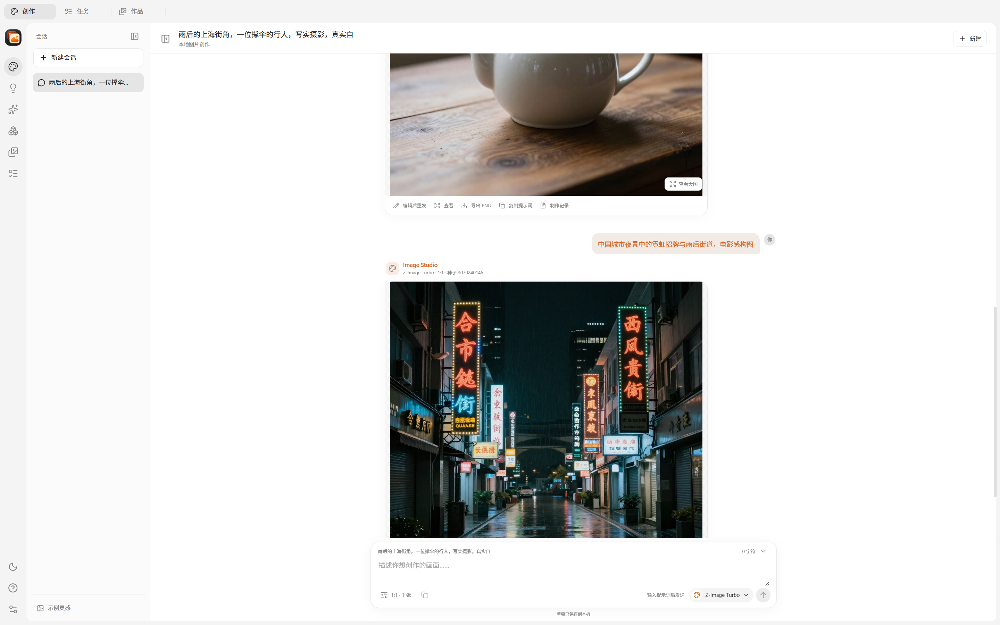

# Image Studio

**English** | [简体中文](README.zh-CN.md)

[](https://github.com/Goldloli/image-studio/actions/workflows/quality.yml)
[](LICENSE)

Image Studio is a local-first desktop image creation studio for macOS arm64 and
Windows x64, built with Rust, Tauri 2, and React. It provides text-to-image,
instruction-based image editing, background removal with RGBA/mask output, and
exact 4× upscaling while keeping model execution and project data on the local
machine.



## Highlights

- **Seven certified models / eight capabilities** on both macOS and Windows.
- **Local execution**: no hosted image API or cloud project storage.
- **Conversation workspace**: drafts, prompts, parameters, progress, results,
  retries, and cancellation remain grouped by conversation.
- **Deterministic model identities**: pinned revisions, per-file SHA-256,
  fixed runtimes, recipes, and worker protocol identities.
- **Durable local library**: SQLite-backed drafts, jobs, attempts, assets, task
  history, and provenance.
- **Strict process supervision**: bounded worker output, cancellation,
  descendant cleanup, execution leases, and crash recovery.
- **Cross-platform releases**: Windows NSIS and macOS arm64 `.app` artifacts
  are built and verified by GitHub Actions.

## Supported Models

| Model | Capabilities | Fixed recipe |
|---|---|---|
| Z-Image Turbo | Text to image | 4-bit loading, 9 steps, 1:1 / 4:3 / 3:4 |
| FLUX.2 Klein 4B distilled | Text to image, single-image edit | 4-bit loading, 4 steps, guidance 1.0 |
| BiRefNet general epoch_244 | Remove background, RGBA + mask | ONNX Runtime CPU, float32 |
| Real-ESRGAN x4plus | Exact 4× upscale | ncnn Vulkan, tile 128 |
| Qwen-Image 2.1 | Text to image | 4-bit NF4, 40 steps, guidance 1.0 |
| Qwen-Image 2.1 Turbo | Text to image | 4-bit NF4, 8 steps, official Turbo sampling |
| MOSS-Image-SFT | Text to image | 4-bit NF4, 50 steps, guidance 3.0 |

**8 GB VRAM support (verified on an RTX 2060 SUPER)**: Qwen-Image 2.1, Qwen-Image 2.1 Turbo,
MOSS-Image-SFT and FLUX.2 Klein 4B all run on 8 GB cards in the compact tier (768×768, fp16,
measured peaks 5.44–5.96 GiB); BiRefNet and Real-ESRGAN were never VRAM-bound. A device that only
meets the compact tier degrades automatically and the model page states "紧凑档 768×768".
Z-Image Turbo keeps its 12 GB threshold because the model overflows in fp16 on BF16-less Turing
architectures.

**Performance on the reference card (RTX 2060 SUPER 8 GB, compact 768×768)**: every job starts a fresh
worker, so the total includes component loading.

| Model | Steps | Total | Sampling |
|---|---|---|---|
| Qwen-Image 2.1 Turbo | 8 | 84.5 s | 66.3 s |
| Qwen-Image 2.1 | 40 | 391.3 s | 358.1 s |
| MOSS-Image-SFT | 50 | 752.1 s | 733.8 s |
| FLUX.2 Klein 4B text-to-image | 4 | 145.6 s | 9.8 s |
| FLUX.2 Klein 4B edit | 4 | 166.1 s | 10.3 s |

Verified environment and full evidence: Windows 11 / i9-9900K / **RTX 2060 SUPER 8 GB (sm75)** /
31.9 GiB RAM — see [`doc/15-windows-8gb-tier.md`](doc/15-windows-8gb-tier.md),
[`doc/16-zimage-quantization-investigation.md`](doc/16-zimage-quantization-investigation.md) and
[`verification/windows-8gb-tier/`](verification/windows-8gb-tier/README.md).

The authoritative model catalog is
[`resources/model-catalog/catalog.json`](resources/model-catalog/catalog.json).
Windows uses separately frozen NF4/ONNX/ncnn profiles; macOS uses the verified
MFLUX/MLX and ONNX runtimes.

## Download

Use the latest published [GitHub Release](https://github.com/Goldloli/image-studio/releases/latest)
and verify the downloaded file against its `SHA256SUMS-*.txt`:

- **Windows x64**: `Image.Studio_<version>_x64-setup.exe`
- **macOS arm64**: `Image-Studio-<version>-macos-arm64.zip`

```bash
sha256sum -c SHA256SUMS-windows.txt
sha256sum -c SHA256SUMS-macos.txt
```

The release is unsigned and not notarized:

- Windows may show SmartScreen. Verify the checksum, then use
  **More info → Run anyway** only if the digest matches.
- macOS may block first launch in Gatekeeper. Verify the checksum, then
  Control-click the app and choose **Open**, or run:

```bash
xattr -dr com.apple.quarantine "Image Studio.app"
```

macOS builds require Apple Silicon and macOS 11 or newer. Model weights and
private Python runtimes are downloaded separately and are not included in the
installer or `.app` archive.

## Product Areas

- **Create**: multi-conversation image generation, source-image workflows,
  immediate placeholders, real worker progress, cancellation, and retry.
- **Inspiration**: a searchable prompt library with source attribution.
- **Features**: only capabilities backed by an installed, executable model
  are exposed as startable.
- **Models**: installation, runtime, device eligibility, hardware thresholds,
  and license information from the host catalog.
- **Works**: immutable formal assets across conversations, filters, preview,
  provenance, and native PNG/RGBA/mask export.
- **Tasks**: host-side filtering, search, stable pagination, attempt history,
  errors, stages, logs, and recovery instructions.
- **Settings**: persistent appearance, explicit new-conversation defaults,
  storage inspection, diagnostic status, and runtime inventory.

## Build From Source

Prerequisites:

- Rust **1.99.1** from [`rust-toolchain.toml`](rust-toolchain.toml)
- Node.js **24.19.0** and npm **11.17.0**
- Python **3.11 or newer** for repository verification scripts; **3.13 recommended**. Model workers use their own pinned private Python runtimes, not the system interpreter.
- Tauri system prerequisites for the target platform

```bash
npm --prefix apps/frontend ci
npm --prefix apps/frontend run build
cargo build --workspace --locked
cargo run -p image-studio-desktop --locked
```

### macOS development bundle

```bash
python3 scripts/prepare-macos-dev-app.py
open "target/dev/Image Studio.app"
```

### Windows sidecars

`cargo clippy`, tests, and Tauri builds require the Windows sidecars to be
present in `apps/desktop/binaries/`. The CI workflow and
[`scripts/build-windows-internal.ps1`](scripts/build-windows-internal.ps1)
construct and copy them automatically.

### Frontend-only preview

```bash
npm --prefix apps/frontend run dev
```

Browser preview does not provide native installation, local generation,
persistence, or process supervision. Rebuild the frontend and desktop app after
UI changes to refresh the embedded production assets.

## Local-First Architecture

```text
React UI
  ↓ restricted Tauri IPC
Desktop host / StudioService
  ├─ exact model installation and integrity checks
  ├─ SQLite library, drafts, jobs, attempts, and assets
  ├─ generation controller and hardware gates
  └─ inference supervisor
       ↓ bounded JSON protocol
     Python / ONNX / native workers
```

| Workspace area | Responsibility |
|---|---|
| `apps/desktop` | Tauri host, constrained IPC, installers, storage, diagnostics, and process adapters |
| `apps/frontend` | React workspace, libraries, settings, task views, and canvas |
| `crates/studio-core` | Typed identities, plans, recipes, attempt state, and validation |
| `crates/worker-protocol` | Framing, handshakes, identity checks, and generation protocol |
| `tools/inference-supervisor` | Host EOF, execution leases, worker/descendant supervision |
| `tools/*worker*` | MFLUX, ONNX, Diffusers/CUDA, and Real-ESRGAN execution |

The core and protocol crates do not depend on the GUI or inference frameworks.
Worker stdout carries bounded protocol frames; stderr carries bounded logs.
Product processes are launched with argument arrays and never through a shell.

## Local Data and Safety

On macOS, default paths are:

- Data: `~/Library/Application Support/ImageStudio`
- Cache: `~/Library/Caches/ImageStudio`
- Logs: `~/Library/Logs/ImageStudio`

Use `--data-dir PATH` for an isolated root. One host owns a data root at a
time. SQLite schema v5 stores projects, conversations, draft revisions, turns,
jobs, attempts, formal assets, and provenance. Model installation and worker
activation bind fixed manifests, runtime inventories, and SHA-256 contents.

Image generation succeeds only after output validation and an atomic database
commit. Restart marks unfinished work as interrupted; retry creates a new
Attempt only after explicit user action. Missing or externally modified assets
remain visible as unavailable without deleting their historical records.

## Diagnostics and Verification

Development builds can open **Development → Communication diagnostics** or run:

```bash
cargo run -p image-studio-desktop --locked -- --diagnostics
```

Diagnostics validate the constrained worker channel only. They do not prove GPU,
model, or image-generation success.

```bash
cargo fmt --all -- --check
cargo clippy --workspace --all-targets --locked -- -D warnings
cargo test --workspace --locked
npm --prefix apps/frontend test
npm --prefix apps/frontend run check
npm --prefix apps/frontend run build
openspec validate --all --strict
python3 scripts/ci/validate-workflows.py
actionlint -no-color
```

Real model acceptance evidence is stored in [`verification/`](verification/).
The installed Windows all-model acceptance record is
[`verification/windows-parity-app/README.md`](verification/windows-parity-app/README.md);
macOS seven-model evidence is summarized in
[`verification/qwen-moss-20261101/moss-stage-report.md`](verification/qwen-moss-20261101/moss-stage-report.md).

## CI and Releases

The public repository uses three pinned GitHub Actions workflows:

- [quality.yml](.github/workflows/quality.yml): Windows x64 and macOS arm64
  formatting, Clippy, workspace tests, frontend tests/build, and OpenSpec.
- [build.yml](.github/workflows/build.yml): Windows NSIS and macOS arm64 app
  artifacts with checksums and package identity checks.
- [release.yml](.github/workflows/release.yml): version/main provenance checks
  and a draft GitHub Release.

See [CI and release documentation](doc/14-ci-release.md) and
[`verification/ci-release/`](verification/ci-release/) for the current runs and
artifact digests.

## Contributing and Security

- Report vulnerabilities through [SECURITY.md](SECURITY.md), not a public issue.
- Functional changes follow OpenSpec and Beads workflows used by the project.
- Keep model/runtime identities pinned; do not substitute a different snapshot
  under an existing install id.

## License

Project source and original distributable assets are licensed under
[Apache-2.0](LICENSE). Third-party libraries, fonts, example prompts/images, and
model materials retain their own licenses. See [NOTICE](NOTICE) and
[THIRD_PARTY_NOTICES.md](THIRD_PARTY_NOTICES.md).
