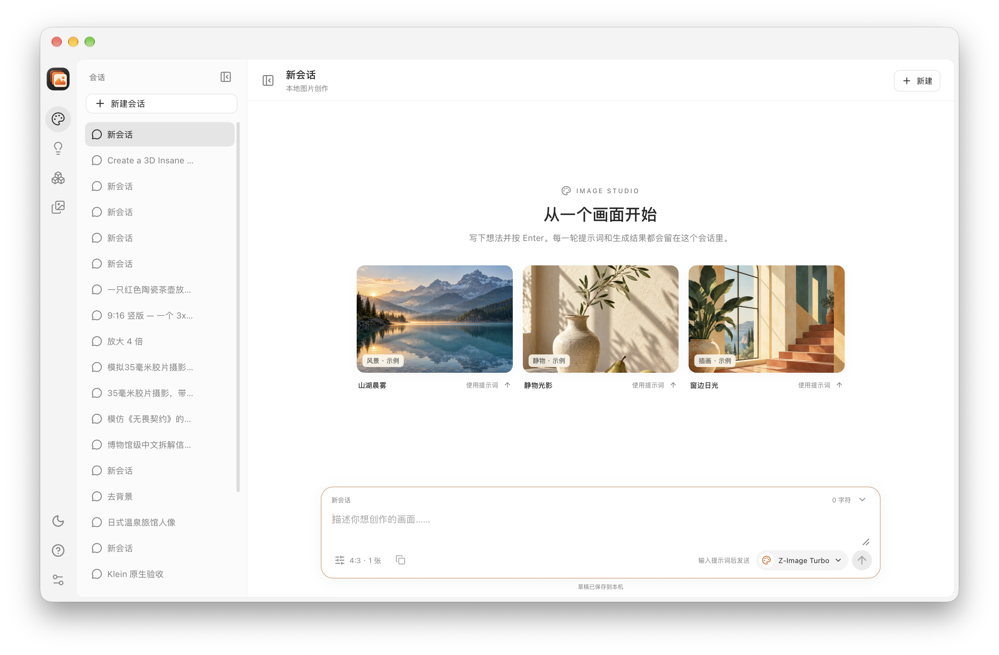
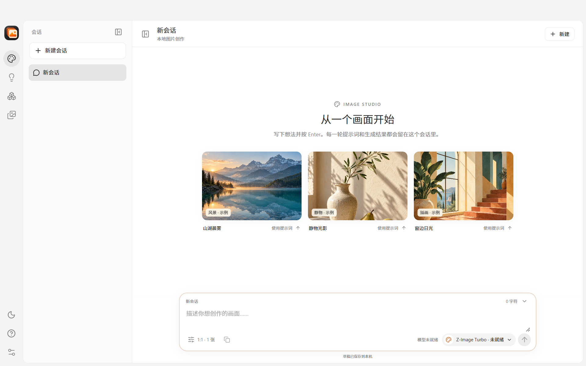
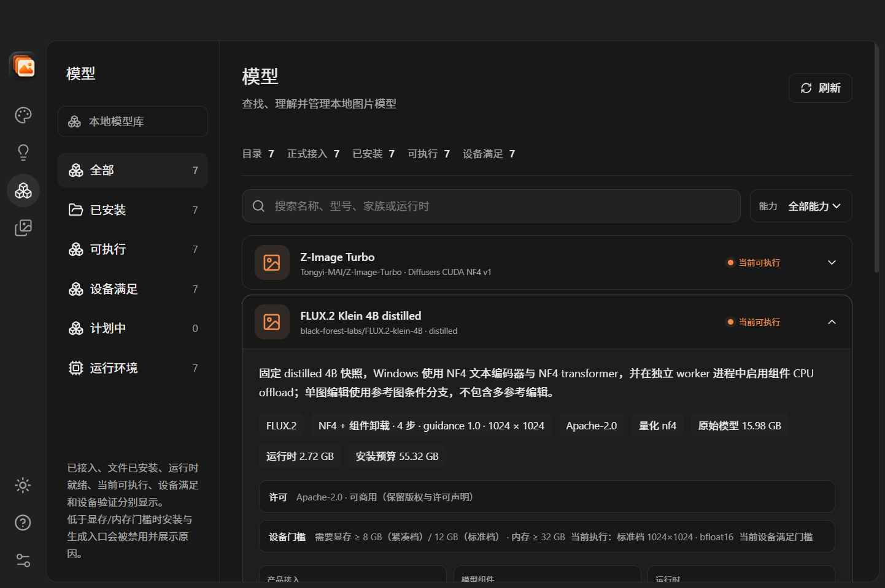
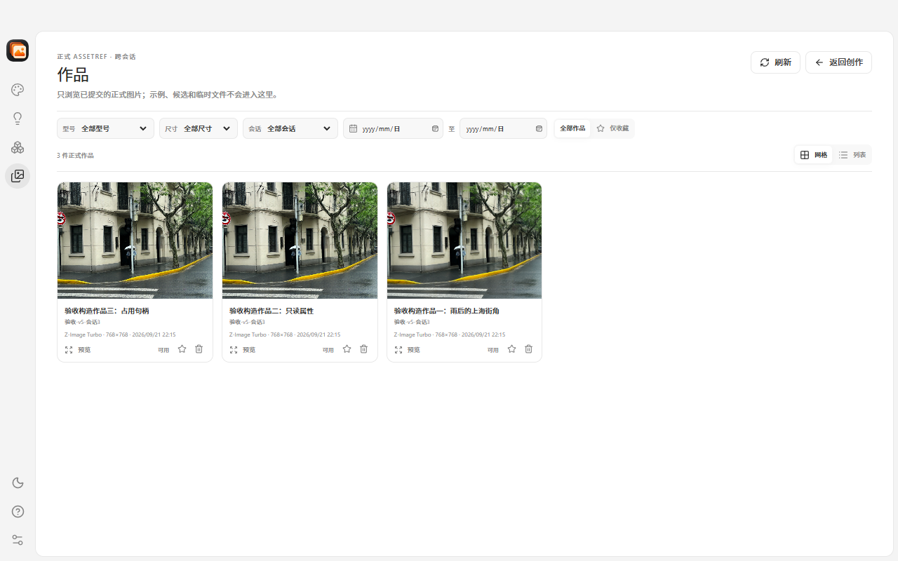

# Image Studio

[English](README.md) | **简体中文**

[](https://github.com/Goldloli/image-studio/actions/workflows/quality.yml)
[](https://github.com/Goldloli/image-studio/releases/latest)
[](LICENSE)

Image Studio 是面向 **Apple Silicon macOS** 与 **Windows x64** 的本地优先桌面
图片创作工作台，使用 Rust、Tauri 2 与 React 构建。你可以用七个固定版本的本地
模型完成文生图、编辑、去背景与放大；模型推理、会话和作品都留在本机。



## 最新版本：v0.2.1

`0.2.1` 是维护版本，把最新依赖更新纳入可下载安装包，不改变模型范围或用户
工作流：

- **原生桌面与压缩包依赖** —— 更新到 `rfd` 0.18.0、`zip` 9.5.0、
  `uuid` 1.29.2 与 `flate2` 1.1.11。
- **前端工具链更新** —— 使用 Vite 8.3.7、React 插件 6.3.0、Vitest 5.1.0
  与 Lucide 1.70.0 构建内嵌界面。
- **无需迁移模型或配方** —— 模型权重、运行时、worker 身份、配方与本地数据继续
  与 `0.2.0` 兼容。
- **保持已验证的产品行为** —— 以 `0.2.0` 的真实模型证据作为行为基线；`0.2.1`
  重新执行当前依赖构建、测试、打包、checksum 与产物检查。

### 延续自 v0.2.0

`0.2.0` 让工作区更接近面向日常创作的图片工作室：

- **更清晰的工作区** —— 用单层左侧导航替代重复的页面页签、独立功能页/任务页和
  开发诊断抽屉；制作记录改为在当前会话或作品中展开。
- **会话与作品管理** —— 可重命名或删除会话且保留已生成作品；可收藏作品、只看
  收藏，并将原图、蒙版与专用预览缓存作为一组删除。仍被引用的作品会受到保护，
  并给出可执行的解除指引。
- **更安全的本地状态** —— SQLite 通过事务从 v5 升级到 v6，保存删除标记、恢复
  状态与历史执行事实。
- **Windows 二次启动更自然** —— 使用同一数据根再次启动时，会还原并聚焦已有窗口；
  若已有实例在 5 秒内未响应，则直接说明原因，不再创建冲突的第二套宿主。
- **可靠的启动诊断** —— 启动或 WebView2 初始化失败时，结构化应用日志和原生失败
  对话框都会保留，不再静默退出。
- **覆盖目标硬件档位** —— 当前构建已在 macOS arm64、Windows 12 GB 标准档机器
  与 Windows 8 GB 紧凑档基线完成对应验证。

完整变更与已知限制见[最新发布说明](https://github.com/Goldloli/image-studio/releases/latest)。

| 会话式创作 | 本地模型库 |
|---|---|
|  |  |
| **作品库** | **去背景** |
|  |  |

## 核心特性

- **七个认证型号、八项能力**，macOS 与 Windows 均已完成真实执行验收。
- **两个执行档位**：标准档（≥ 12 GB 显存、1024²、`bfloat16`）与紧凑档
  （≥ 8 GB 显存、768²、`float16`），由宿主根据设备事实自动选择。
- **本地执行**：不依赖托管图片 API，也不把项目数据上传到云端。
- **会话式创作**：草稿、提示词、参数、进度、结果、重试和取消按会话组织；
  会话可删除且保留其已生成作品。
- **作品管理**：收藏、仅收藏筛选与受控删除；删除只清理应用内原图、配套蒙版与
  专用缓存，外部导出副本和执行历史保持。
- **确定性模型身份**：固定 revision、逐文件 SHA-256、运行时、配方和 worker
  协议身份。
- **持久本地作品库**：SQLite 保存草稿、任务、Attempt、正式资产、任务历史与
  制作记录。
- **严格的进程监督**：有界 worker 输出、取消、后代回收、执行租约和崩溃恢复。
- **单实例数据所有权**：使用同一数据根再次启动时会聚焦已有窗口；通过
  `--data-dir` 使用不同数据根的实例仍可独立运行。
- **双平台发布**：GitHub Actions 构建并验证 Windows NSIS 安装包与 macOS arm64
  `.app`。

## 支持的模型

| 型号 | 能力 | 固定配方 |
|---|---|---|
| Z-Image Turbo | 文生图 | 4-bit 加载、9 步、1:1 / 4:3 / 3:4 |
| FLUX.2 Klein 4B distilled | 文生图、单图编辑 | 4-bit 加载、4 步、guidance 1.0 |
| BiRefNet general epoch_244 | 去背景、RGBA + mask | ONNX Runtime CPU、float32 |
| Real-ESRGAN x4plus | 精确 4× 放大 | ncnn Vulkan、tile 128 |
| Qwen-Image 2.1 | 文生图 | 4-bit（NF4）、40 步、guidance 1.0 |
| Qwen-Image 2.1 Turbo | 文生图 | 4-bit（NF4）、8 步、官方 Turbo 采样 |
| MOSS-Image-SFT | 文生图 | 4-bit（NF4）、50 步、guidance 3.0 |

### 执行档位

| 档位 | 显存 | 画布 | 计算精度 | 加载策略 |
|---|---|---|---|---|
| `standard` | ≥ 12 GB | 1024² | `bfloat16` | 分阶段 / 组件卸载 |
| `compact` | ≥ 8 GB | 768² | `float16` | 分阶段，同一时间只驻留一个 NF4 组件 |

两个档位共享同一份 25–33 GB 模型下载与同一份准备好的 NF4 缓存，只有配方身份
和精确参数表不同。只满足紧凑档门槛的设备会自动降级，模型页标注「紧凑档
768×768」；低于两档门槛的设备保持禁用，并显示未满足的最底要求。BiRefNet 与
Real-ESRGAN 本来就不受显存限制。

**8 GB 支持（已在 RTX 2060 SUPER、Turing sm75 上实测）**：Qwen-Image 2.1、
Qwen-Image 2.1 Turbo、MOSS-Image-SFT 与 FLUX.2 Klein 4B（文生图与编辑）以紧凑档
运行，实测 CUDA reserved 峰值 5.44–5.96 GiB。Z-Image Turbo 因模型在无 BF16 的
Turing 架构上存在 fp16 溢出，仍要求 12 GB 显存。

**8 GB 参考卡性能（紧凑档 768×768）**：每个任务都会新起 worker，总耗时包含组件加载。

| 模型 | 步数 | 总耗时 | 其中采样 |
|---|---|---|---|
| Qwen-Image 2.1 Turbo | 8 | 84.5 s | 66.3 s |
| Qwen-Image 2.1 | 40 | 391.3 s | 358.1 s |
| MOSS-Image-SFT | 50 | 752.1 s | 733.8 s |
| FLUX.2 Klein 4B 文生图 | 4 | 145.6 s | 9.8 s |
| FLUX.2 Klein 4B 编辑 | 4 | 166.1 s | 10.3 s |

在当前 Windows 10 / RTX 3080 Ti 12 GB 验证构建上，八项能力全部完成真实生成：
Klein 文生图 26–27 s、Z-Image Turbo 54 s、Qwen-Image 2.1 86 s、
Qwen-Image 2.1 Turbo 41 s、MOSS-Image-SFT 146 s、Klein 编辑 39 s、
BiRefNet 23 s、Real-ESRGAN 8 s。证据见
[`verification/windows-8gb-tier/`](verification/windows-8gb-tier/README.md)、
[`verification/windows-12gb-real-generation-20261112/`](verification/windows-12gb-real-generation-20261112/README.md)、
[`verification/windows-12gb-standard-tier/`](verification/windows-12gb-standard-tier/README.md)、
[`doc/15-windows-8gb-tier.md`](doc/15-windows-8gb-tier.md) 与
[`doc/16-zimage-quantization-investigation.md`](doc/16-zimage-quantization-investigation.md)。

权威模型目录位于
[`resources/model-catalog/catalog.json`](resources/model-catalog/catalog.json)。
Windows 使用独立冻结的 NF4、ONNX 与 ncnn 配置；macOS 使用已验证的 MFLUX/MLX
和 ONNX 运行时。

## 验证范围与证据边界

项目把编译、界面与真实推理证据分开记录：

| 平台 | 0.2.1 证据范围 | 证据 |
|---|---|---|
| macOS arm64 | 因推理代码、运行时与配方未变，复用 0.2.0 原生与真实模型基线；0.2.1 重新构建并检查应用包 | [`verification/simplify-workspace-20261111/RESULTS.md`](verification/simplify-workspace-20261111/RESULTS.md) |
| Windows 12 GB 标准档 | 复用 0.2.0 的 9/9 真实生成矩阵；0.2.1 重新执行依赖、构建、安装包与产物验证 | [`verification/windows-12gb-real-generation-20261112/`](verification/windows-12gb-real-generation-20261112/README.md) |
| Windows 8 GB 紧凑档 | 复用已验证的紧凑档配方与执行面无变化的功能基线；模型/运行时身份保持不变 | [`verification/windows-8gb-tier/`](verification/windows-8gb-tier/README.md)、[`verification/windows-functional-regression-20261112/`](verification/windows-functional-regression-20261112/README.md) |

GitHub Actions 负责构建、测试、打包、架构、checksum 与版本来源检查；它不下载
模型权重，也不执行 GPU 推理。硬件支持不外推到已记录机器和架构之外；
`waived` 与 `not_run` 项目永远不会写成通过。

## 系统要求

- **Windows**：Windows 10 22H2 或 Windows 11，x64。current-user NSIS 安装包内置
  WebView2 离线安装器。模型可用性取决于显卡（紧凑档 ≥ 8 GB 显存，标准档
  ≥ 12 GB 显存）；安装期量化需要可用物理内存 ≥ 8 GiB 且 commit 余量 ≥ 6 GiB，
  建议 16 GiB 及以上内存。
- **macOS**：Apple Silicon（arm64）、macOS 11 或更高版本。模型执行使用已验证的
  MFLUX/MLX 与 ONNX 运行时；模型页会显示设备可用性。
- **磁盘**：每个生成模型需下载 25–33 GB 并保留一份准备好的 NF4 缓存。建议每个
  生成模型预留至少 40 GB，完整模型集约 150 GB。模型权重与私有 Python 运行时不
  随安装包分发。

## 下载与安装

从最新的已发布 [GitHub Release](https://github.com/Goldloli/image-studio/releases/latest)
下载文件，并使用对应的 `SHA256SUMS-*.txt` 校验：

- **Windows x64**：`Image.Studio_<version>_x64-setup.exe`
- **macOS arm64**：`Image-Studio-<version>-macos-arm64.zip`

```bash
shasum -a 256 -c SHA256SUMS-macos.txt
```

```powershell
Get-FileHash .\Image.Studio_<version>_x64-setup.exe -Algorithm SHA256
```

当前产物未签名、未公证：

- Windows 可能显示 SmartScreen。确认 SHA-256 一致后，才使用
  **更多信息 → 仍要运行**。
- macOS 首次打开时可能显示 **“Image Studio.app 已损坏，无法打开”**。这是未签名
  构建被 Gatekeeper 加上 quarantine 属性后的表现。请先确认下载的 zip 与
  `SHA256SUMS-macos.txt` 一致，把应用放入“应用程序”，然后在终端运行：

```bash
sudo xattr -rd com.apple.quarantine "/Applications/Image Studio.app"
open "/Applications/Image Studio.app"
```

这条命令只会移除已校验应用包的 quarantine 属性。checksum 缺失或与下载文件不一致
时不要执行；如果应用安装在其他位置，请替换引号中的路径。

macOS 产物需要 Apple Silicon 与 macOS 11 或更高版本。

## 主要页面

- **创作**：多会话文生图、源图工作流、即时占位、真实步骤进度、取消与重试；
  会话行支持重命名与删除（删除保留已生成作品）。
- **灵感**：可搜索的提示词库，并保留来源归属；许可信息集中到设置 → 关于。
- **模型**：显示安装、运行时、设备门槛、硬件适配、执行档位与许可信息。
- **作品**：跨会话浏览不可变正式资产，支持收藏、收藏筛选、预览、原位制作记录，
  以及原生 PNG/RGBA/mask 导出；删除会清理应用内原图、同次蒙版与专用缓存。
- **设置**：持久外观、显式新会话默认值、存储位置、运行环境事实、运行时清单与
  有界日志。

## 从源码构建

前置条件：

- Rust **1.99.1**，由 [`rust-toolchain.toml`](rust-toolchain.toml) 固定
- Node.js **24.19.0**、npm **11.17.0**
- Python **≥3.11**（建议 **3.13**），用于运行仓库验证脚本；模型 worker 使用各自固定的私有 Python 运行时，不依赖系统 Python 版本。
- 目标平台所需的 Tauri 系统依赖

```bash
npm --prefix apps/frontend ci
npm --prefix apps/frontend run build
cargo build --workspace --locked
cargo run -p image-studio-desktop --locked
```

### macOS 开发包

```bash
python3 scripts/prepare-macos-dev-app.py
open "target/dev/Image Studio.app"
```

### Windows sidecar

Windows 的 Clippy、测试和 Tauri 构建要求
`apps/desktop/binaries/` 中已有 sidecar。CI workflow 和
[`scripts/build-windows-internal.ps1`](scripts/build-windows-internal.ps1)
会自动构建并复制。

### 仅预览前端

```bash
npm --prefix apps/frontend run dev
```

浏览器预览不提供原生安装、本地生成、持久化或进程监督。修改界面后，需要重新
构建前端和桌面应用，才能刷新内嵌生产资源。

## 本地优先架构

```text
React 界面
  ↓ 受限 Tauri IPC
桌面宿主 / StudioService
  ├─ 精确模型安装与完整性校验
  ├─ SQLite 本地库、草稿、任务、Attempt 与资产
  ├─ 生成控制器与硬件门槛
  └─ inference supervisor
       ↓ 有界 JSON 协议
     Python / ONNX / 原生 worker
```

| Workspace 区域 | 职责 |
|---|---|
| `apps/desktop` | Tauri 宿主、受限 IPC、安装器、存储、诊断与进程 adapter |
| `apps/frontend` | React 工作区、创作/灵感/模型/作品/设置页面与画板 |
| `crates/studio-core` | 类型身份、计划、配方、Attempt 状态与校验 |
| `crates/worker-protocol` | 帧边界、握手、身份检查与生成协议 |
| `tools/inference-supervisor` | 宿主 EOF、执行租约、worker/后代监督与回收 |
| `tools/*worker*` | MFLUX、ONNX、Diffusers/CUDA 与 Real-ESRGAN 执行 |

核心与协议 crate 不依赖 GUI 或推理框架。worker stdout 只传有界协议消息，
stderr 只传有界日志；产品进程使用参数数组启动，不经过 shell。

## 本地数据与安全

默认路径：

- macOS 数据：`~/Library/Application Support/ImageStudio`
- macOS 缓存：`~/Library/Caches/ImageStudio`
- macOS 日志：`~/Library/Logs/ImageStudio`
- Windows 根目录：`%LOCALAPPDATA%\ImageStudio`，内含 `data`、`cache`、`logs` 与
  `work` 子目录
- 应用日志：`<data>/logs/app.log`（有界，8 MiB 轮转）

使用 `--data-dir PATH` 可以创建隔离数据根（其下自动创建 `data`、`cache`、
`logs` 与 `work`）；同一数据根同一时间只允许一个宿主。Windows 上数据路径必须
足够短，保证私有 Python 运行时能打开最长路径文件，宿主会在启动前校验该预算。

SQLite schema v6 保存项目、会话、草稿修订、轮次、任务、Attempt、正式资产与
制作记录，并附加会话删除、作品收藏和删除清理状态。安装和 worker 激活会绑定固定 manifest、运行时清单与 SHA-256 内容。

只有图片验证成功并完成原子数据库提交后，生成任务才成功。重启会把未完成执行
标为中断，只有用户明确重试才创建新 Attempt。图片被外部删除或改写时会显示为
不可用，但不会删除历史记录。

## 诊断与验证

产品界面不提供通信诊断入口（开发构建与正式构建一致）。需要内部排查时，可在
命令行运行：

```bash
cargo run -p image-studio-desktop --locked -- --diagnostics
```

诊断只验证受限 worker 通道，不代表 GPU、模型或图片生成已经通过。

```bash
cargo fmt --all -- --check
cargo clippy --workspace --all-targets --locked -- -D warnings
cargo test --workspace --locked
npm --prefix apps/frontend test
npm --prefix apps/frontend run check
npm --prefix apps/frontend run build
openspec validate --all --strict
python3 scripts/ci/validate-workflows.py
actionlint -no-color
```

真实模型验收证据保存在 [`verification/`](verification/)：

- Windows 紧凑档：[`verification/windows-8gb-tier/`](verification/windows-8gb-tier/README.md)
- Windows 12 GB 当前构建真实生成：[`verification/windows-12gb-real-generation-20261112/`](verification/windows-12gb-real-generation-20261112/README.md)
- Windows 标准档与 Windows 10 目标机基线：[`verification/windows-12gb-standard-tier/`](verification/windows-12gb-standard-tier/README.md)
- Windows 0.2.0 功能回归：[`verification/windows-functional-regression-20261112/`](verification/windows-functional-regression-20261112/README.md)
- 同数据根启动激活：[`verification/single-instance-20261112/`](verification/single-instance-20261112/README.md)
- Windows 桌面覆盖与缺陷：[`verification/windows-desktop-coverage/`](verification/windows-desktop-coverage/2026-11-06-coverage-results.md)、[`verification/windows-desktop-defects/`](verification/windows-desktop-defects/2026-11-06-preflight-and-cancel.md)
- Windows 安装版全模型验收：[`verification/windows-parity-app/`](verification/windows-parity-app/README.md)
- macOS 0.2.0 原生验收：[`verification/simplify-workspace-20261111/RESULTS.md`](verification/simplify-workspace-20261111/RESULTS.md)
- macOS 七模型基线：[`verification/qwen-moss-20261101/moss-stage-report.md`](verification/qwen-moss-20261101/moss-stage-report.md)

## CI 与发布

公开仓库使用三个固定版本的 GitHub Actions workflow：

- [quality.yml](.github/workflows/quality.yml)：Windows x64 与 macOS arm64 的
  格式、Clippy、workspace 测试、前端测试/构建与 OpenSpec。
- [build.yml](.github/workflows/build.yml)：Windows NSIS 与 macOS arm64 产物，
  包含 checksum 与包身份检查。
- [release.yml](.github/workflows/release.yml)：版本/main 来源检查，并创建 draft
  GitHub Release。

推送一个 `v*` tag（提交必须在 `main` 上，且 tag、workspace Cargo、Tauri 与前端
版本完全一致）会构建双平台产物并生成可供产物审阅的 draft Release，审阅后发布。
`v0.2.1` 包含 Windows x64 NSIS 安装包与 macOS arm64 `.app` zip。
运行 ID 与产物摘要见 [CI 与发布文档](doc/14-ci-release.md) 与
[`verification/ci-release/`](verification/ci-release/)。

## 贡献与安全

- 安全漏洞请通过 [SECURITY.md](SECURITY.md) 报告，不要开公开 issue。
- 功能变更遵循项目的 OpenSpec 与 Beads 流程。
- 保持模型/运行时身份固定；不要在既有 install id 下替换为不同快照。

## 许可证

项目源码与原创分发资产采用 [Apache-2.0](LICENSE)。第三方库、字体、示例
提示词/图片与模型材料继续遵循各自许可证，见 [NOTICE](NOTICE) 与
[THIRD_PARTY_NOTICES.md](THIRD_PARTY_NOTICES.md)。
