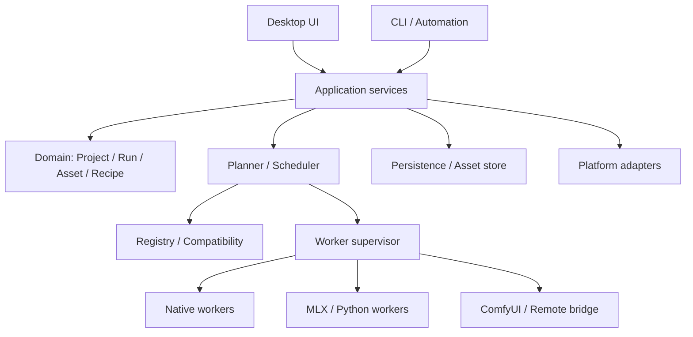
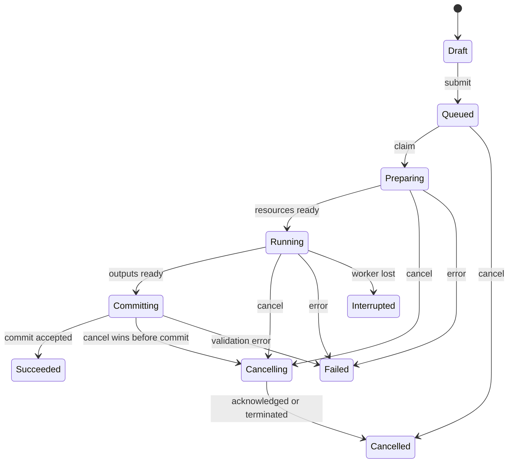

# 02 · Rust 技术架构与实现方法

研究日期：2026-10-28。本文全部模块、协议、状态和目录均为建议方案，尚未实现。上游框架能力引用原始资料；未对任何组合做产品实机验证。返回[总览](README.md)。

## 1. 技术立场：Rust 控制产品，推理实现保持可替换

建议将应用主体写成 Rust：桌面界面、领域模型、命令、任务调度、模型包管理、资产存储、项目与版本、系统整合和可观测性。推理执行通过稳定协议接入多类 worker。

这里有三种不同的“Rust”：Rust UI、Rust 产品核心、Rust 张量与模型实现。前两项可以从第一天坚持；第三项适合在有收益时逐模型推进。调用 C/C++ 引擎或 MLX 不会使 Rust 产品核心失效。若为了代码语言统一而放弃现成的模型实现，模型覆盖速度会受模型重写工作量制约。

需要比较的路线包括：Rust + egui + C++ 原生引擎，Rust + MLX 专用 worker，Rust + Diffusers worker，以及 Rust 自己实现选定的高价值模型。它们可以共存，但每条路线都必须有独立版本和验证范围。

## 2. 分层与依赖方向



领域对象不依赖 egui，不直接调用推理库，不读取系统文件选择器。平台层提供目录、密钥、通知、休眠事件等能力。UI 只依赖应用服务与可展示状态；worker 只能通过协议获取任务与输入，不能直接任意修改产品数据库。

可以从一个 Rust workspace 开始，但第一版无需把每个概念都拆成 crate。先用模块建立边界，出现独立构建、不同许可、不同进程或不同发布节奏时再拆包。

## 3. UI 选型的具体方法

| 候选 | 适合验证的方向 | 需要在本产品验证的点 |
|---|---|---|
| egui + eframe | 画布、参数面板、专业工具工作区、快速迭代 | 中文输入、长提示词、文本选择、无障碍、复杂面板与窗口 |
| Iced | 声明式应用状态与常规桌面 UI | 自定义画布、局部刷绘、模型参数控件与跨平台输入 |
| Slint | 设计驱动的声明式 UI 与原生整合 | 特殊创作控件、渲染互操作、分发许可与团队工作方式 |
| GPUI | 高定制桌面工作区与 GPU UI | 选定版本的 Mac/Windows 能力、API 稳定性、输入与可访问性 |

建议先验证 egui/eframe，因为它与用户喜欢的 Photocraft 路线最接近。其他候选保留为对照，不应仅凭截图或概念偏好决定。四种框架的接口与平台状态应以选定版本为准。[egui](https://github.com/emilk/egui)、[Iced](https://github.com/iced-rs/iced)、[Slint](https://github.com/slint-ui/slint)、[GPUI](https://gpui.rs/)

UI 验证样机应同时包含：长中文输入框、多参考图拖放、可缩放图片、蒙版刷绘、列表虚拟化、后台任务进度、文件选择、系统剪贴板和高 DPI。仅做一个漂亮静态首页不足以证明框架适合。

## 4. UI 状态与业务状态

建议分三类：短期 UI 状态、持久化用户偏好、领域状态。

短期 UI 状态包括鼠标悬停、拖动中的画笔、面板折叠和文本输入中的候选状态。用户偏好包括主题、密度、快捷键、上次目录和面板布局。领域状态包括项目、配方、运行和资产。

每一帧只读已经准备好的展示快照，不在绘制函数里扫描磁盘、解析大模型文件、同步探测 GPU 或查询大量组合数据。界面动作形成应用命令，后台服务完成工作后发布新快照或事件。

egui 是即时模式 UI，不等于必须持续全速重绘。可由交互、动画、预览和后台事件请求重绘；空闲时减少无意义唤醒。Photocraft 采用过消除固定轮询重绘的优化，可作为实现研究方向，而不是直接外推本应用的 CPU 占用。[egui 说明](https://github.com/emilk/egui)、[Photocraft 帧调度](https://github.com/storytold/photocraft/blob/main/crates/ui-egui/src/app/frame.rs)

## 5. 命令与查询边界

典型命令：创建项目、导入资产、保存配方草稿、提交运行、取消运行、重新运行、安装模型、卸载模型、迁移存储、导出结果。

典型查询：当前项目、任务列表、可执行模型、兼容性原因、资产关系、磁盘占用、运行日志、安装进度。查询返回适合界面使用的带类型数据，不暴露 worker 内部临时字典让界面猜测其结构。

一个命令可以被 GUI、CLI 和后续自动化入口共用。对于“生成四张图”，用户命令应带有幂等键，防止双击、重连或调用方重试造成重复提交；命令接收成功与推理完成是两个阶段。

## 6. 核心数据模型

| 对象 | 作用 | 建议保持稳定的属性 |
|---|---|---|
| Project | 一个创作上下文 | 标识、名称、画布、资产集合、偏好 |
| Asset | 可引用图片或辅助数据 | 内容散列、类型、尺寸、颜色、来源、存储位置 |
| AssetRelation | 来源与派生关系 | 父资产、参考角色、生成运行、操作类型 |
| DocumentRevision | 画布文档快照 | 图层、变换、引用资产、编辑命令版本 |
| Recipe | 可重复执行的处理流程 | 输入契约、参数、步骤、依赖、版本 |
| ModelFamily | 架构与任务家族 | 家族标识、能力空间、适配器协议 |
| ModelVariant | 具体权重与变体 | 源 revision、量化、微调、组件依赖 |
| RuntimePackage | 推理运行环境 | OS、架构、包版本、协议版本、设备能力 |
| CompatibilityRecord | 可运行证据 | 精确组合、测试结果、日期、已知问题 |
| ExecutionPlan | 已解析的运行方案 | 实际组件、设备、阶段、资源、参数 |
| Job | 用户提交的工作 | 所属项目、目标、优先级、批次、取消意图 |
| Attempt | 一次具体执行 | worker、租约、状态、时间、错误、心跳 |
| RunManifest | 不可变的执行事实 | 实际输入、版本、参数、输出与警告 |
| Artifact | 最终或中间结果 | 类型、内容散列、来源阶段、保留策略 |

模型是供给对象，运行是执行对象，图片是资产对象。它们要相互引用，但不要把所有状态塞在一个“任务 JSON”里。尤其要避免用文件名作为模型或资产的唯一身份。

## 7. 能力契约比统一参数字典更重要

建议为任务描述输入与输出，而不是先列出全局 slider。能力描述可以表达：输入角色、数量、类型、可选性、尺寸约束、输出 alpha、蒙版语义、允许的控制信号、支持的调度器和模型专用参数。

每个参数应有类型、默认值、范围、单位、UI 提示、依赖条件、是否进入复现记录、是否改变缓存键，以及精确语义。例如 diffusion guidance、true CFG 与模型蒸馏出的 guidance 可能不同，不能用同一个无说明字段强行覆盖。

通用层表达用户目的，专用层表达模型真实参数。适配器负责完成可解释的转换。无法转换时返回能力冲突，而不是悄悄忽略用户输入。

## 8. 执行计划的生成

用户提交任务后，不应立即把“模型 ID + prompt”扔给 worker。应经过一个纯解析或尽量无副作用的计划阶段：

1. 固定项目输入和配方版本。
2. 解析模型变体与全部组件。
3. 选择兼容后端、运行时包和真实设备。
4. 归一化尺寸、参数和输入角色，保留原始请求。
5. 检查文件完整性、可用空间和组件可用性。
6. 估算各阶段资源，生成资源需求与可能的卸载步骤。
7. 输出可展示的计划摘要，或明确的阻塞原因。
8. 用户提交后固化计划指纹，进入队列。

计划可以有“准备资源”步骤，包括下载、转换、编译与缓存文本嵌入。这些步骤具有独立进度与可恢复性，不应隐藏在一个永久转圈的加载状态里。

如果用户配置允许自动选择后端，计划仍记录最终选择。计划生成后硬件状态变化，可以重新调度同一语义计划或生成新计划版本；不可把执行设备变动藏起来。

## 9. 推理后端的分工

### 9.1 stable-diffusion.cpp worker

作为跨平台原生候选，适合研究广泛模型家族、GGUF/其他受支持格式和 Metal/CUDA/Vulkan 路线。Rust 可以通过 C ABI 封装，也可以由专用 worker 进程执行。

建议先用受管理的独立进程验证，再决定是否引入更紧的 FFI。原生库出现崩溃或 GPU 状态异常时，独立进程更容易隔离和重启。其 Metal 文档仍有大矩阵性能提示，因此不能因“原生”就宣布快于 MLX；必须逐模型、逐版本实测。[项目](https://github.com/leejet/stable-diffusion.cpp)、[构建说明](https://github.com/leejet/stable-diffusion.cpp/blob/master/docs/build.md)

### 9.2 MLX / MFLUX worker

作为 Apple Silicon 优化路线。现有 MFLUX 提供多个近期图片模型实现，可以通过 Python worker 管理；MLX 本身提供 Python、C++、C 和 Swift 接口，但这不意味着所有 MFLUX 模型已有可直接调用的 Rust 实现。

适合先使用已存在实现获得模型覆盖和验证基线，再评估将高价值模型迁入原生 worker。MLX 的语言接口、运行环境和模型实现是三层不同问题。[MLX](https://github.com/ml-explore/mlx)、[MFLUX](https://github.com/mflux-community/mflux)

### 9.3 Diffusers worker

作为广覆盖与跟进新模型的主要候选。不同模型可能依赖不同版本的 Diffusers、Transformers、Torch、attention 实现和额外包，因此不应在一个长期共享环境中无限升级。

Mac 上有 MPS 路线，但官方 pipeline 示例、MPS 可用、具体模型完整运行是不同证据等级。CUDA 专用 kernel、未支持精度或自定义算子都可能影响可用性。执行计划必须基于选定环境探针和模型验证记录。[Diffusers](https://github.com/huggingface/diffusers)、[MPS 文档](https://huggingface.co/docs/diffusers/main/en/optimization/mps)

### 9.4 ONNX Runtime worker

适合抠图、分割、检测、深度、OCR 和部分修复等可可靠导出的模型。Rust 可通过 `ort` 连接 ONNX Runtime。要分别记录模型图、opset、动态尺寸、外部权重与 Execution Provider。

CoreML EP 或 Windows EP 支持某些算子，不代表整图都会在 GPU/ANE 上执行。需要记录实际 provider、图分区与 CPU fallback，避免把“成功返回”误认为“已按预期加速”。[ort](https://github.com/pykeio/ort)、[CoreML EP](https://onnxruntime.ai/docs/execution-providers/CoreML-ExecutionProvider.html)

### 9.5 Core ML 专用 worker

适合已经有可靠转换和性能证据的模型。模型转换、编译缓存、shape 组合、compute units 和 OS 版本进入兼容性信息。不要将所有新架构都先强制转 Core ML，转换工作本身应有价值评估。[Apple Stable Diffusion 参考实现](https://github.com/apple-aiml-research/ml-stable-diffusion)

### 9.6 Rust 原生模型 worker

可以采用 Candle 等基础，逐步维护精选的关键模型。收益可能包括产品整合、可控依赖与特定算子优化；成本是跟进架构、权重命名、processor、numerical parity 和 GPU kernel。

应优先选择高使用量、接口稳定、实测有收益的家族。Candle 是构建材料，不能把它当作“所有 Hugging Face 模型都能自动运行”的通用加载器。[Candle](https://github.com/huggingface/candle)

### 9.7 ComfyUI 桥接

适合作为高级工作流与长尾生态路线。通过其 API 提交经过解析的工作流，跟踪队列与事件，并把输出重新纳入产品资产系统。桥接可以连接产品管理的实例，也可以连接用户已有实例，两种模式的所有权、取消权限和文件访问范围要分别处理。[ComfyUI API](https://docs.comfy.org/development/comfyui-server/comms_routes)

导入一个工作流 JSON 不等于它已具备运行条件。需要解析节点类型、版本、模型引用、扩展依赖和输入输出；缺失节点和不受管理的代码保持明确状态。不要把任意 custom node 的安装执行当作读取普通数据文件。

## 10. Worker 协议

推荐第一版使用本地受控进程的结构化协议，起步可用长度受限的 JSON Lines 或带长度前缀的帧；后续需要复杂双向流和远程执行时再评估 Protobuf/gRPC 等方案。

最少需要的消息包括：Hello、Capabilities、Probe、Load、Unload、Submit、Progress、Preview、ArtifactReady、Completed、Failed、Cancel、Cancelled、Heartbeat 和 Shutdown。每条消息应有协议版本、request/run/attempt 标识、序号和必要的错误类型。

以下只是合法 JSON 格式的协议形状示例，不是已发布 API：

```json
{
  "protocol_version": 1,
  "type": "progress",
  "run_id": "run-example-001",
  "attempt_id": "attempt-example-001",
  "sequence": 17,
  "stage": "denoise",
  "completed_units": 7,
  "total_units": 20,
  "unit": "step",
  "preview_artifact_id": "preview-example-004"
}
```

控制消息和日志分离。若 stdout 承载协议，普通日志走 stderr 或独立通道。大图片通过受管理文件或后续共享内存传递；不要把几十 MB 的像素不断 base64 编码进控制消息。

消息大小、未消费预览数量、日志缓冲和事件队列都设上限。高频进度可以合并，最终完成、失败和取消结果不可被普通进度挤掉。界面断开不应让 worker 无限缓存预览。

## 11. 输入与输出的文件协议

Rust 核心为 attempt 创建受管理的临时工作目录，放入输入引用或经过授权的读取路径。worker 只能声明相对于本次输出目录的结果，核心负责校验路径、文件类型、尺寸和散列，再提交为资产。

一般处理顺序为：写临时文件 → 关闭并刷出 → 校验 → 在同一卷内转入最终位置 → 数据库提交引用。跨卷移动不能假设是原子的 rename，应先复制到目标卷临时文件，校验后再激活。

worker 不应直接把数据库里的任务状态标成成功。只有核心确认租约、取消状态和输出有效性后，才能提交成功记录。这样可以处理 worker 完成与用户取消同时发生的竞争。

## 12. 任务生命周期

建议将用户意图状态与 attempt 阶段分开。Job 维护排队、执行、取消请求与最终结果；Attempt 维护安装、加载、预处理、编码、生成、解码、后处理等阶段。



状态变化以数据库事务或单一 actor 的短认领边界协调。推理、网络下载、模型扫描和 subprocess 等待在边界外执行。每次写入最终结果前，重新检查当前状态和执行租约。

不必采用完整事件溯源架构。可以使用规范化当前表加追加事件与不可变 manifest，满足审计、恢复和界面同步。只有出现明确需要时，再扩展到更复杂的分布式一致性模型。

## 13. 取消、暂停与恢复

取消先记录用户意图，再向 worker 请求 cooperative cancel。扩散循环可在步边界检查；某些 GPU 调用与第三方实现无法立即停止，需要等待安全点。超时后可终止专用 worker，并将当前 attempt 结束为取消或中断。

“暂停队列”“暂停下载”和“暂停当前生成”是不同能力。下载通常可记录已验证片段以继续；生成若没有保存中间张量和 scheduler 状态，只能重跑，不能把排队暂停包装成推理续算。

worker 重启使用新的 attempt 标识和 fencing token。旧进程晚到的结果应被拒绝进入新 attempt，避免幽灵完成。子进程和孙进程应按受管理进程组或 Windows Job Object 等平台机制清理，具体平台方案通过原型验证。

## 14. 调度与资源模型

第一版可以先对一台设备上的重型生成任务串行执行，同时允许轻量下载、缩略图和 UI 工作并行。后续按资源令牌管理：统一内存、GPU 显存、CPU、磁盘吞吐、编码器和运行时常驻预算。

调度不是简单的“并发数 = 2”。一个大文本编码器与一个 VAE 解码阶段可能需要完全不同的资源；两个单独能跑的任务同时执行也可能 OOM。执行计划应描述阶段资源与可卸载组件。

任务排序可以同时考虑用户优先级、等待时长、模型热加载复用和资源预算。热模型优先需要防止其他模型长期饥饿；长批次也应允许用户插入一次交互任务。

建议提供三种可理解策略：优先响应、均衡、后台吞吐。每种策略对应可检查的调度行为和资源预算，不能承诺在所有设备上达到相同速度。

## 15. Mac 统一内存与 GPU 竞争

Apple Silicon 的 CPU、GPU 和显示系统共享物理资源，UI 的大纹理、模型权重、激活和系统本身都会争夺内存。不能只读取一个“空闲显存”数字就决定安全并发。

建议监控进程驻留、系统内存压力、swap、模型缓存和预览纹理预算，并在任务开始前做保守估算。模型可通过阶段卸载、分辨率调整、量化和 tile 降低需求，但每一种都会进入实际执行记录。

OOM 后避免无限自动重试。可以释放 worker、保存诊断，并提供一个明确的低内存新方案。自动降尺寸或换模型会改变用户任务，应由显式策略允许，并产生新计划。

## 16. 大图、预览与画布渲染

画布引擎至少处理图片尺寸、EXIF 方向、缩放、平移、颜色、alpha、选择和叠加层。蒙版、控制框、深度图和参考变换使用稳定的图像坐标系；屏幕像素与图像像素之间有明确转换。

资产导入后生成缩略图和多级预览。长资产列表只绘制可见项，大图按可见区域与缩放级别加载。纹理缓存按字节管理，不能只按图片数量限制；一张 8K 图片与一个 128px 缩略图不应占用同等配额。

预览与最终结果使用不同类型。扩散中间预览可能由专用近似 decoder 产生，不能覆盖最终输出或假装等同质量。预览节流策略可以先实验约每秒 1–2 次，但实际频率由设备负载与有效变化决定，此数值只是调优起点。

第一版优先通过文件/CPU 像素把结果交给 UI，只有在性能证据支持时再研究跨进程 GPU 纹理共享。UI 使用 wgpu 与推理使用 Metal，不意味着它们自然共享设备上下文、allocator 或无需同步的纹理。

## 17. 图像语义与颜色

进入模型前的缩放、裁剪、padding、颜色转换和 alpha 处理必须形成可记录的预处理步骤。多参考图分别保存变换，蒙版与控制图使用同一几何变换链，避免模型改到了错误区域。

显示用颜色、模型输入颜色和导出颜色分开处理。建议明确 sRGB、线性空间、ICC profile、8/16-bit、premultiplied alpha 与直通 alpha 的边界。首版可将受支持格式与颜色空间收窄到明确集合，同时保留原始文件及原始元数据。

不能因为某个模型支持 RGBA，就认为整个流程自动正确处理透明度。缩略图、合成、导出和下游模型都需要相应契约；不支持 alpha 的步骤要明示合成背景或舍弃规则。

## 18. 存储结构

建议采用 SQLite 保存元数据，文件系统保存大型资产与模型。数据库事务负责引用关系，文件对象使用内容散列与明确的完成标记。内容散列负责字节身份，语义资产标识负责用户上下文。

一个候选目录组织如下，属于建议布局：

```text
ApplicationData/
  db/
  projects/
  assets/objects/
  assets/previews/
  runs/manifests/
  models/objects/
  models/snapshots/
  runtimes/packages/
  runtimes/environments/
  work/attempts/
  cache/
  logs/
  backups/
```

macOS 的实际根目录交给平台 adapter；Windows 使用对应的用户应用数据目录。文档中不用某个用户机器的绝对路径作为业务身份。外接盘与用户自定义根目录通过 StorageLocation 标识引用。

## 19. 资产回收与备份

垃圾回收以项目、已保留运行、收藏、安装快照和用户固定项为根，计算未引用对象。删除先进入可恢复的待清理状态，再按保留策略真正回收。后台回收不能删除正在被 worker 使用的文件。

缩略图、可重建缓存和模型下载不必全部进入项目备份。项目包可以有“轻量记录”“附输出”“附全部输入”三种形式，并明确是否包含模型权重、许可证允许的文件和访问凭据。

备份应包含一致的数据库快照与对象清单；验证对象完整性后才称为成功。恢复到新机器时，缺少权重或运行时可以重新解析，但不能把不可复现状态隐藏起来。

## 20. 模型下载与缓存

模型安装需要固定 repo revision 与组件清单，支持断点续传、校验、临时文件、重试与磁盘空间检查。下载完成后再激活 snapshot，不能因某个单文件存在就标为“已安装”。

HF 的 snapshot/revision 和缓存文档可作为设计参考；产品同时可以支持 ModelScope、用户目录和其他显式来源。但两个来源只有在对象散列或经过核实的组件映射一致时才可当作镜像，不能仅凭文件同名互换。[下载](https://huggingface.co/docs/huggingface_hub/guides/download)、[缓存](https://huggingface.co/docs/huggingface_hub/guides/manage-cache)

并非所有模型都有 tokenizer、VAE、UNet。模型包按组件角色声明文件与完整性要求。比如 Qwen 2.1 的专用 VAE 不能被旧版组件替代，而 Iris 并不要求 VAE。[Qwen 2.1 组件](https://github.com/leejet/stable-diffusion.cpp/blob/master/docs/qwen_image_2.1.md)、[Iris](https://github.com/speridlabs/iris-3b)

## 21. 运行时包管理

基础应用与运行时包分别分发。运行时包描述 OS、CPU 架构、协议版本、引擎版本、依赖锁、加速后端、签名与校验、支持能力、安装探针和可回滚版本。

Python 路线建议使用应用管理的封闭环境，不要求普通用户配置系统 Python、pip、conda 和全局 CUDA 环境。按兼容组共享环境，而非每模型一个环境，也不能把所有模型塞入永远升级的全局环境。

安装流程应在新目录准备、校验和自测，通过后切换活动指针。升级失败保留旧环境，已有运行固定原版本。正在执行的环境不能被原地覆盖或清理。

“基础安装包很小”与“首次使用下载很多”应同时呈现。轻量化的目标可以是合理模块化与按需安装，而不是把所有字节转移到第一次启动后再宣称体积消失。

## 22. 平台边界

| 共用领域 | macOS adapter | Windows adapter |
|---|---|---|
| 任务、配方、资产和版本 | 相同语义 | 相同语义 |
| 本地目录与外接盘 | 系统目录、卷标识、文件访问 | 用户目录、盘符/卷、长路径 |
| GPU 与加速探针 | Metal、MLX、Core ML、MPS | CUDA、Vulkan、ONNX/WinML 等候选 |
| 进程管理 | 进程组、信号、休眠事件 | Job Object 等机制、无控制台启动 |
| 系统整合 | 菜单、Dock、Finder、通知 | 文件关联、任务栏、资源管理器、通知 |
| 凭据 | 系统凭据存储接口 | 系统凭据存储接口 |
| 打包更新 | 签名、公证、DMG 等评估 | 签名、安装器、就地升级评估 |

不得把 OS 名称当作模型能力。一个模型可能在 Mac 的某条路线可用，却在 Windows 的另一路线缺算子；兼容记录按实际组合保存。

ONNX Runtime 当前官方说明将 DirectML 置于持续维护状态，Windows 新功能转向 WinML。因此 Windows 规划应评估现行 provider 路线，避免长期只绑定一个旧选择；也不能据此推导所有 ONNX 或扩散模型都已在 WinML 上适配。[官方说明](https://onnxruntime.ai/docs/execution-providers/DirectML-ExecutionProvider.html)

## 23. macOS 首发与系统整合

建议以 Apple Silicon 做第一条认证配置，原生 arm64 构建和运行时包保持一致。Intel Mac 可以选择 CPU/远程路线或后续支持，但要在产品定义中明确，不能让通用二进制暗示统一推理能力。

应验证沙盒/文件权限、拖放、外接盘、休眠唤醒、后台执行、系统内存压力和退出时的任务处理。应用主体、嵌套 helper 和运行时包的签名与公证需要独立发布实验；此次只核对了 Apple 官方文档入口，没有验证具体签名参数。

App Store 与独立分发可以分别研究。广泛动态运行时、模型下载和生态插件会影响分发设计，选择渠道时要做实际原型与条款核对，不把某一渠道预设为全部能力的必然归宿。

## 24. Windows 扩展

Windows 适配应从协议、路径和构建矩阵开始，而不是等 Mac 业务全部写完再处理。资源名使用平台中立标识，核心不依赖 POSIX 命令，运行时安装过程不调用用户 shell 拼字符串。

NVIDIA 可以作为第一条本地高性能验证配置，但 AMD、Intel 和 CPU 是不同候选路线。逐组合保存已验证结果；Vulkan/ONNX 等覆盖面不替代模型级验证。避免将缺 CUDA 描述为“没有 GPU”。

Windows 还需要测试路径含中文、空格和长路径，文件被占用时的升级，旧运行时残留，杀毒扫描延迟，安装中断和卸载保留用户数据。后台 worker 运行不弹控制台，GUI 与子进程生命周期一致。

## 25. 插件与不可信扩展

插件可以贡献模型 manifest、配方、输入输出转换和执行适配器。纯数据插件与可执行插件分开分发。主应用读取一个模型定义，不应立即执行仓库中的任意 Python 或自定义代码。

需要执行的扩展通过受管理 worker 运行，并明确环境、文件、网络与凭据边界。独立进程主要提供故障隔离，不应被当作完整安全沙盒；真正的权限隔离需要平台能力及专门验证。

FFI 按明确 ABI 版本交互，约定内存所有权、错误、线程、回调与资源释放。不要把不稳定的 Rust 内部 ABI 直接当作第三方二进制插件接口。

## 26. 诊断与可观测性

每次执行关联 job、attempt、worker、runtime 和模型快照。耗时按下载、加载、编码、生成、解码、后处理和提交拆开。GPU 错误、模型缺文件和用户取消使用不同错误类别。

诊断导出可以包括版本、设备能力、错误摘要和经过筛选的日志。提示词、图片、路径和令牌不应默认进入可分享诊断包。产品应提供用户能检查的导出内容。

“释放内存”操作要有真实结果：卸载模型、终止空闲 worker 或清理引擎缓存，然后重新测量。仅从 UI 删除一条模型记录不能算完成释放。

## 27. 推荐的实现顺序

先实现一个完整的真实垂直链路，再证明第二条后端可复用同一任务、资产和界面契约。接着增加一条不同类型任务，例如抠图或超分，证明能力系统没有只围绕 diffusion 写死。

在此之后扩展组件复用、模型导入、批次、配方、工作流和远程执行。核心应随着已出现的真实差异演进，避免在没有两个实现时就构建庞大插件框架。

首个技术完成标志不是“窗口能打开”或“模型名字很多”，而是：应用安装后，选定模型完整安装，一次真实任务产出受管理资产，取消与错误可解释，退出重启后记录仍一致，第二条执行路线能沿相同边界接入。
