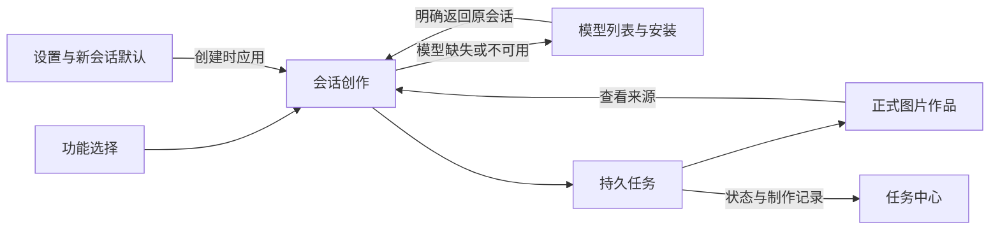

# 09 · ASRbox 全页面调查与 Image Studio 页面蓝图

> 时点说明：本文保留 2026-10-30 的方案调研快照。下文“计划中/未实现”的判断反映当时状态；FLUX.2 Klein 4B distilled 已于 2026-10-31 完成文生图与单图编辑阶段验收，当前状态以 [Klein 阶段报告](../verification/planned-models-20261031/results.md) 和模型目录为准。

研究日期：2026-10-30，Asia/Shanghai。用户要求模型管理具备模型列表，并深入调查设置、功能与其他页面。本记录承接已讨论的 Codex/ZCode 式会话管理，保留当前用户满意的桌面视觉方向。

**本文中的后续页面仍属于研究或待确认建议，不是新增功能已经批准或实现的验收。** [introduce-generation-conversation](../openspec/changes/archive/2026-10-30-introduce-generation-conversation/proposal.md) 已按用户确认完成实现、[实机验收](../verification/conversation-generation-results.md)并归档。这里保留整体页面地图与后续建议边界，其余范围须分别走 change 流程。

## 1. 调查依据与证据范围

参考仓库为 `/Users/gejiawei/Desktop/ai_code/ASRbox`，package.json 版本 0.4.0，本地 HEAD `acc7ab700580cd763f4601318b2c791b6d381ebb`。先阅读其 AGENTS.md，再使用 CodeGraph、聚焦源码和已接受 OpenSpec 核对。未访问远端，未验证是否为最新代码；未修改参考项目、启动后端、安装模型、运行推理或执行参考项目测试。

本轮实际查看 ASRbox `assets/` 下工作台、任务中心、字幕编辑、模型、设置、AI 校对/翻译/对话共 8 张页面截图，另查 `frontend-audit-screenshots/95-gate` 的模型/设置两张图和 report.json。该报告记录 36 个历史布局场景，覆盖 1280×820、1440×900、390×844，**不是本轮运行结果**。其中截图显示 2026-09 与 v0.3.x，一些状态为后端离线、0/0 模型；它们只帮助理解布局，当前逻辑以本次检出源码为准。

可复核的源文件及散列在 [研究输入清单](references/asrbox-pages-2026-10-30.json)。Image Studio 当前能力以 [首个模型验收](../verification/first-generation-results.md)、[会话式生成验收](../verification/conversation-generation-results.md)和主 specs 为准；首个 Z-Image 闭环及会话式多轮生成均已实现。

## 2. ASRbox 的真实页面地图

当前路由是工作台 `/`、任务中心 `/tasks`、AI 工作台 `/ai`、模型管理 `/models` 和设置 `/settings`。`/providers` 重定向到设置的平台页签，`/exports` 重定向任务中心；没有单独的“功能大全”路由。[路由源码](/Users/gejiawei/Desktop/ai_code/ASRbox/app/src/router.tsx:24)

| 页面 | 源码中已有的完整结构 | 图片产品适用的组织方式 |
|---|---|---|
| 工作台 | 输入媒体、后端/模型/语言/参数、开始动作、最近任务和首次启动指引 | 让用户直接开始创作；没有模型时说明缺什么并到模型管理，编辑与已有结果仍可用 |
| 任务中心 | 左侧搜索/状态列表、中间当前任务结果、右侧状态/输出/记录；成功后导出，失败提供原因和重试 | 列表、图片结果、制作记录三者联动；从任务可回所属会话 |
| AI 工作台 | 校对、翻译、对话三个实际工作区；可选择完成且有字幕的上游任务，右侧显示当前状态/依据 | 功能围绕“输入结果→选择处理目的→有效参数→新结果”组织，按依赖条件启用 |
| 模型管理 | 搜索/分类、逐行模型列表、行内展开详情、逐模型下载状态、下载总览、磁盘占用和设置入口 | 用模型列表管理目录与安装，不把单个型号介绍当整个管理页 |
| 设置 | 通用、转写默认、加速、在线ASR、LLM、存储与诊断、关于 | 用职责分组，区分界面偏好、创作默认、存储、运行环境、诊断和版本 |

AI 页按任务完成状态和字幕数量过滤可选项，区分“没有任务”“没有可用结果”“搜索无结果”，功能缺少提供商时直达设置；不是点任何卡都进入同一个空白页。[AIPage](/Users/gejiawei/Desktop/ai_code/ASRbox/app/src/routes/AIPage.tsx:22)、[功能页签](/Users/gejiawei/Desktop/ai_code/ASRbox/app/src/routes/AIPage.tsx:50)

任务页的列表、结果、检查器结构见 [TasksPage](/Users/gejiawei/Desktop/ai_code/ASRbox/app/src/routes/TasksPage.tsx:534)，错误展开及恢复见[失败处理](/Users/gejiawei/Desktop/ai_code/ASRbox/app/src/routes/TasksPage.tsx:713)。本检出版本部分标签、收藏、集合、最近导出是前端 useState，不作为其跨重启持久化的证明。模型“常用”列表也有局部状态，不应据此推导完善的偏好持久化。

## 3. Image Studio 当前实际差距

| 领域 | 当前实现 | 需要形成的页面能力 |
|---|---|---|
| 创作/会话 | 已有多会话、多轮消息、原位进度图片卡、取消/重试/恢复与图片查看器 | 继续沿用现有 Rust 会话/轮次事实；后续页面只读取这些身份，不复制第二套历史 |
| 模型 | ModelLibrary 写死单个 Z-Image 介绍卡，三个分区但没有真正可检索的目录列表 | 目录驱动的模型列表、真实筛选、详情和安装管理；运行时仍独立表达 |
| 功能 | 无独立功能页；文生图只有创作入口 | 按用户目的组织功能，展示依赖与可用性；首先让文生图入口闭环 |
| 作品 | 有不可变资产库、缩略图和单图预览，无独立作品页 | 从图片出发查看、筛选、导出并回到来源会话；与执行记录分工 |
| 任务 | 有真实任务列表、取消/重试、100项分页；状态标签是 span 统计，未接过滤事件；详情主要直接输出 manifest JSON | 真实过滤/查询、结构化制作记录、输出图、阶段与错误、回会话 |
| 设置 | 外观/工作区/关于三块；外观只在内存中保存，工作区主要是说明 | 分组设置及真实持久化/反馈，默认值、路径/运行环境和排错入口 |

依据：[App 页面与状态](/Users/gejiawei/Desktop/ai_code/image-studio/apps/frontend/src/App.tsx:10)、[当前设置](/Users/gejiawei/Desktop/ai_code/image-studio/apps/frontend/src/App.tsx:113)、[ModelLibrary](/Users/gejiawei/Desktop/ai_code/image-studio/apps/frontend/src/LibraryPages.tsx:7)、[任务统计与列表](/Users/gejiawei/Desktop/ai_code/image-studio/apps/frontend/src/LibraryPages.tsx:31)。这反映页面承载不足，不否定已验证的实际模型、存储和导出链路。

## 4. 建议的整体导航

延续现有顶部页签、窄图标导航及亮暗主题，补齐六个主页面。不同页面各有清楚职责，共用同一份模型、会话、任务和资产事实。

| 主入口 | 用户要完成的事 | 二级结构 |
|---|---|---|
| 创作 | 在某个会话连续生成、修改下一条提示词、查看图片 | 会话列表、新建/命名、消息区、图片查看器、底部输入 |
| 功能 | 按目的选择文生图、图片编辑、去背景、放大等 | 功能分类与可用性、具体功能工作区、所需模型入口 |
| 模型 | 找模型、了解条件、安装与恢复、选择用于创作 | 全部/已安装/可执行/计划中/运行环境；列表+详情+安装状态 |
| 作品 | 浏览已经提交的图片，而非等待计算 | 图片网格/列表、按会话/模型/尺寸/日期过滤、预览/导出/来源 |
| 任务 | 了解执行过程、失败原因和重试 | 全部/进行中/成功/失败/取消/中断；详情与制作记录 |
| 设置 | 调整应用偏好和新会话默认值、了解存储与运行环境 | 通用、创作默认、存储、运行环境与诊断、关于 |

作品和任务可以引用同一个 Asset/Job，但不复制第二份历史。会话是创作上下文；任务是某次执行；作品是正式结果。筛选或打开页面不创建新 Job，不把示例计为作品。关于放在设置下，运行时也可从模型页进入；避免为同一信息维护两套状态。

## 5. 模型管理：采用可管理的列表

### 5.1 布局与字段

顶部是页面标题和概况，再是搜索/筛选；主体为紧凑列表，每行能展开详情；活跃安装就地显示，并有下载总览。安装器状态只有一处事实来源，行与总览不会各自计算进度。

建议一级筛选：全部、已安装、可执行、计划中、运行环境；二级能力筛选：文生图、图片编辑、去背景、放大。搜索可覆盖名称、型号ID、家族、运行时。没有匹配结果显示“无匹配模型”和清除筛选；读取本地库失败显示错误和重试，不能渲染成“一个模型也没装”。

| 列 | 用户可见内容 |
|---|---|
| 模型 | 名称、家族、确切变体；少量用途说明 |
| 功能 | 文生图/编辑/去背景/放大等真实能力标签 |
| 体积与运行要求 | 权重下载体积、运行时增量、已知平台；空间预算在安装前明确 |
| 接入/安装状态 | 已接入或计划中；未安装、下载、校验、准备、可执行或异常 |
| 本机条件 | 所需运行时/设备是否就绪，已验证设备范围及当前阻塞原因 |
| 操作 | 详情、安装/继续/停止、恢复、用于会话等当前状态下有意义的动作 |

窄窗优先保留名称、状态、主操作，其他字段移入展开详情或有界横向滚动。列表有完整键盘焦点，不依靠颜色区分异常。普通未安装用中性状态；不要把每个未下载条目都铺成红色错误块。

ASRbox 的搜索/过滤位于 [ModelsPage:130](/Users/gejiawei/Desktop/ai_code/ASRbox/app/src/routes/ModelsPage.tsx:130)，列表位于[同文件:210](/Users/gejiawei/Desktop/ai_code/ASRbox/app/src/routes/ModelsPage.tsx:210)，行内状态/详情位于 [ModelManagement:138](/Users/gejiawei/Desktop/ai_code/ASRbox/app/src/components/models/ModelManagement.tsx:138)、[展开区域:229](/Users/gejiawei/Desktop/ai_code/ASRbox/app/src/components/models/ModelManagement.tsx:229)。

### 5.2 首批目录如何如实展示

| 型号 | 本项目现状 | 列表动作 |
|---|---|---|
| Z-Image Turbo | 已接入并在 M3 Max / 128 GiB 完成固定组合验收；本机是否已安装由当前数据根状态决定 | 详情、安装/继续/停止、就绪后用于会话 |
| FLUX.2 Klein 4B distilled | 首批选型建议，未实现本地闭环 | 计划中/查看接入说明，不能显示为可安装可生成 |
| BiRefNet general epoch_244 | 抠图选型建议，未适配验证 | 计划中，不提供假下载/抠图动作 |
| Real-ESRGAN x4plus | 放大选型建议，未适配验证 | 计划中，不提供假下载/放大动作 |

可以在同一目录显示未来条目，但统计分别列“目录数量 / 正式接入 / 已安装 / 当前可执行”，不把计划中型号增加到支持数。若暂时不显示计划中条目，正式模型列表只有一行仍成立；列表结构应由登记目录驱动，不能用填充数据伪造丰富度。

首批建议见 [08 · 模型选型](08-first-model-batch.md)，它不是可执行安装 manifest。Z-Image 来源是 [正式模型清单](../resources/local-generation/model-manifest.json)，q4 为加载时量化，原始组件仍约 32.85 GB。它不是最低硬件需求证明，也不能将设备小算子探针等同于整模型实测。

### 5.3 详情、状态和动作规则

详情展示：用途与输入/输出限制、三尺寸/单张/9步/q4等当前真实配方、固定 revision、许可/来源、模型组件与运行时、下载和临时空间、已知验证范围、当前就绪条件。高级散列/完整清单折叠，不占主流程。

状态至少区分“已接入、模型文件齐备、运行时就绪、当前可执行、目标设备有实机证据”。`ReadyRecord` 与正式清单仍为宿主权威来源；目录和筛选不触发探针、散列全盘扫描、下载或加载模型。

操作沿现有安装器语义使用“安装模型与运行环境 / 停止安装 / 继续安装”，安装失败显示具体原因和恢复动作。当前没有单独 pause 状态，不能只复制 ASRbox 的“暂停”按钮。下载进度、校验、安装、探针是不同阶段；未知阶段用活动提示。

“用于当前会话”是明确选择动作；模型管理返回创作时携带来源 ConversationId，不覆盖别的会话文字。若提供“设为新会话默认”，只改以后新会话默认，不能暗改当前会话/运行中计划。安装完成可提示可用，不强行跳页或自动换模型。

ASRbox 有内存模型卸载、文件删除和存储迁移接口，源码并非只有页面按钮：[模型接口](/Users/gejiawei/Desktop/ai_code/ASRbox/backend/routes/models.py:36)。但 Image Studio 当前每 Attempt 冷加载并回收，不提供热模型池，故无需照搬“卸载内存”。模型卸载、权重删除、迁移必须另行定义引用/忙碌/校验/回滚规则，再开放入口。

不照搬模型天梯：ASRbox 的部分行内速度/精度等级来自启发式 [ModelManagement:129](/Users/gejiawei/Desktop/ai_code/ASRbox/app/src/components/models/ModelManagement.tsx:129)，不能转成图片质量排行。以后展示“本机实测记录”应列完整型号/设备/尺寸/精度/入口及计时范围，未测写未测；已有四次出图计时口径不同，不据此排列模型快慢。

## 6. 功能页：以创作目的组织具体工作区

ASRbox AI 工作台将校对、翻译、对话分别落到具体操作界面，共用上游任务选择和状态检查器；缺结果、缺配置和运行中都各有反馈。图片工作台可以借鉴“左输入/来源、中操作和结果、右参数/记录”的组织，不需要每个型号再建一个陌生页面。

| 功能 | 用户输入与结果 | 近期页面应如何表达 |
|---|---|---|
| 文生图 | 提示词、尺寸/种子 → PNG | 已有真正执行器，入口进入当前/新建会话，沿统一提交与卡片链路 |
| 图片编辑 | 源图、编辑指令 → 新图片 | 展示计划与所需路线，当前不提供可执行按钮；待 Klein 闭环后再形成实用工作区 |
| 去背景 | 图片 → 透明 PNG/mask | 计划中；未来保留原图、棋盘背景与边缘检查，不伪造现有能力 |
| 放大 | 源图、倍率 → 更大图片 | 计划中；未来展示输入/输出尺寸、切块与原图对比，当前不开放假运行 |
| 局部重绘/扩图/LoRA 等 | 具有不同输入与参数 | 作为后续能力目录，首轮可不放主导航，不能沿用文生图参数冒充 |

功能入口要说明依赖：尚未接入、已接入但未安装、缺运行时、设备未就绪、输入不满足、正在执行、可开始。缺模型可到模型管理并带回功能与会话上下文；“计划中”可打开说明，不用一个可点击“开始”最终吐出尚未实现错误。

功能页和会话共用一个受限提交入口与真实任务记录，不能点击功能卡又创建第二个 Job。后续从作品使用某功能只传 AssetId/角色与有限参数，正式处理另存新资产，原图和 manifest 不覆盖。现阶段无语言模型，不把会话历史自动转成理解“上一张图”的能力。

## 7. 设置页：五个职责分组

ASRbox 当前七组设置见 [SettingsPage:31](/Users/gejiawei/Desktop/ai_code/ASRbox/app/src/routes/SettingsPage.tsx:31)、[页签:303](/Users/gejiawei/Desktop/ai_code/ASRbox/app/src/routes/SettingsPage.tsx:303)。Image Studio 建议按五组组织：

| 分组 | 建议提供 | 首轮应保持的边界 |
|---|---|---|
| 通用与外观 | 跟随系统/浅色/深色、字体档位、密度、减弱动效、侧栏偏好、快捷键说明 | 已有亮暗主题先真正持久化；新增选项要有实际作用，不能只渲染控件 |
| 创作默认值 | 新会话默认模型、画幅、单张、随机/固定种子策略 | 只影响以后新会话，当前会话和已发请求保持；固定型号9步/q4不变成无效滑杆 |
| 存储 | 数据/模型/运行时/缓存/图片/日志路径、占用与空闲容量、定位受管目录 | 先只读可定位；目录迁移和删除有完整预检/引用/回滚后再开放 |
| 运行环境与诊断 | 实际设备、运行时版本/Ready、组件异常、最后错误、刷新和显式诊断 | 区分设备探针与整模型实测；不提供无效果的GPU加速开关，诊断默认不运行 |
| 关于 | 真实版本、平台、项目与依赖许可、本地处理说明、示例来源、当前能力范围 | 当前无公开分发/更新链路，不能照搬自动更新、在线提供商或签名保证 |

ASRbox 的界面偏好是即时写入本地持久 store，[uiStore](/Users/gejiawei/Desktop/ai_code/ASRbox/app/src/stores/uiStore.ts:57)；后端默认设置为表单显式 Save，[SettingsPage:148](/Users/gejiawei/Desktop/ai_code/ASRbox/app/src/routes/SettingsPage.tsx:148)、[默认参数:506](/Users/gejiawei/Desktop/ai_code/ASRbox/app/src/routes/SettingsPage.tsx:506)。目录修改也会先标记待保存，[MediaStorageSettings](/Users/gejiawei/Desktop/ai_code/ASRbox/app/src/components/settings/MediaStorageSettings.tsx:34)。

建议沿用这种区分：外观即时生效并显示保存反馈；创作默认值显式保存/放弃；切组有未保存内容时明确处理。恢复默认只恢复该组偏好，不清库、不删作品或模型。偏好读取逐字段校验与归一化；不能直接复制参考 store 后宣称所有异常值都已覆盖。

默认值必须只有一份权威来源。当前会话提案已经规定新会话使用应用默认设置生成独立快照，不复制当前会话；后续持久设置 change 再把可用优先级明确为“创建入口显式覆盖 → 用户保存的新会话默认 → 内置默认”。普通新建与“用于当前会话”是不同动作，设置/模型页共用同一个默认解析端口，会话 modelId 是其创建后的独立快照。

ASRbox 存储迁移包括计划检查、空间/冲突、move/adopt、阶段与取消、校验和切换，不是目录输入框：[ModelStorageSettings](/Users/gejiawei/Desktop/ai_code/ASRbox/app/src/components/settings/ModelStorageSettings.tsx:62)。Image Studio 的默认路径/自定义验收根、host.lock、SQLite 和安装锁形成整体，不能在生成期间只改一个前端字符串来移动库。目录打开须由宿主按登记种类解析，不给 WebView 任意路径/命令能力。

不迁入 ASRbox 的音频 VAD/说话人/ffmpeg、线上 ASR/LLM API token、独立后端服务地址、Windows CUDA 套件等领域控件。当前 Tauri 业务通信无需用户配置 ASRbox 式 HTTP 服务连接。

## 8. 任务、作品与辅助页面

### 8.1 任务中心

建议真实状态筛选、提示词/会话/模型检索、稳定分页；查询与计数同一过滤条件，不能只过滤已经加载的一页。当前统计标签应变成真正可操作筛选或明确作为统计，避免点击无反馈。

任务行展示标题、会话、型号、尺寸、实际种子、创建/完成时间、状态和输出缩略图。详情先给可读字段与分阶段状态、错误和“下一步”，完整 manifest/日志置于高级区。Failed/Cancelled/Interrupted 可明确重试、成功可导出或再次用提示词，仍复用不可变 Attempt 与取消成功竞争门禁。历史成功的资产若被外部移走，显示文件可用性异常，不反改原成功终态。

安装/下载属于安装器状态，生成属于 Job；页面可以同时提示，但不能把一次安装计为一次成功出图。全局仍串行执行，没有队列的地方不显示排队承诺。从任务定位会话与图片需明确 ConversationId/TurnId/AssetId 关系，不靠文本搜索猜关联。

### 8.2 作品库

会话适合连续创作，作品库适合跨会话找图。建议网格/列表、日期/模型/尺寸/会话筛选、真实缩略图、选中图预览/PNG导出、“回到来源会话”。来源和有效参数来自同一 AssetRef/RunManifest，不读文件名猜来源。作品库首先覆盖已提交图片，示例单独明确身份；外部导入、收藏/标签、批量导出和删除作为后续独立行为定义，不默认包含在本轮。

当前已有稳定资产 ID 与受控 asset URI，可复用它们而不让前端扫描任意文件夹。作品网格分页与缩略图加载应有上限；某一张缺失局部报错，不拖垮全部页面。

### 8.3 首次使用、异常、帮助与空态

首次打开允许不安装直接编辑/看示例。首次实际生成需安装时说明型号、下载、空间和进度；安装完成回到原上下文由用户明确继续，不自动替用户执行。

空态至少区分：新会话无消息、没有作品、无搜索结果、模型未安装、模型/运行时不可用、本地库读取失败和系统旧执行清理中。每个空态给一个有意义的主动作，不把异常伪装成从未使用。

快捷键与功能说明放在设置/关于或就近帮助，正常创作无需常驻硬件、日期、内部 PID 和原始 JSON。断网、960×640、长中文、多会话和亮暗主题都属于最终页面验收场景。

## 9. 页面之间要共用的状态与验证边界

| 事实 | 唯一所有者 | 多页面如何使用 |
|---|---|---|
| 登记模型/清单/就绪 | Rust 模型目录与安装器 | 模型列表、会话选择器、功能可用性都读同一事实 |
| 新会话默认值 | 持久应用偏好 | 设置/模型页更新一份默认，创建会话时快照应用 |
| 会话输入/模型/参数 | 会话归属的CAS草稿 | 切页与模型管理往返保持；后台结果不覆盖 |
| 发送/Job/Attempt | Rust业务接收与生成监督 | 创作卡和任务中心一致，旧Attempt事件不能串入新卡 |
| 正式图片/来源 | AssetRef/RunManifest与存储 | 作品/会话/任务/导出共用，保存前不算正式结果 |
| 当前页/展开/阅读位置 | 前端按页面和会话限定的查看态 | 可恢复但不成为执行事实，不改变任务或资产 |

当前两份后续 change 已把上述边界转成 requirement、scenario 与任务并完成归档：搜索/筛选空态和失败；计划模型不可执行；模型安装停止/继续；切页/换会话时迟到事件；偏好保存失败与默认值唯一优先级；任务过滤跨分页；成功缺图；原生导出；窄窗键盘和中文 IME。静态截图、fixture 与实际 Z-Image 生成分别保留证据，不能互相替代。普通“新建会话”读取持久默认，创建入口显式覆盖和“用于当前会话”是不同动作；默认表单整组验证，防止两处偏好互相覆盖。

## 10. 建议的落地切分

先统一这份页面地图和交互边界，再按真实能力落地：

1. **创作与会话**：[introduce-generation-conversation](../openspec/changes/archive/2026-10-30-introduce-generation-conversation/proposal.md) 已实现、完成[实机验收](../verification/conversation-generation-results.md)并归档为主规格。
2. **模型列表与基础设置**：[introduce-model-catalog-and-settings](../openspec/changes/archive/2026-10-30-introduce-model-catalog-and-settings/proposal.md) 已实现目录/筛选/详情、现有安装器、外观持久化、只读存储/运行时、真实关于和新会话默认策略，并完成[实机验收](../verification/model-catalog-settings-results.md)后归档。
3. **功能入口、任务可读详情与作品浏览**：[improve-feature-works-and-tasks](../openspec/changes/archive/2026-10-30-improve-feature-works-and-tasks/proposal.md) 已实现功能目录、正式作品库、任务查询与跨页返回，并完成[真实生成验收](../verification/feature-works-task-results.md)后归档。
4. **第二个真实模型与具体编辑工具**：Klein/BiRefNet/Real-ESRGAN 各自完成固定组件、接口、输入输出与实机验收后，再启用相应功能；模型迁移/卸载、更新发布、外部服务及批量等再单独定义。

三份 change 已按依赖顺序实施并归档：会话能力先完成实机验收；模型/设置随后把内置默认回退扩展为持久默认与统一解析入口；辅助页面最后消费稳定的 Conversation、Turn、Job、Attempt 与 AssetRef。参考仓库保持未改，本实现未提交或推送代码。
