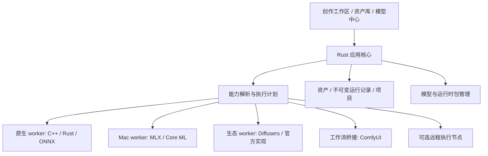

# Image Studio：Rust 图片模型工作台完整研究报告

研究日期：2026 年 10 月 28 日，Asia/Shanghai。工作名：**Image Studio**。

本文档组回应的目标是：从零构建一个类似 ASRbox 的图片 AI 工具，以 Rust 为产品主体，先发布 macOS，随后扩展 Windows，分批接入开源和开放权重图片模型，长期形成覆盖广泛模型、任务和创作流程的桌面工作台。

文档性质：**研究、脑爆和架构建议，不是已经批准的产品规格，也不是应用已经实现的功能说明。** 文中出现的数据结构、协议、模块划分和交互均为设计草案。此次没有编写应用代码，没有运行图片推理，也没有实测模型在 Mac 或 Windows 上的速度、内存或兼容性。

**后续进度（2026-10-30）：** 以下主报告保留 2026-10-28 的研究时点与长期建议。当前应用已采用 Rust core + Tauri 2 + React；首个 Z-Image Turbo 闭环、[会话式生成](../verification/conversation-generation-results.md)、[模型与设置](../verification/model-catalog-settings-results.md)以及[功能、作品与任务](../verification/feature-works-task-results.md)均已完成实机验收并归档。页面研究中的功能目录、正式作品查询和任务中心已落成宿主只读投影；真实 Z-Image 生成、原生 PNG 导出以及可靠会话返回均有独立证据。用户选定的[黑色应用图标](../openspec/specs/product-identity/spec.md)已接入应用包、左栏和关于页。最新全页面调查见 [09 · ASRbox 全页面与产品页面蓝图](09-desktop-pages-research.md)，其余第二个真实模型、编辑工具、批量操作与迁移仍须分别走新 change。

需要一次连续阅读，可打开[完整合订报告](image-studio-rust-research-report.md)；以下分卷便于按主题讨论与修订。

## 先读这几个判断

1. **这个产品值得按“创作工作台 + 模型基础设施”来构建。** 用户最终需要的是把图片做好、继续修改、比较方案和交付结果；模型数量是实现这些目标的供给侧能力。
2. **Rust 应掌握界面、任务、资产、版本、下载、权限、运行时管理和执行计划。** 推理可以来自 Rust、C/C++、MLX、Core ML、ONNX Runtime、Python pipeline 或受管理的 ComfyUI。产品主体使用 Rust，与保留异构推理后端可以同时成立。
3. **“几乎所有模型”靠模型家族适配、组件配方、能力描述和插件扩展来接近。** 给每一个 checkpoint 单独写一个页面或一个执行分支，会让维护工作随模型数量失控。
4. **Mac 首发应设计一条 Apple Silicon 优选路线。** 同时把 Intel Mac、不同内存规格和不同推理设备放进兼容性模型，而不是让“macOS”成为一个模糊的支持标签。是否正式支持 Intel 是待确认的产品选择。
5. **从第一天保存可追溯的生成记录。** 输入、模型与组件 revision、处理配方、运行时版本、实际设备、参数和输出应共同组成一条创作记录。
6. **界面可以像 Photocraft 那样紧凑、统一，并保留日常创作的可理解性。** 前台以画布和资产为中心，后台保存可组合的工作流图；普通用户无需先学习节点编程。
7. **Windows 应成为新平台适配层和新运行时组合。** 产品领域、任务协议、资产结构和配方应尽可能复用，不需要重做第二套应用逻辑。

## 阅读路径

| 文档 | 回答的问题 | 推荐阅读人群 |
|---|---|---|
| [01 · 产品愿景与完整蓝图](01-product-vision.md) | 它是什么、为谁解决什么问题、界面与功能如何组织、长期可以长成什么样 | 产品、创始人、设计 |
| [02 · Rust 技术架构与实现方法](02-rust-architecture.md) | UI、核心、worker、协议、调度、存储、画布、下载、Mac/Windows 如何实现 | 架构、Rust、平台开发 |
| [03 · 模型生态、兼容性与分批路线](03-model-ecosystem-roadmap.md) | 接哪些模型、如何定义支持、如何适配、如何持续扩大覆盖 | 模型、推理、生态维护 |
| [04 · 研发方法、验证与关键决策](04-methods-and-decisions.md) | 如何从想法到可验证产品、怎样组织实验、如何降低反复重构 | 技术负责人、质量、项目组织 |
| [05 · 一手来源索引](05-sources.md) | 哪些事实查过、从哪里来、哪些内容没有验证 | 全部读者 |
| [06 · 场景推演与远期脑爆](06-scenario-walkthroughs.md) | 从真实工作流倒推功能、协议和产品演进 | 产品、设计、架构 |
| [07 · 接口草案与完整执行示例](07-interfaces-and-execution-examples.md) | 用请求、能力、执行计划和消息理解实现边界 | 架构、Rust、推理开发 |
| [08 · 第一批模型选型（2026-10-29）](08-first-model-batch.md) | 四个具体目标、接入顺序、Mac 路线与暂缓理由 | 四个目标均已完成，后续新增 Qwen/MOSS 也已验收 |
| [09 · ASRbox 全页面调查与页面蓝图](09-desktop-pages-research.md) | 模型列表、设置、功能、任务、作品及跨页状态应如何组织 | 当前界面完善与后续规格 |
| [模型候选数据](model-candidates.json) | 可以被后续工具读取的候选模型目录 | 模型接入与自动化 |
| [来源数据](sources.json) | 机器可读的一手资料索引 | 研究与后续复核 |

只想把握总体方向，先读本页和 01。准备选技术，接着读 02 与 04。准备拆模型接入批次，重点读 03 和模型候选数据。准备做交互原型，先读 01 与 06。

## 产品的一句话定义

**把分散的开源图片模型，变成能安装、能选择、能组合、能反复编辑、能追溯和能批量交付的本地创作能力。**

一个理想的用户不必知道文本编码器、VAE、量化格式和 Python 环境，也能完成“用参考图做一组商品海报”。一个专业用户又能查看这次执行具体用了什么模型、如何控制、怎样复现，以及如何扩展新的模型或工作流。

## 本次研究采用的范围

“图片模型”主要包括：文生图、图生图、指令编辑、局部重绘、扩图、多参考生成、身份与风格参考、结构控制、超分与修复、分割与抠图、深度和姿态等辅助控制、图片理解与文字识别。训练与个性化作为后续能力展开。视频、3D、科研成像、医疗分析及专业 CAD 作为相邻方向讨论，不混入首版能力承诺。

“开源”在日常交流中经常包含开放权重、代码开放、研究用途许可等不同情况。本报告不替各项目重新定义许可，也不将“能下载”推导为“可任意商用或再分发”。产品应保存真实许可与来源，具体使用条件以选定权重和组件的原始条款为准。

## 事实、建议与设想的读法

| 标记或表述 | 含义 |
|---|---|
| 上游资料已核对 | 官方仓库、模型卡或文档明确描述了相关模型或接口 |
| 建议、拟、应设计为 | 本报告提出的产品或技术方案 |
| 候选路线、需实验 | 存在合理实现路径，但尚未在本产品与指定硬件组合上验证 |
| 远期设想 | 头脑风暴方向，不代表已存在可用实现或本阶段承诺 |
| 本产品已验证 | 本次调研没有任何模型达到此状态 |

对于近期发布的模型，本报告优先引用项目原始仓库和模型卡。运行时 README 声称支持某个模型，只能证明存在上游路径，不能替代本应用上的安装、加载、生成、取消和恢复验证。

## 建议的总体结构

这张图表达的是未来能够演进到的边界，第一版不需要同时实现所有方框。建议先把工作区、任务、资产和一条真实推理链路接通，再增加第二种执行路线，证明这套边界确实可扩展。

## 已确认需求与尚待选择的事项

用户已明确：新产品、Rust、macOS 先发、后续 Windows、模型分批添加、长期尽量广泛覆盖。这些是报告的出发点。

本报告建议但尚未确认：egui/eframe 作为首选 UI 验证方向、Apple Silicon 优先、异构进程式推理、以项目和资产为核心、基础应用与运行时分发分离。Intel Mac 范围、最低 macOS 版本、首批模型、公开许可和分发渠道、是否在首版支持远程执行，都应在后续 OpenSpec change 中具体选择。

## 2026-10-28 调研时的仓库与交付状态

调研时目标仓库只有开发基础设施与文档目录，没有应用实现；没有活动 OpenSpec change。Git 未配置 remote，`git fetch --prune origin` 无法执行成功，**未验证是否为最新代码**。此次仅在 `doc/` 写研究资料，不修改应用代码，不创建已批准规格，不提交或推送 Git。

本报告的价值在于给后续决策提供足够完整的地图。开始实现时，应把选定的一小段行为转成可观察、可验证的规格；报告中的远期可能性不必一并成为首版要求。
