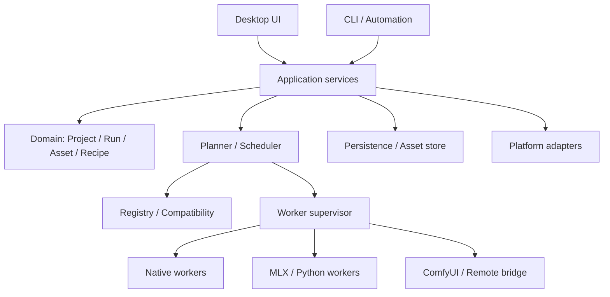
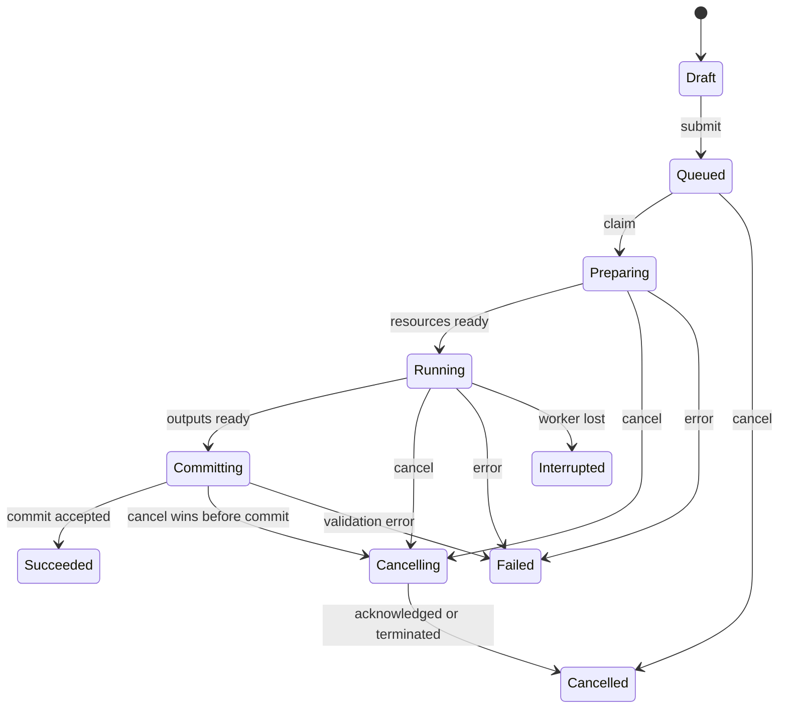

# Image Studio：Rust 图片模型工作台完整研究报告

研究日期：2026 年 10 月 28 日，Asia/Shanghai。

面向目标：Rust 产品主体，macOS 首发，后续 Windows；分批接入广泛开源与开放权重图片模型，建立生成、编辑、修复、控制、资产与工作流的一体化创作工具。

这是研究与脑爆报告，不是已经批准的规格或已经实现的产品。全部架构、接口与分批路线是建议；本次没有运行真实图片推理，不提供虚构的速度、内存和兼容认证。来源为 82 个一手入口，另附 51 项家族或类型级模型候选数据。

核心建议：Rust 管理界面、任务、资产、版本、模型与运行时；通过可替换 worker 接入原生引擎、MLX、ONNX、Diffusers、官方实现与工作流生态。以能力和组件图组织模型覆盖，以真实执行证据形成兼容矩阵。

本合订版由同目录分卷生成，便于连续阅读；修订以分卷为源，随后重新生成本文件。导航与需求边界见 [总览](README.md)，机器可读附件见 [模型候选](model-candidates.json) 与 [研究来源](sources.json)。

## 目录

- [卷 01 · 产品愿景与完整蓝图](#volume-01)
- [卷 02 · Rust 技术架构与实现方法](#volume-02)
- [卷 03 · 模型生态、兼容性与分批路线](#volume-03)
- [卷 04 · 研发方法、验证与关键决策](#volume-04)
- [卷 06 · 完整场景推演与远期脑爆](#volume-06)
- [卷 07 · 接口草案与完整执行示例](#volume-07)
- [卷 05 · 一手来源与研究证据](#volume-05)


---

<a id="volume-01"></a>

# 01 · 产品愿景与完整蓝图

研究日期：2026-10-28。本文为设计建议与脑爆；来源事实在相关位置给出链接。返回[总览](README.md)。

## 1. 从 ASRbox 的方法出发，重新理解图片任务

ASRbox 的核心价值可以概括为：把不同语音引擎与服务包进一个可靠的任务、模型和结果管理系统。图片工具可以继承这种“统一工作台”的思路，但图片创作的结构更复杂。

转写通常从一份媒体得到一份可编辑文本。图片创作会产生大量候选、分支、局部修改、参考关系和派生结果。用户也很少在第一张图出现时结束工作：他可能换构图、保留人物、改一个商品标签、放大、抠图、组合背景、输出不同尺寸。因此本产品的核心对象应同时包含任务与资产，进一步形成项目、画布、创作版本和工作流。

可以继承的 ASRbox 经验包括：任务生命周期清晰、模型按需安装、后台工作不阻塞界面、结果有版本、失败可以诊断、平台能力如实呈现、默认参数能直接工作。需要重新设计的地方包括：图片分支、多个输入资产、蒙版与控制图、跨模型流水线、大型图像预览、批量候选管理和创作回退。

一个用户界面上只显示“模型 + 提示词 + 生成按钮”的产品，能较快开始，但无法自然承载后续几十种任务。建议从第一版就建立资产与运行记录，不过首版界面仍可以非常简单。

## 2. 产品应当承担的五个角色

### 2.1 本地模型入口

发现、下载、导入、校验、安装、选择模型。解释它适合做什么、当前电脑是否有可用执行路线、还缺哪些组件、运行时会占用哪些资源。用户看到的安装进度应覆盖完整组件集合，而非只覆盖最大的权重文件。

### 2.2 创作桌面

提供稳定画布、参考图区、参数检查器、结果胶片带、局部编辑工具和快捷键。模型切换后，用户的图片、提示词和项目上下文应保留。功能差异由可用控件和明确解释表现，而不是每个模型生成一个陌生页面。

### 2.3 任务与实验管理器

支持排队、取消、批量种子、参数扫描、跨模型对比、失败重试、结果筛选和后台继续。用户可以创建一次“构图实验”，得到一组可比较的候选，而不必手动记录每次参数。

### 2.4 图片资产与来源档案

保存原图、参考图、蒙版、生成结果、放大版本和导出版本，以及它们之间的关系。任意结果都应能回答“从什么输入，用什么配方得到”。外部图片导入后可以保留原文件位置，同时建立受管理的项目副本或明确的外部引用。

### 2.5 模型生态适配平台

新模型通过能力描述、组件清单、执行适配器和验证证据进入产品。运行时维护者不必修改核心任务状态机，界面设计者也不必了解每个模型的张量实现。

## 3. 用户与核心使用目的

| 用户类型 | 想完成的工作 | 最在意的体验 |
|---|---|---|
| 偶尔使用 AI 图片的普通用户 | 生成封面、修一张照片、去背景 | 安装后能用、不懂模型也能选择、错误可理解 |
| 内容创作者 | 批量封面、社交配图、人物风格统一 | 快速探索、保存常用风格、尺寸与批量输出 |
| 设计师 | 商品图、海报草案、版式探索、局部编辑 | 高质量参考控制、局部保留、反复迭代和版本对比 |
| 摄影与修复用户 | 老照片修复、降噪、放大、人像处理 | 前后对比、细节可信、可控制的修复强度 |
| 模型爱好者 | 新模型、LoRA、参数和硬件实验 | 原生参数、执行日志、精确版本、可扩展性 |
| 工作室与团队 | 统一资产、复用流程、远程 GPU 批处理 | 项目可移交、来源可追溯、任务不丢、执行可复用 |

产品可以服务所有这些人，但默认工作区应先服务一个自然的创作流程。专业控制可以逐层出现，避免所有功能在第一屏争夺注意力。

## 4. 建议的产品信息架构

### 4.1 创作

中心画布与当前资产。围绕“生成新图、编辑当前图、局部重绘、扩图、增强、抠图”组织入口。用户选择目的后，再显示支持该目的的模型和参数。

### 4.2 项目与资产

项目、收藏、智能集合、标签、评分、搜索、导入与导出。支持按日期、使用模型、任务类型、尺寸、人物或产品参考集、是否最终交付等维度查看。模型信息是筛选条件之一，不应成为唯一分类方法。

### 4.3 任务中心

显示正在下载、准备、加载、生成、后处理和导出的任务。默认呈现当前最重要的状态；展开后可以查看逐阶段进度、执行设备、日志和诊断。一个任务的重试形成新 attempt，旧失败记录保留。

### 4.4 模型中心

分为推荐、本机可运行、已安装、自定义、实验路线和所有目录。支持能力与运行时筛选；相同家族下的原始、蒸馏、量化、微调版本形成清晰层级。模型中心需要同时管理权重和运行时，而不是把二者混成一个“已下载”。

### 4.5 配方与工作流

普通用户看到“商品白底图”“人像换背景”“老照片修复”“封面四宫格”等配方。专业用户可以查看步骤、替换模型、调整节点和保存自己的版本。配方升级不应悄悄改变已有项目的执行定义。

### 4.6 设置与运行环境

管理存储位置、缓存、外接盘、硬件、资源策略、密钥、运行时、诊断、更新和备份。机器信息放在需要它的位置；正常创作不必始终展示大量 GPU 与磁盘徽章。

## 5. 创作工作区的布局

建议采用一个连续工作区，保留可折叠和可调整面板：

```text
+--------------------------------------------------------------------+
| Project / Document tabs       Undo / Redo        Export             |
+-----------+------------------------------------+-------------------+
| Assets    |                                    | Context inspector |
| History   |              Canvas                | Task / Model      |
| Reference |                                    | Inputs / Params   |
|           |                                    | Advanced          |
+-----------+------------------------------------+-------------------+
| Variants / Results / Compare                                        |
+--------------------------------------------------------------------+
| Prompt / Instruction                  Run / Queue / Cancel          |
+--------------------------------------------------------------------+
```

具体摆放可以通过原型调整，核心原则是：画布稳定、主要操作可达、上下文检查器随当前任务变化、结果比较不打断编辑。窗口变窄时，面板应折叠成明确入口；用户选过的图、蒙版和参数不因折叠丢失。

图层与资产需要区分：资产是可独立引用的文件与来源记录，图层是某个画布里的摆放、透明度、混合与可见性。一个资产可以出现在多个画布里，一个画布也可以组合多个资产。

## 6. 以任务为入口的交互

不要要求用户先选模型架构。可以让用户先选择“我想做什么”，再从当前可执行模型里推荐路线。

例如“替换背景”应引导用户确认主体、目标背景和保留要求，再确定使用显式分割与合成，还是指令编辑模型。两种路线得到的控制能力和视觉结果可能不同，执行前应能查看实际选择。

当用户主动选择具体模型时，界面也应尊重这种选择，显示该模型真实支持的任务和参数。任务优先与模型优先是两种视图，底层共用同一套能力与执行计划。

## 7. 参数系统的三个层级

### 7.1 基础层

任务目的、提示词或编辑指令、输入图与参考图、画幅、数量、质量/速度偏好、开始与取消。基础层的每个选项都应映射到可检查的有效参数，而不是不透明的营销档位。

### 7.2 创作层

风格、参考强度、内容保留、蒙版边缘、构图控制、人物一致性、文字内容和布局。不同模型不一定支持所有控制项，界面应显示可用能力及相邻替代方案。

### 7.3 专家层

seed、步数、guidance 语义、scheduler、采样器、分辨率约束、精度、量化、offload、tile、LoRA 组合以及模型专用参数。专家层必须保留原生字段名称与解释；同名参数在不同模型上的不同含义也要保留。

参数切换时应保存每个模型自己的最近配置。切到不支持负面提示词的模型时，可以保留用户草稿但从执行参数中明确移除，不把它伪装成已经应用。自动裁剪或分辨率调整也应进入运行记录。

## 8. 图片任务的完整能力版图

| 任务 | 输入 | 输出 | 关键交互 |
|---|---|---|---|
| 文生图 | 提示词、可选布局 | 一张或一组图片 | 画幅、候选探索、提示词版本 |
| 图生图 | 源图、指令或提示词 | 派生图片 | 改动幅度、原图对比 |
| 指令编辑 | 一张或多张图、自然语言 | 编辑结果 | 参考角色、保留目标、改动区域 |
| 局部重绘 | 源图、蒙版、指令 | 修改区域后的图片 | 画笔、羽化、蒙版反转、区域约束 |
| 扩图 | 源图、新画布与锚点 | 扩展构图 | 边界、接缝、已有区域保留 |
| 超分 | 低分辨率图片 | 更大图片 | 输出尺寸、保真度、tile 接缝 |
| 人像/老照片修复 | 图片、修复策略 | 修复结果 | 身份与细节变化检查 |
| 抠图/分割 | 图片、点框文字等条件 | mask、alpha、前景 | 头发边缘、透明物体、局部修正 |
| 结构控制 | 源图或控制图 | 图像/条件图 | 深度、边缘、姿态对齐 |
| 图像理解 | 图片、问题或识别目的 | 标签、描述、框或文字 | 校正、引用区域、辅助创作 |
| 透明生成 | 提示词或源图 | RGBA 图片 | 棋盘背景、alpha 检查、边缘放大 |
| 多图融合 | 多个参考与角色说明 | 新构图 | 参考绑定、顺序、权重与身份 |
| 布局生成 | 框、文字、对象关系 | 带布局意图图片 | 可视化框选与模型格式转换 |

这些是产品任务类型，不意味着每个模型都支持。Qwen-Image 2.1 的官方实现与 MFLUX 接入资料已经涉及透明输出及多参考编辑；FLUX 3 的官方实现提供布局控制入口；Iris 提醒我们不能把 VAE 当作所有生成模型的必需组件。[Qwen 2.1](https://github.com/QwenLM/Qwen-Image-2.1)、[FLUX 3](https://github.com/black-forest-labs/flux-3-image-klein)、[Iris](https://github.com/speridlabs/iris-3b)

## 9. 非破坏式创作与版本

一次生成或编辑完成后，输出作为新资产保存。用户继续编辑时创建新的运行记录与派生关系，原图与历史结果保持可引用。撤销画布摆放可以是轻量命令；撤销一次 AI 修改则可以回到旧资产版本，不需要重新推理。

建议把“版本”拆为四种：画布文档版本、工作流版本、运行请求快照和输出资产版本。它们有联系，但不能用一个不断变化的 JSON 全部代替。

用户应能从结果看到父图、参考图和处理路径，也可以在分支视图里比较“原图 → 换背景 → 修脸 → 放大”和另一条修改路线。删除一个分支前应说明还被哪些项目或配方引用。

## 10. 生成记录作为产品的一等资产

一张结果图旁边应有可折叠的“制作记录”：模型与组件、原始提示词、实际执行提示词、输入图、蒙版、参数、运行时与设备、耗时阶段、输出尺寸、警告和失败历史。

“再做一张”与“复现此图”是不同操作。前者可以换 seed 或使用更新默认值；后者应尽可能固定原始执行配方。即便固定 seed，不同后端、精度、硬件与算法实现也可能产生不同结果，因此产品应使用“相同配方重新运行”“同环境尽力复现”等准确表达。

如果运行环境已删除或组件缺失，仍然可以查看制作记录；用户可以选择恢复环境，或显式将配方迁移到新的执行路线。迁移要形成新记录，不能覆盖旧结果的来源。

## 11. 模型中心的用户体验

一个模型详情页需要回答以下问题：

| 用户问题 | 应呈现的信息 |
|---|---|
| 它有什么用途 | 任务、适合题材、输入与输出限制 |
| 我的电脑能不能跑 | 当前系统、内存、设备与可用后端的检查结果 |
| 我要下载多少 | 权重、文本编码器、VAE、processor、额外运行时分别多大 |
| 已有的东西能否复用 | 共用组件、已缓存字节、外部目录引用 |
| 为何不兼容 | 缺设备、缺算子、无此后端实现、文件不完整或尚未验证 |
| 它和其他模型有什么区别 | 同一任务下的样例、已测条件、已知能力和盲测偏好 |
| 能否用于我的项目 | 原始许可、组件来源、需用户接受的原始条件 |

“推荐模型”最好根据用户目的和实际可运行路线筛选；“最新模型”与“当前电脑最适合的模型”应分别排序。大模型无需在不适合的机器上假装有快速模式，远程路线可以作为独立选择。

## 12. 模型对比与实验工作台

用户可以固定一组输入和创作意图，让多个模型分别运行，得到候选网格。可以按真实输出尺寸、耗时、成本来源、用户评分、人物保持和文字正确率来比较。

跨模型比较要保存每个模型实际使用的提示词、步数、scheduler 和预处理。允许“共同语义参数 + 模型专用最佳配方”，同时标记它与“严格相同数值参数”的区别。不能因为所有模型输入了相同 seed，就把它描述为相同初始噪声的公平对照。

可支持盲选：先隐藏模型名，用户挑选结果后再揭示来源。结果排序中的“质量”可以来自用户偏好与明确测试集，不必制造一个不透明的总分。

## 13. 批处理与批次审阅

一个批次可以是同一提示词的多 seed、同一产品的多个背景、文件夹批量抠图、相同修复流程作用于多图，或模型与参数的笛卡尔积。

执行前显示计划产出数量、总输入字节、可估计的资源需求和重复输出命名策略。批量里某一张失败不应丢掉已成功结果。取消应能停止未开始项，并在可达的安全点停止当前项。批次审阅允许用户只重跑失败项或某个参数分组。

结果可以按“待审阅、采用、备选、淘汰”管理。删除淘汰结果时保留必要的批次统计或制作记录摘要，是否保留全部文件由用户策略决定。

## 14. 图像理解能力如何服务创作

可以加入图片描述、标签、文字识别、主体定位、构图建议、参考图检索和提示词辅助。它们应回到用户正在做的创作任务，例如把图片描述变成可编辑提示词，把检测框变成局部编辑区域。

模型理解结果只是候选解释。识别出的文字允许用户修正；自动生成的提示词要与原始输入分别保存；视觉模型对身份、品牌或细节的猜测不能悄悄成为不可见的执行条件。

远期可以实现“选择图中这个杯子，保留图案，换成木桌背景”。后台把意图拆成定位、分割、编辑和验证，但用户仍看到可修改的区域与明确的运行计划。

## 15. 与现有工具相比，应该学什么

| 参考对象 | 值得研究的方向 | Image Studio 可以形成的特点 |
|---|---|---|
| Photocraft | Rust 工作区、设计 token、命令驱动、图像显示 | 原生创作界面与可追溯 AI 操作结合 |
| ComfyUI | 可组合执行图、广泛模型与节点生态 | 保留图的表达能力，提供更易理解的任务与配方入口 |
| InvokeAI | 画布与创作工作流 | 将局部编辑与多后端、模型中心和资产关系结合 |
| Fooocus | 减少参数负担 | 默认配方能用，同时允许检查实际执行参数 |
| Draw Things | Mac 本地创作体验与设备整合 | 用跨平台 Rust 核心支持后续 Windows 与扩展生态 |
| SwarmUI | 多后端编排与易用控制 | 让执行位置与运行时成为明确、可替换的服务 |

上述比较是产品研究角度，不代表本次对每个产品做过完整实机测评，也不据此对速度或质量排名。[Photocraft](https://github.com/storytold/photocraft)、[ComfyUI](https://github.com/Comfy-Org/ComfyUI)、[InvokeAI](https://github.com/invoke-ai/InvokeAI)、[Fooocus](https://github.com/lllyasviel/Fooocus)、[Draw Things 社区](https://github.com/drawthingsai/draw-things-community)、[SwarmUI](https://github.com/mcmonkeyprojects/SwarmUI)

## 16. 视觉设计方法

建议选择一个稳定的创作工具风格：连续背景、少量层级表面、紧凑工具栏、清晰文字、少量品牌色。主画布应有足够对比，但不要让所有面板同时使用强边框与阴影。参数可以密集，错误、当前选择和主动作要容易辨认。

设计系统至少包括：亮暗主题、语义颜色、字体级别、数值与单位、间距、圆角、控件高度、图标尺寸、焦点环、禁用态、选中态、错误反馈、动画时间和面板行为。不要把设计系统缩减为几种颜色。

参考 Photocraft 的统一 token 与共用控件做法，但图片模型工具需要适合提示词和多图输入的控件。提示词输入应支持中文输入法、长文本、撤销、复制和快捷键冲突处理；数值输入支持键盘微调与明确范围；图像参考卡支持角色和排序。[Photocraft UI 规则](https://github.com/storytold/photocraft/blob/main/docs/ui-design.md)

## 17. 首次使用与日常使用

首次启动可以先打开完整界面，同时检测设备与运行环境。用户可查看示例项目或导入自己的图片；开始真实任务时再安装需要的组件。模型下载期间仍能浏览资产、编辑配方和排队。

首次成功应是一条完整流程：选目标 → 选择适合路线 → 下载完整组件 → 生成 → 查看结果 → 修改一次 → 导出。完成这条链路后，再展示高级功能比引导用户一次配置十几种模型更自然。

日常启动应优先恢复上次项目和持久化任务状态。上次运行被系统中断时明确展示“中断”，用户可以重新运行；不能在没有真实可恢复状态的情况下显示“继续到第 17 步”。

## 18. 核心体验指标

建议分别跟踪可用性和创作效率，避免只看生成数量：

| 指标 | 含义 |
|---|---|
| 从首次启动到第一份可导出结果 | 安装、模型选择、加载与交互是否连贯 |
| 第一次任务成功率 | 排除硬件不支持后的完整执行可靠性 |
| 从生成到采用的操作数 | 是否容易比较、局部修改与导出 |
| 因环境问题失败的比例 | 运行时管理是否可靠 |
| 已安装却不可执行的模型比例 | 安装状态是否真实 |
| 版本来源完整率 | 结果能否解释与重新执行 |
| 用户主动释放资源的成功率 | “释放内存”是否真正生效 |
| 每种设备上的界面交互延迟 | 推理期间是否仍能正常操作 |

这些是建议的测量方法，没有在本次报告中赋予虚构的实测成绩。性能目标可以在原型基线建立后设定。

## 19. 长期想象空间

如果不先用当前人手或预算压缩视野，产品可以继续演进为：个人模型图书馆、可共享的创作配方、项目式 AI 图片编辑器、实验与评测工具、家庭或工作室 GPU 调度器、模型转换与量化中心、个性化训练入口，以及可以接受自然语言任务的创作助手。

这些方向共享的基础是：稳定资产、可追溯执行、真实能力描述和可替换的推理路线。把这些基础打好，未来新增功能就更接近组合既有能力，而不是每次启动一个独立项目。

对于首发产品，建议保留这样一条产品承诺：**用户能理解正在做什么，等待过程可见，结果不会丢，下一步修改自然可达。** 模型覆盖持续增长，而日常使用的确定感保持稳定。


---

<a id="volume-02"></a>

# 02 · Rust 技术架构与实现方法

研究日期：2026-10-28。本文全部模块、协议、状态和目录均为建议方案，尚未实现。上游框架能力引用原始资料；未对任何组合做产品实机验证。返回[总览](README.md)。

## 1. 技术立场：Rust 控制产品，推理实现保持可替换

建议将应用主体写成 Rust：桌面界面、领域模型、命令、任务调度、模型包管理、资产存储、项目与版本、系统整合和可观测性。推理执行通过稳定协议接入多类 worker。

这里有三种不同的“Rust”：Rust UI、Rust 产品核心、Rust 张量与模型实现。前两项可以从第一天坚持；第三项适合在有收益时逐模型推进。调用 C/C++ 引擎或 MLX 不会使 Rust 产品核心失效。若为了代码语言统一而放弃现成的模型实现，模型覆盖速度会受模型重写工作量制约。

需要比较的路线包括：Rust + egui + C++ 原生引擎，Rust + MLX 专用 worker，Rust + Diffusers worker，以及 Rust 自己实现选定的高价值模型。它们可以共存，但每条路线都必须有独立版本和验证范围。

## 2. 分层与依赖方向



领域对象不依赖 egui，不直接调用推理库，不读取系统文件选择器。平台层提供目录、密钥、通知、休眠事件等能力。UI 只依赖应用服务与可展示状态；worker 只能通过协议获取任务与输入，不能直接任意修改产品数据库。

可以从一个 Rust workspace 开始，但第一版无需把每个概念都拆成 crate。先用模块建立边界，出现独立构建、不同许可、不同进程或不同发布节奏时再拆包。

## 3. UI 选型的具体方法

| 候选 | 适合验证的方向 | 需要在本产品验证的点 |
|---|---|---|
| egui + eframe | 画布、参数面板、专业工具工作区、快速迭代 | 中文输入、长提示词、文本选择、无障碍、复杂面板与窗口 |
| Iced | 声明式应用状态与常规桌面 UI | 自定义画布、局部刷绘、模型参数控件与跨平台输入 |
| Slint | 设计驱动的声明式 UI 与原生整合 | 特殊创作控件、渲染互操作、分发许可与团队工作方式 |
| GPUI | 高定制桌面工作区与 GPU UI | 选定版本的 Mac/Windows 能力、API 稳定性、输入与可访问性 |

建议先验证 egui/eframe，因为它与用户喜欢的 Photocraft 路线最接近。其他候选保留为对照，不应仅凭截图或概念偏好决定。四种框架的接口与平台状态应以选定版本为准。[egui](https://github.com/emilk/egui)、[Iced](https://github.com/iced-rs/iced)、[Slint](https://github.com/slint-ui/slint)、[GPUI](https://gpui.rs/)

UI 验证样机应同时包含：长中文输入框、多参考图拖放、可缩放图片、蒙版刷绘、列表虚拟化、后台任务进度、文件选择、系统剪贴板和高 DPI。仅做一个漂亮静态首页不足以证明框架适合。

## 4. UI 状态与业务状态

建议分三类：短期 UI 状态、持久化用户偏好、领域状态。

短期 UI 状态包括鼠标悬停、拖动中的画笔、面板折叠和文本输入中的候选状态。用户偏好包括主题、密度、快捷键、上次目录和面板布局。领域状态包括项目、配方、运行和资产。

每一帧只读已经准备好的展示快照，不在绘制函数里扫描磁盘、解析大模型文件、同步探测 GPU 或查询大量组合数据。界面动作形成应用命令，后台服务完成工作后发布新快照或事件。

egui 是即时模式 UI，不等于必须持续全速重绘。可由交互、动画、预览和后台事件请求重绘；空闲时减少无意义唤醒。Photocraft 采用过消除固定轮询重绘的优化，可作为实现研究方向，而不是直接外推本应用的 CPU 占用。[egui 说明](https://github.com/emilk/egui)、[Photocraft 帧调度](https://github.com/storytold/photocraft/blob/main/crates/ui-egui/src/app/frame.rs)

## 5. 命令与查询边界

典型命令：创建项目、导入资产、保存配方草稿、提交运行、取消运行、重新运行、安装模型、卸载模型、迁移存储、导出结果。

典型查询：当前项目、任务列表、可执行模型、兼容性原因、资产关系、磁盘占用、运行日志、安装进度。查询返回适合界面使用的带类型数据，不暴露 worker 内部临时字典让界面猜测其结构。

一个命令可以被 GUI、CLI 和后续自动化入口共用。对于“生成四张图”，用户命令应带有幂等键，防止双击、重连或调用方重试造成重复提交；命令接收成功与推理完成是两个阶段。

## 6. 核心数据模型

| 对象 | 作用 | 建议保持稳定的属性 |
|---|---|---|
| Project | 一个创作上下文 | 标识、名称、画布、资产集合、偏好 |
| Asset | 可引用图片或辅助数据 | 内容散列、类型、尺寸、颜色、来源、存储位置 |
| AssetRelation | 来源与派生关系 | 父资产、参考角色、生成运行、操作类型 |
| DocumentRevision | 画布文档快照 | 图层、变换、引用资产、编辑命令版本 |
| Recipe | 可重复执行的处理流程 | 输入契约、参数、步骤、依赖、版本 |
| ModelFamily | 架构与任务家族 | 家族标识、能力空间、适配器协议 |
| ModelVariant | 具体权重与变体 | 源 revision、量化、微调、组件依赖 |
| RuntimePackage | 推理运行环境 | OS、架构、包版本、协议版本、设备能力 |
| CompatibilityRecord | 可运行证据 | 精确组合、测试结果、日期、已知问题 |
| ExecutionPlan | 已解析的运行方案 | 实际组件、设备、阶段、资源、参数 |
| Job | 用户提交的工作 | 所属项目、目标、优先级、批次、取消意图 |
| Attempt | 一次具体执行 | worker、租约、状态、时间、错误、心跳 |
| RunManifest | 不可变的执行事实 | 实际输入、版本、参数、输出与警告 |
| Artifact | 最终或中间结果 | 类型、内容散列、来源阶段、保留策略 |

模型是供给对象，运行是执行对象，图片是资产对象。它们要相互引用，但不要把所有状态塞在一个“任务 JSON”里。尤其要避免用文件名作为模型或资产的唯一身份。

## 7. 能力契约比统一参数字典更重要

建议为任务描述输入与输出，而不是先列出全局 slider。能力描述可以表达：输入角色、数量、类型、可选性、尺寸约束、输出 alpha、蒙版语义、允许的控制信号、支持的调度器和模型专用参数。

每个参数应有类型、默认值、范围、单位、UI 提示、依赖条件、是否进入复现记录、是否改变缓存键，以及精确语义。例如 diffusion guidance、true CFG 与模型蒸馏出的 guidance 可能不同，不能用同一个无说明字段强行覆盖。

通用层表达用户目的，专用层表达模型真实参数。适配器负责完成可解释的转换。无法转换时返回能力冲突，而不是悄悄忽略用户输入。

## 8. 执行计划的生成

用户提交任务后，不应立即把“模型 ID + prompt”扔给 worker。应经过一个纯解析或尽量无副作用的计划阶段：

1. 固定项目输入和配方版本。
2. 解析模型变体与全部组件。
3. 选择兼容后端、运行时包和真实设备。
4. 归一化尺寸、参数和输入角色，保留原始请求。
5. 检查文件完整性、可用空间和组件可用性。
6. 估算各阶段资源，生成资源需求与可能的卸载步骤。
7. 输出可展示的计划摘要，或明确的阻塞原因。
8. 用户提交后固化计划指纹，进入队列。

计划可以有“准备资源”步骤，包括下载、转换、编译与缓存文本嵌入。这些步骤具有独立进度与可恢复性，不应隐藏在一个永久转圈的加载状态里。

如果用户配置允许自动选择后端，计划仍记录最终选择。计划生成后硬件状态变化，可以重新调度同一语义计划或生成新计划版本；不可把执行设备变动藏起来。

## 9. 推理后端的分工

### 9.1 stable-diffusion.cpp worker

作为跨平台原生候选，适合研究广泛模型家族、GGUF/其他受支持格式和 Metal/CUDA/Vulkan 路线。Rust 可以通过 C ABI 封装，也可以由专用 worker 进程执行。

建议先用受管理的独立进程验证，再决定是否引入更紧的 FFI。原生库出现崩溃或 GPU 状态异常时，独立进程更容易隔离和重启。其 Metal 文档仍有大矩阵性能提示，因此不能因“原生”就宣布快于 MLX；必须逐模型、逐版本实测。[项目](https://github.com/leejet/stable-diffusion.cpp)、[构建说明](https://github.com/leejet/stable-diffusion.cpp/blob/master/docs/build.md)

### 9.2 MLX / MFLUX worker

作为 Apple Silicon 优化路线。现有 MFLUX 提供多个近期图片模型实现，可以通过 Python worker 管理；MLX 本身提供 Python、C++、C 和 Swift 接口，但这不意味着所有 MFLUX 模型已有可直接调用的 Rust 实现。

适合先使用已存在实现获得模型覆盖和验证基线，再评估将高价值模型迁入原生 worker。MLX 的语言接口、运行环境和模型实现是三层不同问题。[MLX](https://github.com/ml-explore/mlx)、[MFLUX](https://github.com/mflux-community/mflux)

### 9.3 Diffusers worker

作为广覆盖与跟进新模型的主要候选。不同模型可能依赖不同版本的 Diffusers、Transformers、Torch、attention 实现和额外包，因此不应在一个长期共享环境中无限升级。

Mac 上有 MPS 路线，但官方 pipeline 示例、MPS 可用、具体模型完整运行是不同证据等级。CUDA 专用 kernel、未支持精度或自定义算子都可能影响可用性。执行计划必须基于选定环境探针和模型验证记录。[Diffusers](https://github.com/huggingface/diffusers)、[MPS 文档](https://huggingface.co/docs/diffusers/main/en/optimization/mps)

### 9.4 ONNX Runtime worker

适合抠图、分割、检测、深度、OCR 和部分修复等可可靠导出的模型。Rust 可通过 `ort` 连接 ONNX Runtime。要分别记录模型图、opset、动态尺寸、外部权重与 Execution Provider。

CoreML EP 或 Windows EP 支持某些算子，不代表整图都会在 GPU/ANE 上执行。需要记录实际 provider、图分区与 CPU fallback，避免把“成功返回”误认为“已按预期加速”。[ort](https://github.com/pykeio/ort)、[CoreML EP](https://onnxruntime.ai/docs/execution-providers/CoreML-ExecutionProvider.html)

### 9.5 Core ML 专用 worker

适合已经有可靠转换和性能证据的模型。模型转换、编译缓存、shape 组合、compute units 和 OS 版本进入兼容性信息。不要将所有新架构都先强制转 Core ML，转换工作本身应有价值评估。[Apple Stable Diffusion 参考实现](https://github.com/apple-aiml-research/ml-stable-diffusion)

### 9.6 Rust 原生模型 worker

可以采用 Candle 等基础，逐步维护精选的关键模型。收益可能包括产品整合、可控依赖与特定算子优化；成本是跟进架构、权重命名、processor、numerical parity 和 GPU kernel。

应优先选择高使用量、接口稳定、实测有收益的家族。Candle 是构建材料，不能把它当作“所有 Hugging Face 模型都能自动运行”的通用加载器。[Candle](https://github.com/huggingface/candle)

### 9.7 ComfyUI 桥接

适合作为高级工作流与长尾生态路线。通过其 API 提交经过解析的工作流，跟踪队列与事件，并把输出重新纳入产品资产系统。桥接可以连接产品管理的实例，也可以连接用户已有实例，两种模式的所有权、取消权限和文件访问范围要分别处理。[ComfyUI API](https://docs.comfy.org/development/comfyui-server/comms_routes)

导入一个工作流 JSON 不等于它已具备运行条件。需要解析节点类型、版本、模型引用、扩展依赖和输入输出；缺失节点和不受管理的代码保持明确状态。不要把任意 custom node 的安装执行当作读取普通数据文件。

## 10. Worker 协议

推荐第一版使用本地受控进程的结构化协议，起步可用长度受限的 JSON Lines 或带长度前缀的帧；后续需要复杂双向流和远程执行时再评估 Protobuf/gRPC 等方案。

最少需要的消息包括：Hello、Capabilities、Probe、Load、Unload、Submit、Progress、Preview、ArtifactReady、Completed、Failed、Cancel、Cancelled、Heartbeat 和 Shutdown。每条消息应有协议版本、request/run/attempt 标识、序号和必要的错误类型。

以下只是合法 JSON 格式的协议形状示例，不是已发布 API：

```json
{
  "protocol_version": 1,
  "type": "progress",
  "run_id": "run-example-001",
  "attempt_id": "attempt-example-001",
  "sequence": 17,
  "stage": "denoise",
  "completed_units": 7,
  "total_units": 20,
  "unit": "step",
  "preview_artifact_id": "preview-example-004"
}
```

控制消息和日志分离。若 stdout 承载协议，普通日志走 stderr 或独立通道。大图片通过受管理文件或后续共享内存传递；不要把几十 MB 的像素不断 base64 编码进控制消息。

消息大小、未消费预览数量、日志缓冲和事件队列都设上限。高频进度可以合并，最终完成、失败和取消结果不可被普通进度挤掉。界面断开不应让 worker 无限缓存预览。

## 11. 输入与输出的文件协议

Rust 核心为 attempt 创建受管理的临时工作目录，放入输入引用或经过授权的读取路径。worker 只能声明相对于本次输出目录的结果，核心负责校验路径、文件类型、尺寸和散列，再提交为资产。

一般处理顺序为：写临时文件 → 关闭并刷出 → 校验 → 在同一卷内转入最终位置 → 数据库提交引用。跨卷移动不能假设是原子的 rename，应先复制到目标卷临时文件，校验后再激活。

worker 不应直接把数据库里的任务状态标成成功。只有核心确认租约、取消状态和输出有效性后，才能提交成功记录。这样可以处理 worker 完成与用户取消同时发生的竞争。

## 12. 任务生命周期

建议将用户意图状态与 attempt 阶段分开。Job 维护排队、执行、取消请求与最终结果；Attempt 维护安装、加载、预处理、编码、生成、解码、后处理等阶段。



状态变化以数据库事务或单一 actor 的短认领边界协调。推理、网络下载、模型扫描和 subprocess 等待在边界外执行。每次写入最终结果前，重新检查当前状态和执行租约。

不必采用完整事件溯源架构。可以使用规范化当前表加追加事件与不可变 manifest，满足审计、恢复和界面同步。只有出现明确需要时，再扩展到更复杂的分布式一致性模型。

## 13. 取消、暂停与恢复

取消先记录用户意图，再向 worker 请求 cooperative cancel。扩散循环可在步边界检查；某些 GPU 调用与第三方实现无法立即停止，需要等待安全点。超时后可终止专用 worker，并将当前 attempt 结束为取消或中断。

“暂停队列”“暂停下载”和“暂停当前生成”是不同能力。下载通常可记录已验证片段以继续；生成若没有保存中间张量和 scheduler 状态，只能重跑，不能把排队暂停包装成推理续算。

worker 重启使用新的 attempt 标识和 fencing token。旧进程晚到的结果应被拒绝进入新 attempt，避免幽灵完成。子进程和孙进程应按受管理进程组或 Windows Job Object 等平台机制清理，具体平台方案通过原型验证。

## 14. 调度与资源模型

第一版可以先对一台设备上的重型生成任务串行执行，同时允许轻量下载、缩略图和 UI 工作并行。后续按资源令牌管理：统一内存、GPU 显存、CPU、磁盘吞吐、编码器和运行时常驻预算。

调度不是简单的“并发数 = 2”。一个大文本编码器与一个 VAE 解码阶段可能需要完全不同的资源；两个单独能跑的任务同时执行也可能 OOM。执行计划应描述阶段资源与可卸载组件。

任务排序可以同时考虑用户优先级、等待时长、模型热加载复用和资源预算。热模型优先需要防止其他模型长期饥饿；长批次也应允许用户插入一次交互任务。

建议提供三种可理解策略：优先响应、均衡、后台吞吐。每种策略对应可检查的调度行为和资源预算，不能承诺在所有设备上达到相同速度。

## 15. Mac 统一内存与 GPU 竞争

Apple Silicon 的 CPU、GPU 和显示系统共享物理资源，UI 的大纹理、模型权重、激活和系统本身都会争夺内存。不能只读取一个“空闲显存”数字就决定安全并发。

建议监控进程驻留、系统内存压力、swap、模型缓存和预览纹理预算，并在任务开始前做保守估算。模型可通过阶段卸载、分辨率调整、量化和 tile 降低需求，但每一种都会进入实际执行记录。

OOM 后避免无限自动重试。可以释放 worker、保存诊断，并提供一个明确的低内存新方案。自动降尺寸或换模型会改变用户任务，应由显式策略允许，并产生新计划。

## 16. 大图、预览与画布渲染

画布引擎至少处理图片尺寸、EXIF 方向、缩放、平移、颜色、alpha、选择和叠加层。蒙版、控制框、深度图和参考变换使用稳定的图像坐标系；屏幕像素与图像像素之间有明确转换。

资产导入后生成缩略图和多级预览。长资产列表只绘制可见项，大图按可见区域与缩放级别加载。纹理缓存按字节管理，不能只按图片数量限制；一张 8K 图片与一个 128px 缩略图不应占用同等配额。

预览与最终结果使用不同类型。扩散中间预览可能由专用近似 decoder 产生，不能覆盖最终输出或假装等同质量。预览节流策略可以先实验约每秒 1–2 次，但实际频率由设备负载与有效变化决定，此数值只是调优起点。

第一版优先通过文件/CPU 像素把结果交给 UI，只有在性能证据支持时再研究跨进程 GPU 纹理共享。UI 使用 wgpu 与推理使用 Metal，不意味着它们自然共享设备上下文、allocator 或无需同步的纹理。

## 17. 图像语义与颜色

进入模型前的缩放、裁剪、padding、颜色转换和 alpha 处理必须形成可记录的预处理步骤。多参考图分别保存变换，蒙版与控制图使用同一几何变换链，避免模型改到了错误区域。

显示用颜色、模型输入颜色和导出颜色分开处理。建议明确 sRGB、线性空间、ICC profile、8/16-bit、premultiplied alpha 与直通 alpha 的边界。首版可将受支持格式与颜色空间收窄到明确集合，同时保留原始文件及原始元数据。

不能因为某个模型支持 RGBA，就认为整个流程自动正确处理透明度。缩略图、合成、导出和下游模型都需要相应契约；不支持 alpha 的步骤要明示合成背景或舍弃规则。

## 18. 存储结构

建议采用 SQLite 保存元数据，文件系统保存大型资产与模型。数据库事务负责引用关系，文件对象使用内容散列与明确的完成标记。内容散列负责字节身份，语义资产标识负责用户上下文。

一个候选目录组织如下，属于建议布局：

```text
ApplicationData/
  db/
  projects/
  assets/objects/
  assets/previews/
  runs/manifests/
  models/objects/
  models/snapshots/
  runtimes/packages/
  runtimes/environments/
  work/attempts/
  cache/
  logs/
  backups/
```

macOS 的实际根目录交给平台 adapter；Windows 使用对应的用户应用数据目录。文档中不用某个用户机器的绝对路径作为业务身份。外接盘与用户自定义根目录通过 StorageLocation 标识引用。

## 19. 资产回收与备份

垃圾回收以项目、已保留运行、收藏、安装快照和用户固定项为根，计算未引用对象。删除先进入可恢复的待清理状态，再按保留策略真正回收。后台回收不能删除正在被 worker 使用的文件。

缩略图、可重建缓存和模型下载不必全部进入项目备份。项目包可以有“轻量记录”“附输出”“附全部输入”三种形式，并明确是否包含模型权重、许可证允许的文件和访问凭据。

备份应包含一致的数据库快照与对象清单；验证对象完整性后才称为成功。恢复到新机器时，缺少权重或运行时可以重新解析，但不能把不可复现状态隐藏起来。

## 20. 模型下载与缓存

模型安装需要固定 repo revision 与组件清单，支持断点续传、校验、临时文件、重试与磁盘空间检查。下载完成后再激活 snapshot，不能因某个单文件存在就标为“已安装”。

HF 的 snapshot/revision 和缓存文档可作为设计参考；产品同时可以支持 ModelScope、用户目录和其他显式来源。但两个来源只有在对象散列或经过核实的组件映射一致时才可当作镜像，不能仅凭文件同名互换。[下载](https://huggingface.co/docs/huggingface_hub/guides/download)、[缓存](https://huggingface.co/docs/huggingface_hub/guides/manage-cache)

并非所有模型都有 tokenizer、VAE、UNet。模型包按组件角色声明文件与完整性要求。比如 Qwen 2.1 的专用 VAE 不能被旧版组件替代，而 Iris 并不要求 VAE。[Qwen 2.1 组件](https://github.com/leejet/stable-diffusion.cpp/blob/master/docs/qwen_image_2.1.md)、[Iris](https://github.com/speridlabs/iris-3b)

## 21. 运行时包管理

基础应用与运行时包分别分发。运行时包描述 OS、CPU 架构、协议版本、引擎版本、依赖锁、加速后端、签名与校验、支持能力、安装探针和可回滚版本。

Python 路线建议使用应用管理的封闭环境，不要求普通用户配置系统 Python、pip、conda 和全局 CUDA 环境。按兼容组共享环境，而非每模型一个环境，也不能把所有模型塞入永远升级的全局环境。

安装流程应在新目录准备、校验和自测，通过后切换活动指针。升级失败保留旧环境，已有运行固定原版本。正在执行的环境不能被原地覆盖或清理。

“基础安装包很小”与“首次使用下载很多”应同时呈现。轻量化的目标可以是合理模块化与按需安装，而不是把所有字节转移到第一次启动后再宣称体积消失。

## 22. 平台边界

| 共用领域 | macOS adapter | Windows adapter |
|---|---|---|
| 任务、配方、资产和版本 | 相同语义 | 相同语义 |
| 本地目录与外接盘 | 系统目录、卷标识、文件访问 | 用户目录、盘符/卷、长路径 |
| GPU 与加速探针 | Metal、MLX、Core ML、MPS | CUDA、Vulkan、ONNX/WinML 等候选 |
| 进程管理 | 进程组、信号、休眠事件 | Job Object 等机制、无控制台启动 |
| 系统整合 | 菜单、Dock、Finder、通知 | 文件关联、任务栏、资源管理器、通知 |
| 凭据 | 系统凭据存储接口 | 系统凭据存储接口 |
| 打包更新 | 签名、公证、DMG 等评估 | 签名、安装器、就地升级评估 |

不得把 OS 名称当作模型能力。一个模型可能在 Mac 的某条路线可用，却在 Windows 的另一路线缺算子；兼容记录按实际组合保存。

ONNX Runtime 当前官方说明将 DirectML 置于持续维护状态，Windows 新功能转向 WinML。因此 Windows 规划应评估现行 provider 路线，避免长期只绑定一个旧选择；也不能据此推导所有 ONNX 或扩散模型都已在 WinML 上适配。[官方说明](https://onnxruntime.ai/docs/execution-providers/DirectML-ExecutionProvider.html)

## 23. macOS 首发与系统整合

建议以 Apple Silicon 做第一条认证配置，原生 arm64 构建和运行时包保持一致。Intel Mac 可以选择 CPU/远程路线或后续支持，但要在产品定义中明确，不能让通用二进制暗示统一推理能力。

应验证沙盒/文件权限、拖放、外接盘、休眠唤醒、后台执行、系统内存压力和退出时的任务处理。应用主体、嵌套 helper 和运行时包的签名与公证需要独立发布实验；此次只核对了 Apple 官方文档入口，没有验证具体签名参数。

App Store 与独立分发可以分别研究。广泛动态运行时、模型下载和生态插件会影响分发设计，选择渠道时要做实际原型与条款核对，不把某一渠道预设为全部能力的必然归宿。

## 24. Windows 扩展

Windows 适配应从协议、路径和构建矩阵开始，而不是等 Mac 业务全部写完再处理。资源名使用平台中立标识，核心不依赖 POSIX 命令，运行时安装过程不调用用户 shell 拼字符串。

NVIDIA 可以作为第一条本地高性能验证配置，但 AMD、Intel 和 CPU 是不同候选路线。逐组合保存已验证结果；Vulkan/ONNX 等覆盖面不替代模型级验证。避免将缺 CUDA 描述为“没有 GPU”。

Windows 还需要测试路径含中文、空格和长路径，文件被占用时的升级，旧运行时残留，杀毒扫描延迟，安装中断和卸载保留用户数据。后台 worker 运行不弹控制台，GUI 与子进程生命周期一致。

## 25. 插件与不可信扩展

插件可以贡献模型 manifest、配方、输入输出转换和执行适配器。纯数据插件与可执行插件分开分发。主应用读取一个模型定义，不应立即执行仓库中的任意 Python 或自定义代码。

需要执行的扩展通过受管理 worker 运行，并明确环境、文件、网络与凭据边界。独立进程主要提供故障隔离，不应被当作完整安全沙盒；真正的权限隔离需要平台能力及专门验证。

FFI 按明确 ABI 版本交互，约定内存所有权、错误、线程、回调与资源释放。不要把不稳定的 Rust 内部 ABI 直接当作第三方二进制插件接口。

## 26. 诊断与可观测性

每次执行关联 job、attempt、worker、runtime 和模型快照。耗时按下载、加载、编码、生成、解码、后处理和提交拆开。GPU 错误、模型缺文件和用户取消使用不同错误类别。

诊断导出可以包括版本、设备能力、错误摘要和经过筛选的日志。提示词、图片、路径和令牌不应默认进入可分享诊断包。产品应提供用户能检查的导出内容。

“释放内存”操作要有真实结果：卸载模型、终止空闲 worker 或清理引擎缓存，然后重新测量。仅从 UI 删除一条模型记录不能算完成释放。

## 27. 推荐的实现顺序

先实现一个完整的真实垂直链路，再证明第二条后端可复用同一任务、资产和界面契约。接着增加一条不同类型任务，例如抠图或超分，证明能力系统没有只围绕 diffusion 写死。

在此之后扩展组件复用、模型导入、批次、配方、工作流和远程执行。核心应随着已出现的真实差异演进，避免在没有两个实现时就构建庞大插件框架。

首个技术完成标志不是“窗口能打开”或“模型名字很多”，而是：应用安装后，选定模型完整安装，一次真实任务产出受管理资产，取消与错误可解释，退出重启后记录仍一致，第二条执行路线能沿相同边界接入。


---

<a id="volume-03"></a>

# 03 · 模型生态、兼容性与分批路线

研究日期：2026-10-28。本文中的路线、优先级和批次为建议；上游项目存在不代表已经在 Image Studio 中运行。机器可读候选见 [model-candidates.json](model-candidates.json)，来源见 [05](05-sources.md)。返回[总览](README.md)。

## 1. 如何理解“最终覆盖几乎所有模型”

这应当成为一种持续吸纳新架构与长尾模型的系统能力。它不适合表达为一个静态数字，因为模型会不断发布，微调和合并权重数量远大于基础架构数量，且同一名称可能有多个量化、格式和用途。

建议将覆盖拆成六个维度：基础模型家族覆盖、具体权重变体覆盖、任务覆盖、适配器覆盖、执行平台覆盖、完整创作流程覆盖。一个模型名称被加入目录，只提高发现覆盖；只有特定组合通过真实运行，才提高可执行覆盖。

因此产品可以追求极广的目录与生态，同时对每台电脑给出真实可用集合。用户最需要知道“我现在能完成什么”，而不是看到一个无法兑现的大数字。

## 2. 覆盖等级与证据

| 等级 | 含义 | 可以展示什么 |
|---|---|---|
| C0 观察 | 有公开介绍或论文 | 观察目录、来源链接 |
| C1 可获取 | 完整代码/权重与组件可获取 | 原始下载入口、待适配状态 |
| C2 上游路径 | 某后端文档声称支持 | 后端候选与版本范围 |
| C3 产品适配 | 已实现 adapter 与参数契约 | 实验入口、仍需硬件验证 |
| C4 实机验证 | 精确模型/后端/设备组合通过真实测试 | 此配置可用与测试日期 |
| C5 产品认证 | 安装、运行、取消、恢复、更新与质量均过门禁 | 默认推荐或稳定支持 |

等级应落实到组合，而不是只落到家族名。一个家族里的文生图分支达到 C5，不代表编辑分支、量化版和第三方 LoRA 也达到 C5。

本次报告主要核对到 C0–C2 所需资料，没有产生 Image Studio 的 C3–C5 证据。

## 3. 模型分类应采用多轴体系

### 3.1 架构轴

潜空间 diffusion、flow matching/DiT、像素空间生成、自回归多模态、混合架构、传统超分与恢复网络、检测分割与视觉理解。架构轴影响执行器、组件和控制语义。

### 3.2 任务轴

生成、编辑、参考融合、重绘、扩图、透明生成、修复、放大、分割、抠图、深度、姿态、检测、理解与 OCR。一种架构可能覆盖多个任务，同一任务也能由不同架构完成。

### 3.3 组件轴

主网络、文本编码器、视觉编码器、VAE 或其他 decoder、tokenizer、processor、scheduler、adapter、control 模型和后处理。组件不应假定全部存在，也不能仅按文件后缀推断用途。

### 3.4 变体轴

基础、微调、蒸馏、加速、量化、合并、任务专用、平台转换和社区派生版本。基础与蒸馏模型的推荐步数及 guidance 语义可能不同；量化包也可能只压缩部分组件。

### 3.5 分发与运行轴

Safetensors、GGUF、ONNX、Core ML 包、MLX 包、Diffusers 目录和官方自定义布局。格式不是架构，文件可以被解析也不代表运行时具备相应模型实现。

## 4. 截至研究日值得纳入地图的家族

以下是候选地图，并非速度排名、质量排名或 Mac 兼容认证。

| 家族/项目 | 值得纳入的原因 | 首要接入问题 |
|---|---|---|
| SD 1.x | 经典基础与大量社区资源 | 老格式、微调识别和兼容资产 |
| SDXL | 基础/Refiner、LoRA 与工作流生态 | 双阶段、组件配对与变体管理 |
| SD 3.5 | 不同于经典 SD 的生成架构 | 文本编码器、精度和后端实现 |
| FLUX.1 | Schnell、Dev 以及 Fill/Kontext/Redux 等用途 | 不同变体的任务语义与许可 |
| FLUX.2 Klein / Dev | 统一生成编辑、多参考 | 变体、组件和设备路径 |
| FLUX 3 Image Klein | 新一代生成、编辑与布局表达 | 新组件、布局坐标、上游版本固定 |
| Qwen-Image 原始与编辑家族 | 中文文字、编辑与多个版本 | 不同版本的组件和输入规则 |
| Qwen-Image 2.1 / Turbo | 统一生成与编辑、RGBA、多参考 | 专用 VAE、视觉编码器和完整内存口径 |
| Z-Image Turbo / Base | 高效生成与较新社区生态 | Turbo/Base 配方区别 |
| Krea 2 RAW / Turbo | 基础与蒸馏版本、风格探索 | 训练与推理分工、组件复用 |
| Iris-3B | 像素空间生成 | 不把 VAE 写成强制依赖 |
| MOSS-Image | 文字与布局生成 | 结构化提示、参考语义与新版本 |
| Anima | 动漫与插画生态 | 标签/自然语言提示和版本语义 |
| SANA 图片分支 | 高效生成家族 | 图片与视频模型分开编目 |
| HiDream-I1 | Full/Dev/Fast 等变体 | 外部编码器、模型较多组件依赖 |
| HunyuanImage 3.0 / Instruct | 大规模多模态生成和编辑 | 大型模型、专用算子与远程路线 |
| PixArt / Lumina / Kolors | 重要独立生成架构 | 各自 processor、pipeline 与模型参数 |
| OmniGen2 / BAGEL / Janus | 统一或自回归多模态方向 | 输出类型、推理阶段与输入序列 |
| GLM-Image / LongCat-Image | 新的生成与编辑生态 | 与通用 diffusion 参数的差异 |

近期事实应直接依据原始资料复核：[FLUX.2](https://github.com/black-forest-labs/flux2)、[FLUX 3](https://github.com/black-forest-labs/flux-3-image-klein)、[Qwen 2.1](https://github.com/QwenLM/Qwen-Image-2.1)、[Z-Image](https://github.com/Tongyi-MAI/Z-Image)、[Krea 2](https://github.com/krea-ai/krea-2)、[Iris](https://github.com/speridlabs/iris-3b)、[MOSS](https://github.com/OpenMOSS/MOSS-Image)、[Anima](https://huggingface.co/circlestone-labs/Anima)。本表其余来源由附录逐项列出。

有两个具体反例值得成为系统规则：Z-Image README 在本次核对时仍将 Omni-Base 与 Edit 标成待发布，不能因介绍里出现名称就标为可下载；Qwen-Image 2.1 专用 VAE 与旧版不可互换，不能以“同一家厂商”判断组件兼容。[Z-Image 模型表](https://github.com/Tongyi-MAI/Z-Image/blob/main/README.md)、[Qwen 2.1 组件说明](https://github.com/leejet/stable-diffusion.cpp/blob/master/docs/qwen_image_2.1.md)

## 5. 图片工具链模型同样重要

| 类型 | 候选项目 | 产品价值 |
|---|---|---|
| 实用超分 | Real-ESRGAN、HAT | 老图放大、输出尺寸提升 |
| 生成式修复 | SUPIR、SeedVR2 的静态图路径 | 修复复杂退化、细节重建 |
| 人脸修复 | GFPGAN、CodeFormer | 老照片和人像处理 |
| 前景分离 | BiRefNet、rembg 所封装的模型 | 商品白底图、抠图、合成 |
| 交互分割 | SAM 2、SAM 3 | 点框选择、语义选区与蒙版 |
| 深度 | Depth Anything V2 等 | 控制图、景深与空间布局 |
| 文本定位 | GroundingDINO 等 | 通过文字指定主体与局部区域 |
| 图像参考 | IP-Adapter 等 | 内容与风格参考 |
| 身份参考 | PhotoMaker 等 | 人物参考与一致性探索 |
| 文字识别 | PaddleOCR 等 | 海报中文字检查、编辑辅助 |

同样需要区分后端与模型。例如 rembg 是工具与封装入口，不是一个唯一的基础模型；ControlNet、LoRA 和 IP-Adapter 也分别代表方法或模型集合。产品目录应能表达“家族、方法、具体实现、具体权重”之间的关系。[Real-ESRGAN](https://github.com/xinntao/Real-ESRGAN)、[SeedVR2 MLX 路径](https://github.com/mflux-community/mflux/blob/main/src/mflux/models/seedvr2/README.md)、[BiRefNet](https://github.com/ZhengPeng7/BiRefNet)、[SAM 3](https://github.com/facebookresearch/sam3)

## 6. Adapter 类型的生态

LoRA、LyCORIS/LoKr、ControlNet、IP-Adapter、身份参考和各类蒸馏加速权重，都应成为依赖模型家族的组件。不能只提供一个“选择附加权重”按钮，然后尝试加载所有文件。

需要保存兼容的目标架构、模块命名、基础版本、rank 或专用结构、精度、支持后端、推荐强度、触发词和组合约束。不同 LoRA 可以在单独使用时有效，叠加后仍产生明显质量问题，组合应进入自己的运行记录与测试范围。

如果采用自动判断，给出置信度和待确认字段。权重文件的 key 结构可以辅助识别，却不应被当作无误的证书。错误架构应在加载前被拒绝，避免耗时或导致 worker 崩溃。[Diffusers Adapter 文档](https://huggingface.co/docs/diffusers/main/en/using-diffusers/loading_adapters)

## 7. 具体模型如何成为一份可运行包

建议使用四层记录：

| 层 | 描述 | 示例含义 |
|---|---|---|
| Family | 架构、能力和参数语义 | 某生成编辑家族 |
| Variant | 原始/蒸馏/微调/量化分支 | Turbo 或 Base、4-bit 或原始权重 |
| Component snapshot | 具体文件与 revision | 主网络、文本编码器、VAE 等 |
| Execution recipe | 后端与实际执行方法 | MFLUX 路线或 C++ 路线的预处理和参数 |

在这四层之上再保存 hardware profile 与验证记录。一个由社区转换的量化模型应保留上游原始模型、转换工具、转换设置和转换后的散列，不能覆盖原模型身份。

## 8. Manifest 至少表达什么

建议把 manifest 设计为带版本的声明文档，包含：稳定 ID、名称、作者、来源、家族、变体、能力、组件角色、文件与散列、revision、依赖、许可、输入输出规则、后端候选、参数 schema、推荐配方、兼容性和验证指向。

下载 manifest 与执行 recipe 分离。前者回答“需要哪些字节”，后者回答“怎样使用”。UI 提示可以由 manifest 派生，但不能允许远程目录在未经审查的情况下变成任意执行脚本。

完整性要求由适配器声明。例如某个模型需要 processor 的 Python 源码，某个需要专用 tokenizer，某个无需 tokenizer；按统一的几个文件名检查会产生假完整与假缺失。

## 9. 运行时路线与接入策略

| 路线 | 优先承担的任务 | 接入边界 |
|---|---|---|
| stable-diffusion.cpp | 已有支持家族的原生推理 | 固定引擎版本与组件格式；Metal 性能逐模型验证 |
| MFLUX / MLX | Apple Silicon 上已有移植的图片模型 | 不能把 MFLUX 支持外推成所有 MLX API 都直接可用 |
| Diffusers | 快速扩展新家族与通用生态 | 环境锁、设备算子、模型专用 processor |
| ONNX | 抠图、分割、深度、OCR、部分修复 | 转换正确性与 provider 实际执行 |
| Core ML | 精选模型的系统优化部署 | 转换、shape、compute units 与 OS 组合 |
| Candle 等 Rust 实现 | 具有长期收益的精选家族 | 自行维护模型实现与数值验证 |
| ComfyUI | 长尾工作流与专业生态 | 节点依赖、版本、执行代码与资产交换 |
| 官方 Python worker | 尚未进入通用生态的模型 | 单独兼容组、可追溯环境与输出适配 |
| 远程 worker | 本机不适合的大模型或批处理 | 明确执行位置、上传和结果回收 |

这些是推荐分工，不是各后端所有能力的事实矩阵。实际产品的路由表应由版本固定的测试结果生成。

## 10. 模型接入工厂：每个新家族的处理流程

### 10.1 资料确认

确认官方代码、权重、组件、任务、已发布状态和运行示例。阅读模型卡、processor、预处理、采样与后处理逻辑。记录代码许可、权重许可和额外组件来源。不要只看营销页或一张效果图。

### 10.2 原始基线

在官方支持环境运行固定输入，保留完整环境与输出，建立质量参考。如果本机硬件无法运行，建立明确的待验证记录或在显式选择的远程机器验证，不能把未跑过的官方示例当本产品成功。

### 10.3 能力与组件建模

为任务建立输入输出契约、参数 schema、组件图和可选能力。遇到新结构时先判断现有契约是否能表达，不能强行将多模态模型压成“prompt + width + height”。

### 10.4 最薄 adapter

把归一化请求转成后端原生调用，映射事件、取消与输出，不重写无关推理逻辑。保留原生参数与有效参数，明确不支持字段。

### 10.5 产品链路验证

经真实调度器与 worker 启动路径提交任务，验证模型安装、组件解析、执行、预览、最终输出、元数据、取消、OOM、中断与恢复。只调用 adapter 内部函数不能证明装配正确。

### 10.6 质量与性能标定

对比原始基线，检查尺寸、颜色、提示词遵循、参考身份、蒙版范围、alpha、文字和关键任务指标。记录加载时间、热运行时间、峰值资源和稳定性，而非只保存总耗时。

### 10.7 发布与维护

将版本、设备组合、已知问题、推荐配方和回滚信息加入发布目录。后续升级需要回归选定基线；数值或输出语义变化应形成新 recipe version。

## 11. 新模型接入时的必备证据包

| 证据 | 内容 |
|---|---|
| 来源 | 官方仓库/模型卡、revision、组件清单 |
| 环境 | OS、硬件、运行时包与依赖锁 |
| 任务 | 真实输入、有效参数、任务类型 |
| 输出 | 输出资产与散列、尺寸、颜色、alpha |
| 行为 | 取消、中断、错误、重试与资源释放 |
| 质量 | 官方基线或先前版本对比、已知差异 |
| 性能 | 冷/热、加载/编码/生成/解码分段、峰值资源 |
| 维护 | 支持组合、负责人角色、升级路径、回滚版本 |

证据包可以机器读取，用于生成模型中心的状态与兼容性，而不是只藏在开发者的聊天记录里。

## 12. Mac 兼容性记录的维度

至少记录：CPU 架构、SoC 家族、统一内存、macOS 版本、后端版本、模型变体、精度/量化、任务、分辨率、参考图数量、控制组件、内存策略和输出模式。

M1 家族与后续芯片不能仅按“都支持 Metal”归为完全等价。MFLUX 文档已经有针对 Apple M1 家族的计算精度选项；具体模型是否需要它，应按该模型和后端版本确定。[MFLUX 共用说明](https://github.com/mflux-community/mflux/blob/main/src/mflux/models/common/README.md)

兼容性评估结果建议使用：推荐、已验证可用、有限支持、可尝试但未验证、不适合本机、依赖缺失、当前无此路线。错误原因与建议动作分别保存。

## 13. 内存与模型大小的口径

至少分别展示：下载字节、安装占用、权重驻留、运行峰值、可释放缓存和预计额外空间。模型宣传的参数量不包括所有组件，也不能直接换算为完整运行内存。

基础估算可以从组件参数量乘每参数字节开始，再加激活、工作区、VAE、参考图、运行时与 UI，但这只是估算。MoE 的“激活参数”也不能被当作全部权重只占这些字节。

例如 MFLUX 的 Qwen 2.1 编辑文档单独说明原始权重下载与加载时量化的关系；“4-bit 运行”不必然意味着首次下载也是相应缩小。Iris 的文档也提醒量化的内存收益与速度收益不能一概而论。[Qwen 2.1 编辑](https://github.com/mflux-community/mflux/blob/main/src/mflux/models/qwen21/reference/README.md)、[Iris MLX](https://github.com/mflux-community/mflux/blob/main/src/mflux/models/iris/README.md)

## 14. 模型优先级的决策方法

建议根据新增用户能力、已有实现可复用程度、真实需求、硬件可达性、质量差异、生态价值和持续维护成本共同排序。这里不设虚构的精确总分，先用有说明的高/中/低或实验证据。

一个新家族如果为现有用户增加透明生成或可靠多参考编辑，价值可能高于第十个风格相近的文生图模型。相反，大量兼容微调权重也可能通过完善一个家族适配器获得，不需要逐个项目开发。

接入批次可以同时包含一个主要新家族和一项工具链能力，让产品用途逐步完整。避免连续几个版本都只扩大模型列表而不改善可完成的任务。

## 15. 分批路线：以能力增量和依赖为门槛

### 批次 0：建立真实执行基线

选择一条 Mac 后端与一个模型，跑通安装、生成、取消、资产提交、记录和重启恢复。此阶段目标是证明产品链路可靠。并行做 UI 输入、画布与资源行为的原型。

出口条件：真实输入到可导出结果闭环；失败可解释；任务与文件一致；没有用 mock 代替核心模型执行。

### 批次 1：首发创作闭环

候选池包含 Z-Image Turbo、FLUX.2 Klein、SDXL，以及 BiRefNet/Real-ESRGAN 等工具链。**建议依据实机结果选择其中少数，而不是承诺首版全部认证。** 配方覆盖生成、导入、选图、简单派生、抠图或放大与导出。

出口条件：基础应用与必要运行时可以由干净 Mac 安装；选定配置达到 C5；模型与运行时状态真实；创作过程可追溯。

### 批次 2：近期主流家族

加入 Qwen-Image 2.1/Turbo、FLUX 3 Image Klein、Krea 2、FLUX.1 与 Z-Image Base 等候选。优先实现家族共享组件和模型专用参数，支持一组跨模型对比实验。

出口条件：至少两条执行路线复用相同产品契约；模型切换不丢上下文；组件安装与卸载正确；新架构字段不会污染全部 UI。

### 批次 3：编辑与复杂输入

扩展 Qwen 编辑分支、Kontext/Fill、透明生成、多参考编辑，以及 Iris、MOSS、Anima 等有明确需求的家族。不同分支按真实任务与硬件证据选择。

出口条件：参考角色、蒙版、alpha、布局坐标和输入变换可解释；局部编辑与原图保留通过场景测试；没有把所有模型强制套入 VAE/UNet 结构。

### 批次 4：可控创作工具链

扩展 ControlNet、IP-Adapter、身份参考、分割、深度、检测、人脸修复和生成式超分。支持多个步骤形成配方、局部失败恢复与结果比较。

出口条件：跨模型资产类型正确；依赖可安装；组件组合有兼容证据；图片颜色、尺寸和蒙版变换一致。

### 批次 5：广覆盖生态与大模型

通过 Diffusers、官方实现与受控 ComfyUI 桥接扩大 HiDream、Hunyuan、SANA、PixArt、Lumina、Kolors、OmniGen、BAGEL、Janus、GLM、LongCat 等候选。适合远程执行的路线独立展示，不冒充本机能力。

出口条件：新增家族不要求重写任务核心；环境冲突可隔离；目录覆盖与产品认证分开；长尾工作流有明确依赖与所有权。

### 批次 6：Windows 认证

复用领域与协议，选择 Windows x64 与一条主要 GPU 路线建立基线。逐步扩大 CPU、其他 GPU 与不同后端；验证安装、升级残留、路径、进程、取消与资源释放。

出口条件：明确平台矩阵和机器可读验证结果；同一配方跨平台导入后能解析为本机路线；不支持的能力能准确降级。

### 批次 7：持续吸纳与开放生态

建立目录提案、社区 adapter、自动探测与证据提交。新发布但权重缺失的模型停留在观察等级，发布后再推进。模型转换、LoRA 训练和远程资源调度逐步成为独立能力。

出口条件：社区可以在不修改核心的情况下提出一个模型包或配方，产品能审核来源、运行并产出统一证据。

以上批次按依赖组织，不绑定虚构日历。Windows 基础构建和协议检查可以更早进行，正式可用的 Windows 产品仍在 Mac 首发之后。

## 16. 社区 checkpoint 与海量派生模型

当某个家族已经适配，社区 checkpoint 导入应尽量变成“识别、补全信息、选择组件、验证”的流程。模型中心可以读取用户文件、仓库或既有工具的模型目录，但保留“外部引用”和“复制入管理存储”的区别。

自动识别需要处理：同名文件、合并权重、缺组件、未知训练基础、文本编码器混配、附加 trigger words 和不同许可。对无法判断的模型允许用户提供信息，形成自定义条目，不要靠一个文件名猜到底。

兼容性可沿相同基础架构和组件图传播部分证据，但“能够加载”与“输出质量正确”仍然分别记录。批量认证可以扩大覆盖，不能省掉对代表性变体的真实测试。

## 17. 模型目录更新的治理

目录数据、adapter 代码和 runtime 包具有不同风险和更新频率。可以更频繁更新目录描述；执行代码和运行时则走签名、校验、测试和回滚流程。

一个目录更新可能增加新模型、调整推荐路线、撤销有问题的转换包或标记上游缺陷。已有项目固定的 snapshot 不应被悄悄改写。用户应能查看推荐变化，必要时保留旧版或选择迁移。

远期可设置稳定、实验和社区三个发布通道。通道表示验证与维护承诺，不应该用模糊标签掩盖已知崩溃或丢数据风险。

## 18. 模型质量测试集

按能力创建小而有代表性的固定集合：中英文文字、人物与手部、商品标识、复杂构图、多参考身份、透明边缘、蒙版外保留、扩图接缝、超分细节、动漫线条和低照度修复。

自动指标可以测输出结构、几何、alpha、文字识别和特征相似，但不要把自动分数当成全部审美。结合固定对照、人审与用户盲选。人像修复尤其要识别“细节更清晰但身份改变”的情况。

检测启发式需要标定反例，避免把重复纹理、设计字体或动漫线条当成错误。性能优化也要在质量基线上回归，不能仅凭生成速度判断收益。

## 19. 持续跟进新模型的研究方法

维护来源列表：模型发布者、关键运行时、Diffusers/ComfyUI 新 pipeline 与节点、模型平台的官方组织。发现新名称后，先完成权重与代码状态确认，再进入适配研究。

新模型接入研究可固定输出一页“架构差异卡”：带来什么任务、输入输出是否新增、组件是否复用、最快已有路径、Mac 是否有实证、Windows 是否有路径、许可与依赖是什么、适配需要改哪条边界。

本报告只提出持续研究的方法，没有创建自动监控或定时任务。若之后需要自动跟踪，再明确通知频率、来源和何种变化值得提醒。

## 20. 避免几种会阻碍广覆盖的设计

| 做法 | 长期后果 | 替代设计 |
|---|---|---|
| 模型名字写死在 UI 条件判断中 | 新模型频繁修改所有页面 | 能力 schema 与专用控件扩展 |
| 所有模型共享一个 Python 环境 | 依赖升级相互破坏 | 运行时兼容组和版本固定 |
| 看到 `.safetensors` 就加载 | 架构和组件不匹配 | 权重识别、manifest 与解析计划 |
| 上游说支持就标为本产品可用 | Mac/Windows 真实失败被隐藏 | 分级证据与精确组合认证 |
| 所有参数都统一成 SD 的字段 | 新架构语义丢失 | 通用目标层与模型原生参数层 |
| 开源与可任意商用混为一谈 | 来源与用户判断失真 | 保留原始许可与组件来源 |
| 新模型全部用 Rust 重写 | 跟进工作与产品开发竞争 | 先复用上游，再精选原生优化 |
| 运行时随主程序全部打包 | 下载与升级随模型数膨胀 | 基础应用、运行时、权重分开 |

## 21. 最终可形成的生态资产

随着接入推进，真正累积的资产将是：模型组件图、任务能力 schema、跨平台执行配方、可靠运行时包、代表性评测集、硬件兼容证据、创作预设和可迁移的用户项目。

这些积累比“当前支持多少个名字”更有长期价值。它们让新模型的接入更快，让用户机器上的可用性更准确，也让后续 Windows、远程节点与专业工作流能够沿已有边界扩展。


---

<a id="volume-04"></a>

# 04 · 研发方法、验证与关键决策

研究日期：2026-10-28。本文描述建议采用的方法、实验和验收，不是当前项目的执行任务列表。返回[总览](README.md)。

## 1. 用三条主线组织研发

建议同时维护产品链路、模型供给与平台质量三条主线。

产品链路解决用户如何完成一次创作；模型供给解决能力从哪里来、如何接入；平台质量解决真实安装、资源、故障和更新。三条线都以可观察行为为交汇点，例如“用户在一台干净 Mac 上安装一个模型，生成图片，取消下一次任务，重启后仍能查看结果”。

早期不能只完成模型研究而没有可用工作区，也不能把静态界面当作图片产品已经成立。真实模型、真实文件与真实后台执行应尽早进入原型。

## 2. 区分三种文档

研究报告保存可能性、比较、证据与建议；产品规格保存已经确认的行为；实现设计保存选定范围内的技术方案。它们可以相互引用，但不应互相冒充。

本文档组属于研究报告。后续选择首发模型、UI 与平台范围后，再创建聚焦的 OpenSpec change。一个 change 可以围绕“首个可恢复的图片生成闭环”展开，不必把整个远期生态塞进同一次实现。

项目任务跟踪继续使用 Beads；报告里的路线图和表格表达建议，不替代任务系统，也不表示任何功能已经认领或开发。

## 3. 先做五个有判别力的实验

### 实验 A：Rust UI 能否承载真实创作输入

同一原型包含：中文输入法组合文本、长提示词、多个可拖放参考图、画布缩放与平移、蒙版画笔、属性面板、结果网格和后台事件。

观察：输入是否丢字、快捷键是否抢走输入、画笔与图片坐标是否一致、高 DPI 是否清楚、窗口缩放是否重叠、无障碍语义是否可用。优先在 egui 中验证，同时用必要的对照样机检查无法接受的问题是否属于框架还是实现。

产出：选择依据、已通过交互、剩余问题和可替代方案。不要只给出“感觉流畅”四个字。

### 实验 B：同一模型的原生与 MLX 路线

选择双方确实支持的同一变体和尽量相近组件，分别记录冷加载、热运行、完整输出、峰值内存、取消、连续多次运行和卸载后的内存。若量化与采样不同，明确分组，不做伪等价比较。

产出：在指定 Mac 上的证据表；默认路线由质量、可靠性和资源一起决定。不能把某引擎 README 的 CUDA 成绩当 Mac 实测。

### 实验 C：不同任务是否共用核心

用一条生成路线和一条抠图或超分路线接同一任务系统。检查是否能表达不同输入、阶段、输出与取消方式，而不在主任务表中加入大量特例。

产出：需要稳定的通用契约与需要留在 adapter 内的差异。至少经历两种真实实现后，再决定抽象的大小。

### 实验 D：完整安装与恢复

从没有模型和运行时的干净用户环境开始，下载、校验、断网重试、中途退出、磁盘不足、安装失败回滚，再完成真实生成。

产出：安装状态机、每类失败的用户动作、完整性探针。开发机器上“包已经都装好了”不能作为此实验替代。

### 实验 E：下一平台不会推翻当前结构

在 Windows 构建最小 Rust 核心与 worker hello/probe，测试路径、进程与协议；正式 UI 和 GPU 认证仍在 Mac 首发之后推进。

产出：平台依赖清单、协议差异、可复用领域范围。早期只验证边界，不把未来 Windows 扩大成首发的全部交付负担。

## 4. 垂直切片的组织

第一条切片建议包含：桌面窗口、任务提交、一个实际 worker、一个模型安装快照、一次成功结果、一次取消、一次重启恢复和一次导出。

这一条链路应该使用未来正式架构中的身份、文件和状态语义。UI 可以朴素，模型选择可以只有一个，但不要在后续必需的关键边界上使用只能演示的临时捷径。

第二条切片加入另一后端执行同一类任务，第三条加入不同任务类型。之后才扩大资产组织、批次、配方和专业编辑。这样每一阶段都会暴露真正的结构差异。

## 5. 如何逐步建立架构

采用“模块优先、边界先行、真实差异推动抽象”的方法。第一次实现可以用具体代码；第二次遇到相同生命周期或装配逻辑时提取共用服务。不要在第一天设计一个适用于未来所有模型的巨型基类。

值得尽早稳定的是身份、资产引用、任务最终状态、协议版本和不可变运行记录。可以晚些决定的是节点编辑器、插件市场、远程调度算法、复杂推荐系统和共享协作。

一个模块拆分是否值得，可以问三个问题：它是否有独立发布节奏，是否要在不同进程或平台构建，是否已有两个真实调用方。答案都是否时，普通模块通常足够。

## 6. 推荐的工程工作区形状

以下是未来候选布局，不是要求一次创建的文件清单：

```text
apps/desktop/
apps/cli/
crates/domain/
crates/application/
crates/registry/
crates/planner/
crates/scheduler/
crates/storage/
crates/worker-protocol/
crates/platform/
crates/canvas/
workers/native/
workers/mlx/
workers/diffusers/
workers/onnx/
adapters/
catalog/
recipes/
fixtures/
verification/
packaging/
doc/
```

开发中按实际需要创建模块，并检查干净检出能否包含必要数据与资源。模型权重、用户图片、私有测试媒体、运行环境和构建结果不应因本地测试方便进入源码仓库。

## 7. 测试分层

| 层 | 主要验证 | 适合执行频率 |
|---|---|---|
| 纯领域测试 | 状态变化、参数、版本、引用、兼容性规则 | 每次相关改动 |
| 存储与恢复 | 事务、部分文件、迁移、崩溃恢复 | 每次存储相关改动 |
| 协议测试 | 版本、序号、消息边界、失联、错误与取消 | 每次协议/worker 改动 |
| 假 worker 集成 | 调度与装配、乱序与迟到消息、失败注入 | 常规 CI |
| 小模型真实冒烟 | 真实进程、真实文件、实际输出与释放 | 关键分支和发布门禁 |
| 完整模型认证 | 指定组合质量、资源、长批次、故障与更新 | 新家族/新运行时/发布 |
| UI 行为与视觉 | 输入、画布、焦点、尺寸、主题与可访问性 | 相应交互改动 |
| 安装与升级 | 干净安装、就地升级、回滚与卸载 | 打包/运行时变化 |

假 worker 适合覆盖竞争与故障，但不能代替真实模型验证。真实模型跑通也不能代替 UI 可达性与安装链路验证。

## 8. 任务与并发的重点测试

建议重点构造：双击提交、同一任务重复取消、取消与完成同时发生、worker 重启后旧结果晚到、一次输出多文件仅部分完成、任务被两个调度器认领、预览高速产生但 UI 消费缓慢。

最终断言应关注语义：只有一个被接受的完成记录；取消后没有未经允许的新成功结果；旧 attempt 无法提交新任务的结果；资产与数据库一致；队列上限有效；终止事件不丢。

不要依赖一次测试恰好没有命中竞争。用同步屏障、故障注入和可控制的 worker 精确安排时序，验证状态认领与提交边界。

## 9. 故障注入地图

| 故障 | 预期产品行为 | 必须保留的信息 |
|---|---|---|
| 下载中断 | 可重试或继续，未完成包不激活 | 来源、revision、已验证片段 |
| 文件校验失败 | 拒绝加载，提供重下 | 文件与散列差异 |
| 缺文本编码器/processor | 明确缺组件 | 组件角色与依赖关系 |
| 设备不支持精度 | 提供受支持路线或明确不兼容 | 精度、设备和后端 |
| 内存不足 | 当前 attempt 失败，释放资源 | 估算与实际阶段、内存上下文 |
| worker 崩溃 | UI 保持可用，任务中断或失败 | 退出码、版本、最后阶段 |
| 用户取消 | 状态可见，停止未开始项 | 取消请求和确认时间 |
| 磁盘写满 | 已有资产不受损，新输出不提交 | 临时输出与可恢复说明 |
| 系统休眠 | 唤醒后检测 worker 状态 | 心跳与设备恢复情况 |
| 外接盘拔出 | 明确存储离线，避免错误覆盖 | StorageLocation 与待写状态 |
| 数据库迁移失败 | 保留备份与原始数据 | 迁移版本与失败阶段 |
| 运行时升级失败 | 旧版本继续可用 | 安装日志与活动版本 |

失败行为是产品功能的一部分，可以在原型时逐个验证，而不必等用户使用后再被动补救。

## 10. 性能基准如何做

固定硬件、OS、电源模式、显示环境、运行时、模型组件、量化、任务、输入、输出尺寸和参数。记录缓存是否命中、是否冷启动、是否有并发下载、是否发生 swap。

分开测应用启动、worker 启动、模型加载、文本/视觉编码、生成、解码、后处理、保存和 UI 交互。总时间能描述体验，分段时间才便于优化。

每个配置运行多次，报告中位数与波动，不以一次最快结果作为承诺。跨平台比较应保留不同精度和算子的差异；质量不同的设置可以分别比较速度，但不能只以统一“快几倍”表达。

本报告没有实测性能数字。早期目标可以从交互稳定和完整成功率开始，测得基线后再决定响应预算与优化目标。

## 11. 质量测试的方法

把质量问题拆为结构正确、语义正确与审美偏好。结构正确可以自动检查：输出存在、可解码、尺寸/alpha 正确、没有 NaN 对应的异常输出、蒙版几何一致。语义正确需要参考图、文字和局部保持等专项测试。审美偏好适合盲选和人审。

测试样例应包含合法反例。例如棋盘格、纯色、重复图案、动漫线稿、短文字与透明资产都可能被粗糙的黑图/重复检测误判。任何自动拒绝输出的规则，都应先在真实语料上标定并保存反例。

图片修复需要特别对比“看起来更清晰”与“忠于原图”。人脸、标识、文字和细节的改动应能被用户看见并决定是否采用。

## 12. 可访问性与输入体验

验证中文输入法组合文本、候选确认、粘贴、大文本撤销、系统剪贴板、多键快捷键、焦点顺序、键盘激活、屏幕阅读器名称以及高对比度。跨窗口切换、输入法激活和取消快捷键之间需要明确优先级。

画布操作提供菜单与键盘替代。颜色表达同时辅以形状、文字或图标。长日志、模型列表和资产网格使用有边界的渲染与可理解的选择状态。

这些内容在选择 Rust GUI 时就是实验项；不能等界面全部完成后才发现输入与可访问性不符合产品目标。

## 13. 建议保留的关键决策记录

| 决策 | 当前建议 | 为什么 | 重新考虑的触发条件 |
|---|---|---|---|
| 产品形态 | 桌面创作工作台 | 符合 Mac 首发与本地资产场景 | Web 成为同等主要渠道 |
| UI | 优先验证 egui/eframe | 与工作区和画布匹配，有参考项目 | 真实输入或可访问性无法达标 |
| 领域与 UI | 分离 | 为 CLI、Windows 与其他 UI 保留复用 | 通常保持 |
| 推理边界 | 独立 worker | 故障与依赖隔离 | 实测 IPC 成为主要瓶颈 |
| Rust 模型重写 | 精选推进 | 跟进速度与维护平衡 | 稳定高使用家族有明确收益 |
| 数据库 | SQLite 元数据 | 本地事务与部署简单 | 出现真实多主协作需求 |
| 大文件 | 文件对象与散列 | 易于校验、复用和恢复 | 远程存储成为主形态 |
| 运行记录 | 不可变 manifest | 可追溯、复现和迁移 | 应保持语义，格式可演进 |
| 基础安装 | 与 runtime/weights 分离 | 控制升级与依赖范围 | 特定离线套装有完整需求 |
| 下载 | 快照与组件完整性 | 避免半安装状态 | 应保持 |
| 调度 | 先保守串行重任务 | 降低 OOM 与资源竞争 | 资源证据足以支持并发 |
| 节点 UI | 先配方，后专业节点 | 普通创作更易理解 | 高级用户组合需求成熟 |
| Windows | 先测边界，后认证产品 | 避免深层平台绑死 | Mac 首发后扩大投入 |
| 模型支持 | 组合级证据 | 名称不能代表运行能力 | 应保持 |

这是研究中的建议决策表，不是已经通过的 ADR。选定后将范围、备选方案和证据写进正式 change。

## 14. 如何决定首批模型

可以让四类候选参与同一轮实验：一个快速生成家族、一个成熟生态家族、一个高质量编辑家族、一个小型工具链模型。根据实机质量、安装完整性、加载/热运行、取消和资源释放来选。

例如 Z-Image Turbo、FLUX.2 Klein、SDXL、Qwen 2.1 等属于不同侧重点的候选池；BiRefNet 或 Real-ESRGAN 则帮助验证非生成任务。最终名单应由选定 Mac 配置的证据决定。

不要把“最新”“参数最小”“某次榜单最高”单独作为选择依据。对用户而言，可靠完成一条流程通常比额外增加一个无法运行的模型更有价值。

## 15. 模型维护的组织方式

按模型家族建立维护责任，再按 runtime 维护共用基础。一个家族适配者关注任务语义和组件，一个后端维护者关注运行库、设备、进程和性能；二者共同签署兼容证据。

新增模型的审查材料固定为：架构差异、组件来源、支持任务、参数、真实运行证据、失败行为、质量对照和升级策略。这样后续人或 agent 接手不依赖原作者记忆。

将“目录收录”“adapter 实现”“Mac 认证”“Windows 认证”拆成不同工作成果。它们可以并行推进，但状态不能混用。

## 16. 发布与更新策略

主应用、运行时、模型目录、配方和权重分别版本化。主应用负责协议与数据 schema；运行时负责依赖与设备；模型目录负责可发现信息；配方负责执行方法；权重固定来源 revision。

发布时生成一份机器可读 bill of materials：应用版本、worker 协议、运行时包、可用家族、推荐组合、schema 迁移和已知问题。更新前后的旧项目应能保留原配方和来源记录。

目录热更新应经过校验，执行组件更新应具备签名/散列与回滚。新包准备成功后再激活，避免升级途中破坏当前使用环境。

## 17. Mac 与 Windows 的验证矩阵

硬件矩阵可以逐步增长，而不把所有组合都叫“支持”。Mac 至少区分芯片家族、统一内存和 OS；Windows 至少区分 CPU 架构、GPU 厂商/代际、驱动与加速路线。

矩阵单元为：模型变体 × 任务 × runtime × OS × device profile × 精度 × 关键参数范围。可以选代表性配置认证，但其外延需要明确。例如某个 1024px 单参考编辑通过，不能自动认证 4K 十参考编辑。

模型数增长后，通过风险与使用量选择回归矩阵，同时保留新增架构的专项测试。没有测试硬件的项目标为待验证，而不是用软件单元测试代替。

## 18. 数据与格式演进

数据库 schema、项目文件、配方和运行 manifest 都有独立版本。旧 manifest 尽可能可读，迁移不修改既有输出来源事实。用户编辑旧配方产生新版本，保留旧定义。

导入项目时先检查版本与依赖，再决定原样运行、可解释迁移或仅查看。迁移发生在副本或可回滚事务中，避免用户打开一次项目就永久失去旧版本兼容。

备份与恢复也是需要验证的产品链路。恢复成功应至少能读取项目、打开资产、查看制作记录并明确缺失的模型和环境。

## 19. 依赖与供应链方法

Rust 依赖锁、原生库版本、Python 环境锁、模型转换工具和权重来源共同构成复现环境。更新其中任何一层，都可能改变行为。

依赖审查的重点放在实际分发与执行：哪些代码会被运行、哪些动态库被带入、哪些模型会要求远程代码、哪些组件来自第三方转换。Safetensors 提供权重容器层面的安全特性，但不能使一个任意 Python pipeline 自动变为安全。[Safetensors](https://huggingface.co/docs/safetensors/index)

这里的目标是可控的产品运行条件，而不是堆砌与用户无关的提示。普通用户的主流程仍应简单，技术细节在诊断、许可和高级设置中可查。

## 20. 可以提前准备的长期接口

可以较早留出：结构化命令入口、带版本 worker 协议、稳定资产引用、能力查询、配方导入导出和验证结果格式。它们能服务 CLI、自动化、远程 worker 和社区生态。

无需立即实现：公共插件市场、多租户平台、复杂分布式集群、协同编辑 CRDT、计费系统和全自动模型移植。真正需要时，这些能力会依赖前面已经稳定的数据与执行边界。

## 21. 推荐的度量与迭代节奏

每一轮迭代围绕一个可观察目标，例如“一个干净 Mac 能离线完成已安装模型的编辑与导出”。先复现当前基线，再实现变化，运行聚焦验证，最后检查相邻风险。

阶段交付以证据和可用流程为准，不用文件数量、代码行数或目录模型总数衡量完成。产品实际学习可以来自用户在何处停下、哪些结果被采用、何种错误最常见，以及哪些控制真正提高了采用率。

## 22. 下一次规格讨论应解决什么

在进入代码之前，最有价值的是明确：首发 Mac 的硬件范围、主要用户工作、首个完整场景、首批候选的实验方式、是否接受可选 Python runtime、UI 原型通过条件，以及如何定义首次可交付版本。

这些选择不需要否定远期的大愿景。它们只是为第一段可验证实现确定边界，并使后续模型覆盖沿既有方法持续增长。


---

<a id="volume-06"></a>

# 06 · 完整场景推演与远期脑爆

研究日期：2026-10-28。以下流程均为产品设计与架构推演，不代表已经实现，也不保证候选模型在所有硬件上达到预期效果。返回[总览](README.md)。

## 1. 场景：从一句话做一张封面

### 用户看到的流程

用户新建项目，输入“为一篇讲城市夜行的文章做横版封面”，选择横版与偏写实风格。产品根据本机已安装且已验证的路线推荐模型，展示将生成四个候选。用户采用一张，稍改构图后导出。

### 后台需要发生什么

创建项目与提示词草稿；解析任务为文生图；根据模型实际能力选择尺寸；固化有效提示词与参数；生成四个 Job 或一个具有明确子项的批次；依次执行并提交资产。每张候选关联自己的 seed 和 attempt，不能只保存批次级随机数。

### 交互重点

下载模型时仍能编辑提示词；运行时能看阶段与取消；候选出现后可立即比较；采用结果后继续编辑形成分支；导出同时保留项目内部原图。

### 失败与判定

其中一张失败不影响其余候选。模型缺组件时显示所缺内容；不能在失败后自动换另一个模型但保持同一制作记录。完整验证包括结果可解码、制作记录完整、批次可恢复查看和导出可用。

## 2. 场景：商品图换背景，保留商品

### 输入与目标

用户导入一个杯子的实拍图，希望保留杯子图案和颜色，生成木桌、咖啡馆和纯白三组背景。

### 两条合理路线

路线 A：分割/抠图 → 生成背景 → 几何摆放与合成 → 可选光照协调。路线 B：多模态指令编辑，明确参考图片和保留要求。两条路线应由配方表达，用户可以选择保真优先或一体化重绘。

分割合成通常能更明确地控制保留的原始像素；指令编辑可能更自然地整合光照，但也可能改变图案或文字。这里是任务结构上的差异，实际效果需要选定模型验证。

### 工作区交互

画布显示主体选区和边缘放大；用户可修补透明区域。三种背景成为可切换方案，商品源资产固定。采用后可以批量导出电商尺寸，并保留每个版本的合成与生成来源。

### 技术要求

支持 mask/alpha 资产、不同尺寸坐标变换、背景锚点、非破坏合成、子任务 DAG 和多结果审阅。抠图模型完成后应释放或按资源预算保留，背景生成阶段再加载重型模型。

### 验证

检查商品边缘、半透明区域、阴影、文字与图案是否变化。若产品声称“保留原图主体像素”，应使用能保证该语义的合成路径，并检验蒙版内外实际像素；不能把生成模型的主观保持当作字节级保证。

## 3. 场景：人物参考，生成一组一致封面

用户提供同一个人的数张授权参考图，希望生成不同场景的一组封面。参考图可以分别标注为身份、服装、姿态或风格；身份参考与风格参考不能默认为同一用途。

后台选择支持该参考形式的配方，例如多参考编辑或家族兼容的身份条件 adapter。输入角色、顺序、裁剪和参数进入运行记录。不同参考技术的可用性由模型与后端组合决定。

用户先生成小批量，人工选择最接近身份的结果，再固定配方扩大批次。产品可以提供脸部区域对比和候选一致性提示，但不能将一个相似度分数当作身份绝对正确。

批次失败后只重跑失败项，原有采用结果不被覆盖。若更换基础模型或 adapter，形成新配方版本，旧批次仍保留原始环境。

这个场景会推动：参考集资产、人物项目上下文、多图输入 schema、adapter 兼容检查、局部对比和批次采用状态。[PhotoMaker](https://github.com/TencentARC/PhotoMaker)、[IP-Adapter](https://github.com/tencent-ailab/IP-Adapter) 可以作为方法研究入口，但不能外推为任意模型都兼容。

## 4. 场景：局部编辑海报上的一个对象

用户打开已有海报，圈选一个杯子，输入“换成红色陶瓷杯，保持其他区域”。产品应让用户看见选区和可能受影响的边界，而不是只保留一个不可见蒙版文件。

执行前将画布蒙版转换到模型输入坐标，记录 crop、padding、resize 和羽化。推理输出回贴时使用逆变换；全图编辑模型与局部重绘模型走不同 recipe，不能因为都有“编辑”就混用同一处理。

如果模型只提供全图重绘，产品应明确其可能影响范围。需要严格保持蒙版外像素时，可以设计外部合成策略，但仍需处理接缝与光照，并对语义作出准确说明。

完成后提供闪烁对比、差异图或左右比较。用户选择采用后创建派生版本，撤销切回父资产，不重新生成旧图。

此场景特别适合测坐标、alpha、预处理和版本边界。一个错误常见于界面看着圈对了，传给模型的蒙版却因缩放或 EXIF 方向错位；测试必须覆盖旋转图、不同长宽比与画布缩放。

## 5. 场景：把横图扩成竖版海报

用户将横图放进竖版画布，选定主体位置，要求上方留标题空间。画布显示原图区、扩展区和锚点，可以先调整摆放再运行。

后台将扩图任务解析成输入图、目标画布和可生成区域。模型可能通过专用 Fill 或 inpaint 路线完成，也可能需要多步配方。执行计划保存外扩方向、尺寸、缩放和文本意图。

结果比较应关注主体是否缩放或变形、接缝、重复纹理和标题空间是否符合要求。若最终还要加入可编辑文字，建议保留真正的文字图层；模型生成的文字可以用于视觉探索，但并不天然等于可编辑字体对象。

该流程可以继续延伸为多比例导出：同一项目保存各画幅的独立构图，避免把所有输出简单裁剪为相同比例。

## 6. 场景：老照片修复与放大

用户导入一张扫描旧照，选择修复划痕、适度增强人脸和放大。原图作为只读来源保存，修复链中每个关键步骤产生独立派生资产或可追溯中间产物。

候选配方可以包含去退化、修复、人脸处理和超分。用户可以单独关闭人脸生成式修复，避免人像变得陌生。每个步骤的强度有实际模型含义，不用一个全局“美化程度”掩盖不同算法。

界面提供按相同物理区域对齐的 100% 对比、脸部与文字局部放大。若模型创造了原图不存在的细节，应让用户据效果决定，而不将其描述为恢复了真实历史信息。

性能策略按步骤卸载模型，大图使用可靠 tile，检查接缝与全局一致性。保存最终结果时保留原始分辨率、输出分辨率、处理步骤和采用状态。[Real-ESRGAN](https://github.com/xinntao/Real-ESRGAN)、[GFPGAN](https://github.com/TencentARC/GFPGAN)、[CodeFormer](https://github.com/sczhou/CodeFormer)、[SUPIR](https://github.com/Fanghua-Yu/SUPIR) 是不同用途的候选，不能统一承诺同样的保真效果。

## 7. 场景：生成透明素材与游戏资源

用户需要透明背景的徽章、道具或贴纸。产品将“原生透明生成”和“生成后抠图”显示为不同配方选择。

原生 RGBA 路线需要真实 alpha 输出支持；后处理抠图路线则经过独立分割模型。两者都可完成透明资产，但边缘、半透明细节和阴影效果不同。

资产库显示棋盘底，支持白、黑和彩色背景检查边缘。导出 PNG 时保留 alpha；导出不支持透明度的格式时，明确选择背景。蒙版缩略图与图片缩略图分别缓存，防止 alpha 在某一步意外丢失。

远期可以加切边、统一留白、尺寸对齐、图集导出和命名模板。这些功能主要基于资产与图像处理能力，生成模型只是流程中的一段。Qwen 2.1 可作为原生透明生成的当前研究入口，但产品仍需逐路线验证。[Qwen 2.1](https://github.com/QwenLM/Qwen-Image-2.1)

## 8. 场景：版式与文字控制

用户希望做一张包含标题、商品和装饰的海报。产品可以提供框布局：标题框、商品框、装饰区域和留白。框坐标保存为产品自己的稳定格式，再由 adapter 转换成模型需要的坐标约定与提示格式。

部分模型提供布局表达能力，其他模型可以选择近似配方或保持不可用。不能在某个框输入后，仅把内容拼进普通 prompt，却让用户以为已经有强制布局约束。

文字内容同时保留为可编辑对象。模型渲染出的文字可以用 OCR 辅助检查，但需要用户确认。导出时可以选择烘焙像素，或将文字与生成背景组合成项目文档。

这个场景会推动产品建立“语义布局 → 模型条件”和“可编辑排版 → 像素输出”的分工。FLUX 3 和 MOSS 的布局相关实现适合研究，但二者原生格式应分别适配。[FLUX 3](https://github.com/black-forest-labs/flux-3-image-klein)、[MOSS](https://github.com/OpenMOSS/MOSS-Image)

## 9. 场景：同一创意跨模型比较

用户提交同一创意，让三种模型分别生成一组图。产品先记录一个共同语义任务，再生成每个模型的有效执行参数。默认可以用各模型推荐配方，另提供严格控制变量的实验模式。

结果网格显示来源、是否热启动、实际精度、尺寸与耗时。盲选模式先隐藏来源，用户选择后揭示。跨模型 seed 仅作各自运行记录，不能当作相同初始状态的证据。

对比可以分三类：效果探索、生产配置比较、技术回归。效果探索重主观选择；生产配置同时看资源与稳定性；技术回归尽量固定环境和输入。混在一个“排行榜”里会使结论失真。

采用的图和未采用的图分别标记。即使用户清理部分文件，也可以保留实验条件与采用关系，便于未来复盘。

## 10. 场景：一百张图片批量抠图

用户导入文件夹，选择配方和输出目录，先对少数代表图预览，再执行全批次。任务中心展示已完成、失败、未开始和正在处理项，每项都有稳定 ID。

后台枚举输入并固定批次清单，避免执行中目录新增文件悄悄改变批次。输出命名处理同名文件和原目录结构；用户可以选择写入独立结果目录，保护源文件。

如果第 37 张出错，前 36 张不丢；取消停止后续项；重试只选择失败项或指定范围。批次输出有清单，可以对照源图查漏。

性能优化可以复用同一模型驻留，CPU 预处理与写盘适度流水化，但不应无限并发解码大图。资源上限按字节与任务类型设置，预览队列有界。

## 11. 场景：导入用户已有的模型目录

用户已经在其他工具下载过大量模型，不希望重复占用存储。产品先扫描文件与元数据，列出识别结果、未知条目、缺失组件与可引用路径。

用户选择外部引用或复制到管理存储。外部引用保留文件位置和校验结果，原文件移动或删除时显示离线/缺失，不能悄悄指向另一个同名模型。

能识别的家族进入配方选择；未知权重允许用户提供基础架构和组件信息，然后在隔离 worker 中测试。导入操作本身不自动执行模型仓库代码。

此场景需要：模型身份与文件位置分离、非破坏扫描、组件解析、路径变更检测，以及“已发现”和“已认证”的区分。

## 12. 场景：导入 ComfyUI 工作流

用户导入一个工作流，希望用已有素材运行。产品展示工作流需要的节点、模型、扩展和版本，并识别可映射为简单表单的输入。

若工作流使用已支持的内建路线，可以翻译为产品配方；若依赖特定 ComfyUI 节点，则明确在 ComfyUI 桥接执行。两种模式的完整性与可复现信息分别保存。

缺失节点时停在依赖解析，不自动从任意地址执行安装脚本。用户已有 ComfyUI 实例与产品管理的实例有不同的取消权限；取消自己的工作流不应无意影响其他客户端任务。

输出由桥接获取并进入产品资产系统，不能只保存一个可能稍后失效的临时 URL。工作流 JSON 与实际节点版本、权重快照共同进入制作记录。[ComfyUI 路由文档](https://docs.comfy.org/development/comfyui-server/comms_routes)

## 13. 场景：Mac 上设计，远程 GPU 执行

用户在 Mac 上编辑画布和参数，但一个大模型选择远程节点运行。执行位置始终可见；计划说明将传输哪些输入和需要回收哪些输出。

调度器解析远程节点能力与模型快照，优先复用已存在组件。输入按内容散列去重传输；提交幂等键防止网络重连重复生成；远程 attempt 保持稳定身份。

连接中断时，前台显示连接状态和任务最后已知状态，不能立即判断远程任务失败。重连后查询实际状态。取消请求与取消确认分开，远程完成但客户端晚收到的结果按统一提交规则处理。

远期可以让另一台 Windows GPU 电脑、家庭服务器或租用节点承担执行。产品领域对象不应依赖执行节点的绝对路径，而使用资产 ID 与受控传输。

## 14. 场景：同一项目从 Mac 移到 Windows

导出项目包包含文档、输入输出、配方、模型来源和运行记录。权重与凭据默认独立处理，并明确哪些内容包含在包里。

Windows 导入后先解析依赖。原 Mac MLX 路线可能没有本机对应运行时，产品可以推荐同模型的另一个后端，或保持仅查看。用户选择迁移后创建新的执行计划与记录，旧运行事实保留。

不承诺相同 seed 跨后端产生逐像素相同图片。可以比较语义结果、采用状态和来源；真正要求精确复现时需要保留精确环境，且仍按后端的确定性能力说明。

这条流程要求项目是平台中立数据，而不是 Mac 应用内部目录的直接压缩副本。

## 15. 场景：训练自己的风格或角色

作为远期能力，用户整理数据集、标注、选择基础模型和训练方式，产出 LoRA 或其他适配器，再回到同一创作工作区使用。

数据集包含原始文件、处理版本、裁剪、标签与授权来源。训练任务具有与生成不同的资源、检查点、进度和恢复语义；不应只给生成任务增加几个训练字段。

训练输出保存基础模型版本、训练配置、数据集指纹、工具版本和评测结果。基础家族、目标模块与推理兼容性明确标注。不能将“某训练框架支持 LoRA”推导为所有图片家族在 Mac 上都支持训练。

起步可以只提供外部训练结果导入与验证；随后选择一条有需求、有实现的本地或远程训练路线，再扩大。

## 16. 场景：自然语言创作助手

远期可以让用户说“把这组产品图统一成暖色背景，保留商标，输出三种横版尺寸”。助手先产生可检查的计划：识别输入、选择配方、列出模型、标出改动和导出方案。

计划转成同一套类型化命令和配方，不通过模拟点击偷偷执行。用户可以修改计划或单步运行。长任务期间的失败、取消和输出进入正常任务中心。

助手可以推荐模型、解释参数、比较结果或提出下一步，但它不应绕过能力契约、文件权限和用户选择的执行位置。模型生成的描述与用户原始要求分别保存。

助手的价值来自调用可靠工具，而非把所有动作变成难以复盘的对话。完整创作记录仍可在没有助手时继续使用。

## 17. 未来能力地图：按基础条件组合

| 远期方向 | 可以带来的体验 | 依赖的基础 |
|---|---|---|
| 风格与人物参考库 | 一键调用自己的长期创作上下文 | 资产角色、来源、参考适配 |
| 项目色板与视觉规范 | 同一项目保持色调与构图 | 项目元数据、可解释配方 |
| 智能配方推荐 | 根据当前图片与目的选择流程 | 能力目录、验证证据、用户偏好 |
| 批量多比例构图 | 自动准备多个渠道尺寸 | 画布版本、扩图、导出模板 |
| 局部变化审阅 | 快速找出 AI 改了哪里 | 对齐变换、差异图与版本 |
| 生成实验室 | 参数扫描、盲选、模型比较 | 批次、manifest、指标 |
| 模型转换中心 | 生成平台专用或量化包 | 转换 recipe、来源、质量回归 |
| 组件共享缓存 | 多模型复用编码器与其他组件 | 内容身份、依赖图、兼容校验 |
| 家庭 GPU 网络 | Mac 编辑，其他机器推理 | 远程协议、资产传输、节点认证 |
| 工作室任务池 | 多成员审阅与共享执行 | 项目权限、任务所有权、可追溯操作 |
| 配方分享平台 | 分享创作方法与可安装依赖 | 版本化 recipe、依赖解析 |
| 第三方插件 SDK | 社区贡献新家族与工具 | 协议、schema、证据与治理 |
| 模型质量档案 | 了解具体设备上的实际表现 | 验证结果格式与代表测试集 |
| 训练工作台 | 数据到个人 LoRA 的闭环 | 数据集版本、训练任务与评测 |
| 自动资产整理 | 从大量结果中筛选与分类 | 图片嵌入、搜索、用户确认 |
| 创作助手 | 自然语言规划与工具执行 | 可靠命令、能力查询、可检查计划 |
| 图片到视频扩展 | 将选定资产用于视频任务 | 时间轴资产、视频协议、独立任务语义 |
| 图片到 3D 扩展 | 视角与素材进入 3D 流程 | 新资产类型、独立 renderer 与模型 |

后两项属于相邻产品方向。可以在数据与插件结构中保留扩展空间，但不应把视频或 3D 参数提前塞入所有图片任务。

## 18. 真正值得形成的差异

一个用户愿意长期使用的工具，可以因为“我所有图片与来源都在这里”“我知道这台机器能跑什么”“模型换了但工作流程没乱”“一次编辑失败也不会丢项目”“我能把结果继续做成作品”而被选择。

这些体验需要产品、模型与系统工程共同成立。宽广的模型目录提供可能性，稳定的工作区与执行记录让可能性真正进入日常创作。

## 19. 从这些场景倒推的最小共同底座

几乎每个场景都需要：资产身份、输入角色、配方版本、执行计划、任务与 attempt、输出提交、制作记录、取消和恢复。它们是最值得在早期做扎实的共用能力。

画布图层、专业节点、训练、远程集群和团队协作则可以按实际需求逐步出现。每次新增能力，都应能说明它如何进入既有对象和边界，而不是另开一个无法互通的小工具页。


---

<a id="volume-07"></a>

# 07 · 接口草案与完整执行示例

研究日期：2026-10-28。本文把前面各卷的建议落实为可讨论的接口形状。所有示例均为说明性草案，不是可安装模型配置、正式 API 或应用实现；示例 ID 和指纹不指向真实对象。返回[总览](README.md)。

## 1. Rust 工程中各类库负责什么

| 能力 | 可研究的 Rust 基础 | 应避免的混用 |
|---|---|---|
| 桌面工作区 | egui / eframe | 不在 UI 帧中进行同步推理 |
| 异步 IO 与 worker 管理 | Tokio | 不把重型 CPU 推理当普通 async IO |
| 数据与协议 | Serde 与适合的序列化格式 | 不让无约束 JSON 替代全部领域类型 |
| 本地事务 | rusqlite 或经过比较的 SQLite 接入 | 不把长推理放进数据库事务 |
| 图片编解码 | image 与专用颜色/格式模块 | 不认为基础解码器自动解决全部 ICC/RAW/HDR |
| 下载与 HTTP | reqwest | 不把进度 UI 与下载状态机绑死 |
| 诊断 | tracing | 不把敏感输入与令牌写入普通日志 |
| 文件选择 | rfd 或平台接口 | 尊重原生对话框线程与平台规则 |
| 系统凭据 | keyring 或平台 adapter | 选择版本与 feature 后验证实际凭据后端 |
| 推理 | ort / Candle / 自定义 worker bridge | 不把库存在当作具体模型兼容证明 |

这些只是职责匹配的候选，未锁版本、未审计依赖或构建实际应用。[Tokio](https://docs.rs/tokio/latest/tokio/)、[Serde](https://docs.rs/serde/latest/serde/)、[rusqlite](https://docs.rs/rusqlite/latest/rusqlite/)、[image](https://docs.rs/image/latest/image/)、[reqwest](https://docs.rs/reqwest/latest/reqwest/)、[tracing](https://docs.rs/tracing/latest/tracing/)、[rfd](https://docs.rs/rfd/latest/rfd/)、[keyring](https://docs.rs/keyring/latest/keyring/)

## 2. 稳定标识与版本的形状

建议使用不同 ID 类型区分项目、资产、运行与组件，避免函数收到一个任意字符串后在运行时才发现传错对象。来源 revision、内容散列与用户对象 ID 分别保存。

以下 Rust 片段仅展示类型边界，未作为项目代码编译：

```rust
use serde::{Deserialize, Serialize};

#[derive(Clone, Debug, Eq, PartialEq, Hash, Serialize, Deserialize)]
pub struct AssetId(pub String);

#[derive(Clone, Debug, Eq, PartialEq, Hash, Serialize, Deserialize)]
pub struct ModelVariantId(pub String);

#[derive(Clone, Debug, Serialize, Deserialize)]
pub struct AssetInput {
    pub asset_id: AssetId,
    pub role: String,
    pub order: u32,
}

#[derive(Clone, Debug, Serialize, Deserialize)]
#[serde(rename_all = "snake_case")]
pub enum TaskKind {
    TextToImage,
    InstructionEdit,
    Inpaint,
    Outpaint,
    Upscale,
    BackgroundRemoval,
    Segmentation,
    ImageUnderstanding,
}

#[derive(Clone, Debug, Serialize, Deserialize)]
pub struct ImageSize {
    pub width: u32,
    pub height: u32,
}
```

TaskKind 只是当前任务类别的候选。插件扩展需要稳定的能力命名空间，不能要求每次新增外部任务都修改核心枚举。可以在正式设计时采用内建枚举加扩展能力 ID；这里先展示需要区分的语义。

AssetInput 的 role 也应由能力 schema 校验，例如 source、identity、style、mask 或 control。排序是用户意图的一部分；没有对应能力的角色不能未经说明地丢弃。

## 3. 用户请求与有效执行参数分开

用户请求保留用户原话、选择与允许的策略。执行参数保存解析后的模型专用设置和预处理。

```json
{
  "schema_version": 1,
  "request_id": "request-example-001",
  "project_id": "project-example-001",
  "task": "instruction_edit",
  "instruction": "把背景换成木桌，保留杯子上的图案",
  "inputs": [
    {"asset_id": "asset-example-cup", "role": "source", "order": 0}
  ],
  "model_variant_id": "model-example-edit",
  "requested_output": {"width": 1024, "height": 1024, "count": 2},
  "policy": {
    "execution_location": "local",
    "allow_model_substitution": false,
    "allow_resolution_change": false,
    "allow_cpu_fallback": false
  },
  "parameters": {"seed": 314159},
  "idempotency_key": "user-action-example-001"
}
```

请求里不直接携带任意 worker 命令、Python 代码或可执行路径。模型 ID 由本地目录解析，用户导入模型也先形成受管理条目。输出尺寸是否有效由具体能力检查；示例中的 1024 只是说明，不是所有模型的固定推荐值。

当用户允许自动选择模型或 fallback，解析计划应列出实际选择和调整。不能因为应用能自动决定，就省去记录这些决定。

## 4. 能力 schema 的示例

以下是用于讨论的能力描述形状，不是一个真实模型的认证声明：

```json
{
  "capability_id": "example.image.instruction_edit.v1",
  "input_roles": [
    {"role": "source", "kind": "image", "minimum": 1, "maximum": 1},
    {"role": "reference", "kind": "image", "minimum": 0, "maximum": 3}
  ],
  "instruction_required": true,
  "output_kinds": ["image_rgb"],
  "size_rules": {
    "minimum_side": 256,
    "maximum_pixels": 1048576,
    "multiple_of": 16
  },
  "parameters": {
    "seed": {"type": "integer", "minimum": 0},
    "steps": {"type": "integer", "minimum": 1, "maximum": 100},
    "native_options": {"type": "object", "schema_id": "example.edit.options.v1"}
  },
  "features": {
    "explicit_mask": false,
    "negative_prompt": false,
    "native_alpha": false,
    "progress_steps": true,
    "cooperative_cancel": true
  }
}
```

正式 schema 还需要处理条件依赖、单位、默认值、互斥项、固定参数、UI 提示、缓存键和版本兼容。上面的字段展示了一个关键点：能力通过明确契约表达，不能仅靠自然语言简介或 UI 是否显示按钮判断。

## 5. 模型安装解析结果

解析模型时应返回一个依赖图，而不是单个路径。图中每个节点描述组件角色、来源 revision、散列、格式和安装状态；边描述版本约束与使用关系。

例如一个编辑配方可能需要主网络、文本/视觉编码器、tokenizer、processor 和 decoder。另一种像素空间模型可能不需要 decoder/VAE。共用组件只有在实际内容与兼容约束一致时才复用。

计划显示总下载字节、已经缓存的字节、临时空间需求和缺少的运行时。用户取消安装时保持未激活状态；下一次安装可复用已经完整校验的对象。

## 6. 执行计划示例

```json
{
  "plan_version": 1,
  "plan_id": "plan-example-001",
  "request_id": "request-example-001",
  "recipe_id": "recipe-example-edit",
  "recipe_revision": 3,
  "runtime_package_id": "runtime-example-macos-arm64",
  "runtime_revision": 2,
  "device_profile_id": "device-example-apple-gpu",
  "model_snapshot_id": "snapshot-example-001",
  "effective_output": {"width": 1024, "height": 1024, "count": 2},
  "effective_parameters": {"seed": 314159, "steps": 20},
  "stages": [
    {"id": "prepare", "kind": "resolve_inputs"},
    {"id": "load", "kind": "load_components"},
    {"id": "encode", "kind": "encode_conditioning"},
    {"id": "generate", "kind": "model_inference"},
    {"id": "decode", "kind": "decode_output"},
    {"id": "validate", "kind": "validate_output"},
    {"id": "commit", "kind": "commit_artifacts"}
  ],
  "adjustments": [],
  "compatibility_evidence_id": "evidence-example-only",
  "executable": false
}
```

示例特意标记不可执行，避免文档数据被误用为真实配置。正式计划中的组件、版本、精度、内存策略和验证证据必须来自解析结果；不能用这里的假 ID 执行任务。

Stages 由执行路线提供。上例包含 decode，但它不是所有模型的强制阶段。输出可以是多张图、mask、深度或结构化数据，完成事件应支持多个带类型 artifact。

## 7. 一次任务从点击到提交的完整链路

| 序号 | 参与方 | 行为 | 形成的持久化结果 |
|---|---|---|---|
| 1 | UI | 提交用户请求与幂等键 | 请求草稿或提交记录 |
| 2 | 应用核心 | 校验输入与项目状态 | 已接受请求 |
| 3 | Planner | 解析组件、能力、路线和参数 | 版本化执行计划 |
| 4 | Scheduler | 短事务认领并分配资源 | Attempt 与 fencing token |
| 5 | Supervisor | 启动或复用兼容 worker | Worker 身份与握手信息 |
| 6 | Worker | 验证计划、加载并执行 | 有界进度、预览与临时输出 |
| 7 | 核心 | 接收输出声明并校验 | 待提交 artifact 清单 |
| 8 | 核心 | 复核租约与取消状态 | 被接受的最终状态 |
| 9 | 存储 | 激活对象并提交引用 | 资产、来源关系与 manifest |
| 10 | UI | 展示结果与制作记录 | 用户采用/继续编辑动作 |

核心提交成功后，即使 UI 尚未收到事件，重启也能从数据库看到结果。UI 收到成功事件前数据库尚未提交则容易产生“显示成功但结果丢失”，因此顺序应明确。

如果某一步重复收到请求，按幂等键、attempt 和阶段语义处理。计算本身不必保证分布式意义上的恰好一次，但最终资产提交可以设计为一次被接受的结果。

## 8. Worker 握手与能力探针

worker 启动后先报告协议范围、引擎版本、构建标识、运行时包、可见设备与可探测能力。核心再发最小探针，检查动态库、设备初始化和一个具有判别力的实际计算。

普通版本命令成功不能证明 GPU 算子可用；设备枚举成功也不能证明指定模型可运行。探针分级：运行时可启动、设备可初始化、基础算子可运行、模型配方可加载、真实任务可完成。

探针结果有时间和环境指纹。驱动、OS、运行时或包内容改变后重新评估。探针在后台执行，UI 不因其卡住。

## 9. 事件顺序与重连

消息包含 attempt_id、sequence 和阶段。相同 attempt 内序号单调；时间戳用于观察，不能代替顺序。核心拒绝旧 attempt 的消息推进当前状态。

UI 可以通过事件快速更新，也应能够查询当前状态恢复。事件丢失或重连不会要求用户重新运行任务。预览允许合并或丢弃，最终状态保存在数据库。

远程或 ComfyUI 桥接需要记录外部任务 ID 和本地 attempt 的映射，避免把不同执行器的 ID 当作产品全局身份。

## 10. 取消竞争的一个具体例子

假设 worker 已写完图片，正在发出完成消息，同时用户点击取消。核心先以短事务记录取消请求；完成消息到达时检查当前 attempt 与 token，若取消在最终提交前已生效，就不提交普通成功状态。

临时图片可以按明确策略清理，或保留为“取消时已产生的临时结果”供高级诊断；不应偷偷进入正常成功资产。若成功提交已经先完成，取消返回“已完成”，并保持已提交资产。

这个行为需要在产品规格中明确选择。关键是以一个可测试边界决定结果，而不是由网络或线程恰好谁快决定界面说法。

## 11. 错误类型与恢复动作

| 错误码候选 | 含义 | 恢复方向 |
|---|---|---|
| MODEL_NOT_INSTALLED | 缺少模型快照 | 安装所需组件 |
| COMPONENT_MISMATCH | 文件或组件不匹配 | 选择正确快照或重新下载 |
| RUNTIME_UNAVAILABLE | 运行时缺失或损坏 | 安装/修复运行时 |
| DEVICE_UNSUPPORTED | 当前路线不支持设备 | 显式选择另一条兼容路线 |
| PRECISION_UNSUPPORTED | 指定精度不被支持 | 使用经过验证的精度配方 |
| TASK_UNSUPPORTED | 模型不支持任务 | 保留输入，选择支持此任务的模型 |
| INPUT_INVALID | 输入数量、角色或尺寸不符合 | 修正请求或确认预处理方案 |
| OUT_OF_MEMORY | 资源不足 | 释放 worker 或生成新的低内存计划 |
| OUTPUT_INVALID | 输出文件或语义契约不符 | 保留诊断，重试或更换受验证配方 |
| STORAGE_UNAVAILABLE | 目标卷离线或不可写 | 重新连接或迁移受管理存储 |
| WORKER_LOST | worker 非正常退出 | 新 attempt 重跑 |
| EXECUTION_INTERRUPTED | 系统或应用中断 | 查看记录并重新执行 |
| UPSTREAM_AUTH_REQUIRED | 源站需要用户授权 | 使用原始来源要求的授权流程 |
| CANCELLED_BY_USER | 用户取消 | 保留已完成项与请求记录 |

最终错误结构同时包含稳定代码、用户摘要、开发诊断、可重试性和建议动作。只有确实可以重试的错误才自动进入重试策略，并设置次数与退避上限。

## 12. RunManifest 应保存的事实

最少包含：原始请求、有版本的有效计划、输入资产及其散列、全部组件来源与 revision、运行时与引擎、设备与精度、有效参数、随机性设置、预处理变换、阶段耗时、警告、输出资产和最终状态。

不要把当前模型目录再查一遍的结果当作历史事实。目录可能升级，模型名称也可能更改；manifest 应固化执行时的真实信息。

提示词增强若由 VLM/LLM 完成，保留用户原文、增强后的文本、所用模型与用户采用行为。重跑时可以选择复用最终文本或重新增强，两种行为要分开。

## 13. 从一个模型扩展到下一个模型

第二个模型接入时，按以下顺序检查差异：输入角色、输出类型、组件图、参数语义、预处理、推理阶段、取消点、预览方式、设备约束和质量证据。

只有差异确实属于产品共用语义时，才扩展核心契约。例如透明输出与多参考是产品能力；某层权重的具体名字应留在 adapter。某个模型的特殊 Python 调用也不应变成整个产品公共 API。

每次接入都应形成一个小的“差异与证据”文档，使后续家族逐渐复用稳定模式。最终生态能力来自这些可累积的契约与验证，不靠一个无所不能的加载函数。

## 14. 未来编写正式规格时的切口

可以把首个 change 定义为“macOS 本地图片生成闭环”，明确具体硬件、一个 runtime、一个模型变体、输入输出、安装、取消、资产提交与恢复行为。接下来用第二后端或第二任务验证可扩展性。

本卷给出了可讨论的接口形状，但没有替用户决定最终版本、依赖、首批模型或 UI 框架。确认这些选择后再进入正式实现，更容易让代码与已接受的行为保持一致。


---

<a id="volume-05"></a>

# 05 · 一手来源与研究证据

研究日期：2026-10-28，Asia/Shanghai。返回[总览](README.md)。

## 1. 研究方法与证据边界

本次优先阅读模型作者、运行时维护者和平台提供者的一手仓库、模型卡与官方文档。没有使用论坛性能截图或二手排行榜来证明本产品的可用性，也没有把任一上游 README 当成实机验收。

已完成的工作：核对公开架构、界面设计、运行时接口、模型家族与发布状态、组件要求、平台执行路线、模型下载缓存和竞品公开资料。未完成、也未声称完成的工作：模型权重下载、真实图片推理、Mac/Windows 性能测试、安装包签名公证、运行时依赖锁定或商业使用许可审查。

来源状态为“上游文档已阅读”，与“Image Studio 已实现或认证”严格分开。Apple 公证文档只确认了官方入口，正文工具获取不完整，报告没有据此给出已验证的签名命令。

## 2. 一手资料中对架构最有影响的发现

| 发现 | 影响 | 来源 |
|---|---|---|
| Photocraft 采用 Rust UI 与独立引擎边界，并维护统一 UI 规则 | 设计系统和核心分层可以分别借鉴 | S001、S002 |
| 主流推理生态同时存在原生、MLX、Python 与图工作流路线 | Rust 产品核心应接入异构 worker | S007–S017 |
| 新图片模型包含多参考、布局与透明生成等能力 | 能力 schema 要能表达不同输入输出 | S029、S031、S035 |
| 像素空间生成并不要求通用 VAE 组件 | 组件图不能把 VAE/UNet 写死 | S034、S069 |
| Z-Image 的部分介绍变体在所读表中仍待发布 | 目录收录与可下载需要分开 | S032 |
| Qwen 2.1 有专用组件兼容要求 | 家族名相近不能替代组件校验 | S070 |
| 模型运行量化与原始下载大小可能不同 | 下载、安装、驻留与峰值需分别表达 | S068、S069 |
| Windows ONNX 路线已有 DirectML 与 WinML 的演进说明 | Windows 选型需复核当前 provider 状态 | S020 |

这些是产品设计依据，不是所有相关项目的完整综述。报告中的总体产品蓝图、调度、状态、目录、分期和场景是原创建议，不代表这些上游项目已经采用同样方案。

## 3. 完整来源目录

每个来源在 [sources.json](sources.json) 中具有相同 ID、URL、说明和核对日期。链接指向研究时访问的原始入口或文件；未选择运行时发行版本，后续接入需固定 commit 或 release。

<a id="s001"></a>

### S001 · Photocraft 架构

[原始资料](https://github.com/storytold/photocraft/blob/main/docs/architecture.md)。Rust 界面与图像引擎分层参考。

核对状态：上游公开资料已核对；Image Studio 实机验证：未运行。

<a id="s002"></a>

### S002 · Photocraft 界面设计系统

[原始资料](https://github.com/storytold/photocraft/blob/main/docs/ui-design.md)。主题 token、共用控件和截图验证参考。

核对状态：上游公开资料已核对；Image Studio 实机验证：未运行。

<a id="s003"></a>

### S003 · egui

[原始资料](https://github.com/emilk/egui)。Rust 即时模式 GUI 与 eframe 集成。

核对状态：上游公开资料已核对；Image Studio 实机验证：未运行。

<a id="s004"></a>

### S004 · Iced

[原始资料](https://github.com/iced-rs/iced)。Rust 跨平台声明式 GUI 候选。

核对状态：上游公开资料已核对；Image Studio 实机验证：未运行。

<a id="s005"></a>

### S005 · Slint

[原始资料](https://github.com/slint-ui/slint)。声明式 GUI 候选；具体分发许可需按选定版本复核。

核对状态：上游公开资料已核对；Image Studio 实机验证：未运行。

<a id="s006"></a>

### S006 · GPUI

[原始资料](https://gpui.rs/)。GPU 加速的 Rust UI 候选。

核对状态：上游公开资料已核对；Image Studio 实机验证：未运行。

<a id="s007"></a>

### S007 · Candle

[原始资料](https://github.com/huggingface/candle/blob/main/README.md)。Rust ML 框架与模型示例；不等于自动支持所有图片模型。

核对状态：上游公开资料已核对；Image Studio 实机验证：未运行。

<a id="s008"></a>

### S008 · stable-diffusion.cpp

[原始资料](https://github.com/leejet/stable-diffusion.cpp/blob/master/README.md)。多图片模型、量化和多硬件后端的 C/C++ 推理实现。

核对状态：上游公开资料已核对；Image Studio 实机验证：未运行。

<a id="s009"></a>

### S009 · stable-diffusion.cpp 构建说明

[原始资料](https://github.com/leejet/stable-diffusion.cpp/blob/master/docs/build.md)。Metal、CUDA、Vulkan 构建及性能注意事项。

核对状态：上游公开资料已核对；Image Studio 实机验证：未运行。

<a id="s010"></a>

### S010 · MLX

[原始资料](https://github.com/ml-explore/mlx/blob/main/README.md)。MLX API、统一内存与运行时范围。

核对状态：上游公开资料已核对；Image Studio 实机验证：未运行。

<a id="s011"></a>

### S011 · MFLUX

[原始资料](https://github.com/mflux-community/mflux/blob/main/README.md)。MLX 图片模型实现与功能入口。

核对状态：上游公开资料已核对；Image Studio 实机验证：未运行。

<a id="s012"></a>

### S012 · Diffusers

[原始资料](https://github.com/huggingface/diffusers)。广泛的图片模型 pipeline 生态。

核对状态：上游公开资料已核对；Image Studio 实机验证：未运行。

<a id="s013"></a>

### S013 · Diffusers MPS

[原始资料](https://huggingface.co/docs/diffusers/main/en/optimization/mps)。Apple MPS 路径；文档不构成每个模型的实机验证。

核对状态：上游公开资料已核对；Image Studio 实机验证：未运行。

<a id="s014"></a>

### S014 · Modular Diffusers

[原始资料](https://github.com/huggingface/diffusers/blob/main/docs/source/en/modular_diffusers/modular_pipeline.md)。可组合 pipeline 思路。

核对状态：上游公开资料已核对；Image Studio 实机验证：未运行。

<a id="s015"></a>

### S015 · ComfyUI

[原始资料](https://github.com/Comfy-Org/ComfyUI/blob/master/README.md)。模型、节点及多设备生态。

核对状态：上游公开资料已核对；Image Studio 实机验证：未运行。

<a id="s016"></a>

### S016 · ComfyUI Server Routes

[原始资料](https://docs.comfy.org/development/comfyui-server/comms_routes)。队列、工作流和 WebSocket 接口。

核对状态：上游公开资料已核对；Image Studio 实机验证：未运行。

<a id="s017"></a>

### S017 · Apple Core ML Stable Diffusion

[原始资料](https://github.com/apple-aiml-research/ml-stable-diffusion)。Core ML 图片模型部署参考。

核对状态：上游公开资料已核对；Image Studio 实机验证：未运行。

<a id="s018"></a>

### S018 · ort

[原始资料](https://github.com/pykeio/ort)。ONNX Runtime 的 Rust 接口项目。

核对状态：上游公开资料已核对；Image Studio 实机验证：未运行。

<a id="s019"></a>

### S019 · ONNX Runtime CoreML EP

[原始资料](https://onnxruntime.ai/docs/execution-providers/CoreML-ExecutionProvider.html)。Core ML Execution Provider 与算子约束。

核对状态：上游公开资料已核对；Image Studio 实机验证：未运行。

<a id="s020"></a>

### S020 · ONNX Runtime DirectML EP

[原始资料](https://onnxruntime.ai/docs/execution-providers/DirectML-ExecutionProvider.html)。DirectML 持续维护状态，以及 Windows 新功能转向 WinML 的说明。

核对状态：上游公开资料已核对；Image Studio 实机验证：未运行。

<a id="s021"></a>

### S021 · HF Hub 文件下载

[原始资料](https://huggingface.co/docs/huggingface_hub/guides/download)。模型快照、revision 与选择下载。

核对状态：上游公开资料已核对；Image Studio 实机验证：未运行。

<a id="s022"></a>

### S022 · HF Hub 缓存

[原始资料](https://huggingface.co/docs/huggingface_hub/guides/manage-cache)。共享对象、快照与缓存管理参考。

核对状态：上游公开资料已核对；Image Studio 实机验证：未运行。

<a id="s023"></a>

### S023 · Safetensors

[原始资料](https://huggingface.co/docs/safetensors/index)。权重容器及安全加载边界。

核对状态：上游公开资料已核对；Image Studio 实机验证：未运行。

<a id="s024"></a>

### S024 · Diffusers 加载 Adapter

[原始资料](https://huggingface.co/docs/diffusers/main/en/using-diffusers/loading_adapters)。LoRA、IP-Adapter 等接入；兼容性需逐配方确定。

核对状态：上游公开资料已核对；Image Studio 实机验证：未运行。

<a id="s025"></a>

### S025 · SDXL 模型卡

[原始资料](https://huggingface.co/stabilityai/stable-diffusion-xl-base-1.0)。SDXL 基础模型与模型卡。

核对状态：上游公开资料已核对；Image Studio 实机验证：未运行。

<a id="s026"></a>

### S026 · SD 3.5 Large 模型卡

[原始资料](https://huggingface.co/stabilityai/stable-diffusion-3.5-large)。SD 3.5 家族入口与模型许可元数据。

核对状态：上游公开资料已核对；Image Studio 实机验证：未运行。

<a id="s027"></a>

### S027 · FLUX.1

[原始资料](https://github.com/black-forest-labs/flux/blob/main/README.md)。FLUX.1 及 Fill、Kontext、Redux 等变体。

核对状态：上游公开资料已核对；Image Studio 实机验证：未运行。

<a id="s028"></a>

### S028 · FLUX.2

[原始资料](https://github.com/black-forest-labs/flux2/blob/main/README.md)。FLUX.2 Klein 与基础/蒸馏分支。

核对状态：上游公开资料已核对；Image Studio 实机验证：未运行。

<a id="s029"></a>

### S029 · FLUX 3 Image Klein

[原始资料](https://github.com/black-forest-labs/flux-3-image-klein/blob/main/README.md)。生成、编辑、多参考与布局控制入口。

核对状态：上游公开资料已核对；Image Studio 实机验证：未运行。

<a id="s030"></a>

### S030 · Qwen-Image

[原始资料](https://github.com/QwenLM/Qwen-Image/blob/main/README.md)。Qwen-Image 原始与编辑家族。

核对状态：上游公开资料已核对；Image Studio 实机验证：未运行。

<a id="s031"></a>

### S031 · Qwen-Image 2.1

[原始资料](https://github.com/QwenLM/Qwen-Image-2.1/blob/main/README.md)。统一生成与编辑、透明输出等新能力。

核对状态：上游公开资料已核对；Image Studio 实机验证：未运行。

<a id="s032"></a>

### S032 · Z-Image

[原始资料](https://github.com/Tongyi-MAI/Z-Image/blob/main/README.md)。Turbo/Base 可下载；本次 README 将 Omni-Base/Edit 仍标为 To be released。

核对状态：上游公开资料已核对；Image Studio 实机验证：未运行。

<a id="s033"></a>

### S033 · Krea 2

[原始资料](https://github.com/krea-ai/krea-2/blob/main/README.md)。RAW 与 Turbo 分支。

核对状态：上游公开资料已核对；Image Studio 实机验证：未运行。

<a id="s034"></a>

### S034 · Iris-3B

[原始资料](https://github.com/speridlabs/iris-3b/blob/main/README.md)。像素空间生成，不应强制要求 VAE。

核对状态：上游公开资料已核对；Image Studio 实机验证：未运行。

<a id="s035"></a>

### S035 · MOSS-Image

[原始资料](https://github.com/OpenMOSS/MOSS-Image/blob/main/README.md)。布局、文字和生成模型家族入口。

核对状态：上游公开资料已核对；Image Studio 实机验证：未运行。

<a id="s036"></a>

### S036 · Anima

[原始资料](https://huggingface.co/circlestone-labs/Anima)。插画与动漫模型家族、模型卡。

核对状态：上游公开资料已核对；Image Studio 实机验证：未运行。

<a id="s037"></a>

### S037 · SANA

[原始资料](https://github.com/NVlabs/Sana/blob/main/README.md)。高效生成家族；图片与视频分支需分别分类。

核对状态：上游公开资料已核对；Image Studio 实机验证：未运行。

<a id="s038"></a>

### S038 · HunyuanImage 3.0

[原始资料](https://github.com/Tencent-Hunyuan/HunyuanImage-3.0/blob/main/README.md)。生成与 Instruct 家族；Mac 路径未实测。

核对状态：上游公开资料已核对；Image Studio 实机验证：未运行。

<a id="s039"></a>

### S039 · HiDream-I1

[原始资料](https://github.com/HiDream-ai/HiDream-I1/blob/main/README.md)。Full/Dev/Fast 家族及外部文本编码器依赖。

核对状态：上游公开资料已核对；Image Studio 实机验证：未运行。

<a id="s040"></a>

### S040 · PixArt-Sigma

[原始资料](https://github.com/PixArt-alpha/PixArt-sigma/blob/master/README.md)。历史与扩展生成家族。

核对状态：上游公开资料已核对；Image Studio 实机验证：未运行。

<a id="s041"></a>

### S041 · Lumina-Image 2.0

[原始资料](https://github.com/Alpha-VLLM/Lumina-Image-2.0/blob/main/README.md)。独立生成架构。

核对状态：上游公开资料已核对；Image Studio 实机验证：未运行。

<a id="s042"></a>

### S042 · Kolors

[原始资料](https://github.com/Kwai-Kolors/Kolors/blob/master/README.md)。中文生成生态入口。

核对状态：上游公开资料已核对；Image Studio 实机验证：未运行。

<a id="s043"></a>

### S043 · OmniGen2

[原始资料](https://github.com/VectorSpaceLab/OmniGen2/blob/main/README.md)。统一生成与编辑模型入口。

核对状态：上游公开资料已核对；Image Studio 实机验证：未运行。

<a id="s044"></a>

### S044 · BAGEL

[原始资料](https://github.com/ByteDance-Seed/Bagel/blob/main/README.md)。理解和生成统一模型入口。

核对状态：上游公开资料已核对；Image Studio 实机验证：未运行。

<a id="s045"></a>

### S045 · Janus

[原始资料](https://github.com/deepseek-ai/Janus/blob/main/README.md)。自回归多模态模型入口。

核对状态：上游公开资料已核对；Image Studio 实机验证：未运行。

<a id="s046"></a>

### S046 · GLM-Image

[原始资料](https://github.com/zai-org/GLM-Image/blob/main/README.md)。多模态图片生成架构入口。

核对状态：上游公开资料已核对；Image Studio 实机验证：未运行。

<a id="s047"></a>

### S047 · LongCat-Image

[原始资料](https://github.com/meituan-longcat/LongCat-Image/blob/main/README.md)。生成与编辑模型入口。

核对状态：上游公开资料已核对；Image Studio 实机验证：未运行。

<a id="s048"></a>

### S048 · Real-ESRGAN

[原始资料](https://github.com/xinntao/Real-ESRGAN/blob/master/README.md)。实用超分与修复家族。

核对状态：上游公开资料已核对；Image Studio 实机验证：未运行。

<a id="s049"></a>

### S049 · HAT

[原始资料](https://github.com/XPixelGroup/HAT/blob/main/README.md)。超分家族。

核对状态：上游公开资料已核对；Image Studio 实机验证：未运行。

<a id="s050"></a>

### S050 · SUPIR

[原始资料](https://github.com/Fanghua-Yu/SUPIR/blob/master/README.md)。生成式修复候选。

核对状态：上游公开资料已核对；Image Studio 实机验证：未运行。

<a id="s051"></a>

### S051 · SeedVR / SeedVR2

[原始资料](https://github.com/ByteDance-Seed/SeedVR)。修复模型；本次以仓库网页核对，不能外推全部平台能力。

核对状态：上游公开资料已核对；Image Studio 实机验证：未运行。

<a id="s052"></a>

### S052 · GFPGAN

[原始资料](https://github.com/TencentARC/GFPGAN/blob/master/README.md)。人脸修复候选。

核对状态：上游公开资料已核对；Image Studio 实机验证：未运行。

<a id="s053"></a>

### S053 · CodeFormer

[原始资料](https://github.com/sczhou/CodeFormer/blob/master/README.md)。人脸修复候选。

核对状态：上游公开资料已核对；Image Studio 实机验证：未运行。

<a id="s054"></a>

### S054 · BiRefNet

[原始资料](https://github.com/ZhengPeng7/BiRefNet/blob/main/README.md)。前景分离候选。

核对状态：上游公开资料已核对；Image Studio 实机验证：未运行。

<a id="s055"></a>

### S055 · rembg

[原始资料](https://github.com/danielgatis/rembg/blob/main/README.md)。抠图工作流与多模型封装参考。

核对状态：上游公开资料已核对；Image Studio 实机验证：未运行。

<a id="s056"></a>

### S056 · SAM 2

[原始资料](https://github.com/facebookresearch/sam2/blob/main/README.md)。交互式分割候选。

核对状态：上游公开资料已核对；Image Studio 实机验证：未运行。

<a id="s057"></a>

### S057 · SAM 3

[原始资料](https://github.com/facebookresearch/sam3/blob/main/README.md)。概念分割候选；与 SAM 2 不能视为同一模型包。

核对状态：上游公开资料已核对；Image Studio 实机验证：未运行。

<a id="s058"></a>

### S058 · Depth Anything V2

[原始资料](https://github.com/DepthAnything/Depth-Anything-V2)。深度估计候选。

核对状态：上游公开资料已核对；Image Studio 实机验证：未运行。

<a id="s059"></a>

### S059 · GroundingDINO

[原始资料](https://github.com/IDEA-Research/GroundingDINO)。文本定位和检测候选。

核对状态：上游公开资料已核对；Image Studio 实机验证：未运行。

<a id="s060"></a>

### S060 · IP-Adapter

[原始资料](https://github.com/tencent-ailab/IP-Adapter/blob/main/README.md)。图像参考条件适配。

核对状态：上游公开资料已核对；Image Studio 实机验证：未运行。

<a id="s061"></a>

### S061 · PhotoMaker

[原始资料](https://github.com/TencentARC/PhotoMaker/blob/main/README.md)。人物身份参考候选。

核对状态：上游公开资料已核对；Image Studio 实机验证：未运行。

<a id="s062"></a>

### S062 · ControlNet

[原始资料](https://github.com/lllyasviel/ControlNet)。结构控制方法与模型生态。

核对状态：上游公开资料已核对；Image Studio 实机验证：未运行。

<a id="s063"></a>

### S063 · PaddleOCR

[原始资料](https://github.com/PaddlePaddle/PaddleOCR)。图片中文字检测和识别辅助。

核对状态：上游公开资料已核对；Image Studio 实机验证：未运行。

<a id="s064"></a>

### S064 · InvokeAI

[原始资料](https://github.com/invoke-ai/InvokeAI)。创作工作区与画布工作流参考。

核对状态：上游公开资料已核对；Image Studio 实机验证：未运行。

<a id="s065"></a>

### S065 · Draw Things 社区仓库

[原始资料](https://github.com/drawthingsai/draw-things-community)。Mac 产品体验与社区接口参考，不代表整个应用源码开放。

核对状态：上游公开资料已核对；Image Studio 实机验证：未运行。

<a id="s066"></a>

### S066 · Fooocus

[原始资料](https://github.com/lllyasviel/Fooocus)。降低参数负担的交互参考。

核对状态：上游公开资料已核对；Image Studio 实机验证：未运行。

<a id="s067"></a>

### S067 · SwarmUI

[原始资料](https://github.com/mcmonkeyprojects/SwarmUI)。面向用户的多后端编排参考。

核对状态：上游公开资料已核对；Image Studio 实机验证：未运行。

<a id="s068"></a>

### S068 · MFLUX Qwen 2.1 编辑说明

[原始资料](https://github.com/mflux-community/mflux/blob/main/src/mflux/models/qwen21/reference/README.md)。多参考、RGBA、下载与内存口径示例。

核对状态：上游公开资料已核对；Image Studio 实机验证：未运行。

<a id="s069"></a>

### S069 · MFLUX Iris 说明

[原始资料](https://github.com/mflux-community/mflux/blob/main/src/mflux/models/iris/README.md)。像素空间架构、量化和冷加载注意事项。

核对状态：上游公开资料已核对；Image Studio 实机验证：未运行。

<a id="s070"></a>

### S070 · stable-diffusion.cpp Qwen 2.1

[原始资料](https://github.com/leejet/stable-diffusion.cpp/blob/master/docs/qwen_image_2.1.md)。专用 VAE 与文本/视觉编码器兼容关系。

核对状态：上游公开资料已核对；Image Studio 实机验证：未运行。

<a id="s071"></a>

### S071 · stable-diffusion.cpp FLUX 3

[原始资料](https://github.com/leejet/stable-diffusion.cpp/blob/master/docs/flux3.md)。多组件和参考图输入方式。

核对状态：上游公开资料已核对；Image Studio 实机验证：未运行。

<a id="s072"></a>

### S072 · Apple macOS 公证文档

[原始资料](https://developer.apple.com/documentation/security/notarizing-macos-software-before-distribution)。仅核对官方文档入口；工具未取得完整正文，不据此提供已验证的签名参数。

核对状态：官方入口已确认，正文未完整获取；Image Studio 实机验证：未运行。

<a id="s073"></a>

### S073 · MFLUX 共用参数说明

[原始资料](https://github.com/mflux-community/mflux/blob/main/src/mflux/models/common/README.md)。量化、计算精度和 Apple M1 家族专用参数。

核对状态：上游公开资料已核对；Image Studio 实机验证：未运行。

<a id="s074"></a>

### S074 · MFLUX SeedVR2

[原始资料](https://github.com/mflux-community/mflux/blob/main/src/mflux/models/seedvr2/README.md)。静态图片放大路径与内存模式。

核对状态：上游公开资料已核对；Image Studio 实机验证：未运行。

<a id="s075"></a>

### S075 · Tokio

[原始资料](https://docs.rs/tokio/latest/tokio/)。异步任务、通道、IO 与进程管理的 Rust 候选基础。

核对状态：上游公开资料已核对；Image Studio 实机验证：未运行。

<a id="s076"></a>

### S076 · Serde

[原始资料](https://docs.rs/serde/latest/serde/)。Rust 类型与序列化基础。

核对状态：上游公开资料已核对；Image Studio 实机验证：未运行。

<a id="s077"></a>

### S077 · rusqlite

[原始资料](https://docs.rs/rusqlite/latest/rusqlite/)。SQLite Rust 接入候选。

核对状态：上游公开资料已核对；Image Studio 实机验证：未运行。

<a id="s078"></a>

### S078 · image

[原始资料](https://docs.rs/image/latest/image/)。图片编解码与基础处理候选。

核对状态：上游公开资料已核对；Image Studio 实机验证：未运行。

<a id="s079"></a>

### S079 · tracing

[原始资料](https://docs.rs/tracing/latest/tracing/)。结构化诊断与事件记录。

核对状态：上游公开资料已核对；Image Studio 实机验证：未运行。

<a id="s080"></a>

### S080 · reqwest

[原始资料](https://docs.rs/reqwest/latest/reqwest/)。HTTP 与下载基础候选。

核对状态：上游公开资料已核对；Image Studio 实机验证：未运行。

<a id="s081"></a>

### S081 · rfd

[原始资料](https://docs.rs/rfd/latest/rfd/)。跨平台原生文件对话框。

核对状态：上游公开资料已核对；Image Studio 实机验证：未运行。

<a id="s082"></a>

### S082 · keyring

[原始资料](https://docs.rs/keyring/latest/keyring/)。系统凭据候选；版本与 feature 的实际行为需集成验证。

核对状态：上游公开资料已核对；Image Studio 实机验证：未运行。

## 4. 后续复核的方法

模型接入时再次核对代码与权重来源，固定 revision、运行时版本与组件散列。新发布消息只能推进发现状态；完整文件与可用后端才能推进适配研究；真实产品链路证据才能推进本机验证与认证。

运行时文档中的支持列表需展开到任务、变体、精度、控制组件和设备。任何性能数字都应带完整环境与冷/热口径；许可信息保存原始链接和版本，按实际组件组合重新核对。

## 5. 资料限制与未解决问题

没有使用目标硬件运行模型，所以不能据本报告确定首批模型的实际排序、最低内存、最佳后端或耗时。没有选择固定 UI/推理库版本，因此没有锁定其最终 API、二进制尺寸或平台支持边界。模型目录中的路线为候选，并非可直接执行配置。

目标 Git 仓库未配置 remote，本次未验证是否为最新代码。以上不妨碍完成所请求的脑爆与研究报告，但进入实现时需要把选定范围转成正式规格和真实实验。
