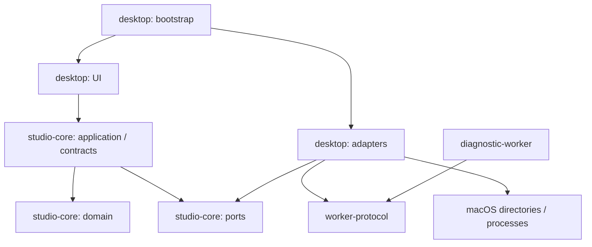

## Context

当前仓库包含开发基础设施和 `doc/` 研究资料，没有应用工程或正式业务规格。研究给出的长期方向包括 Rust 桌面工作台、可替换推理后端、资产溯源和跨平台运行，但其中的库选择、模型列表和结构示例均未成为已批准实现。

本设计对应 proposal 中的“项目基础框架”，用户已于 2026-10-29（Asia/Shanghai）回复“开始”批准实现。真实图片生成应使用后续 change，并以其自身的模型与硬件证据验收。

相关依据：
- [研究总览](../../../../doc/README.md)
- [架构研究](../../../../doc/02-rust-architecture.md)
- [研发方法](../../../../doc/04-methods-and-decisions.md)
- [接口示例](../../../../doc/07-interfaces-and-execution-examples.md)

## Goals / Non-Goals

**Goals**

- 为后续工作确定依赖方向、身份和版本语义、平台边界及受管理通信方式。
- 交付有真实构建、文本输入和子进程验证的工程底座。
- 让每项基础 spec 都能在本阶段直接验证，交付记录准确区分通过、失败和未验证。

**Non-Goals**

- 本阶段不运行图片推理，不安装模型或 Python，不实现数据库、下载器、任务调度、资产落盘和重启恢复。
- 本阶段不冻结全部未来模型字段或公共插件 API；模型专用实现、完整状态机和存储事务由对应 change 细化。
- 本阶段不提供 Windows 应用或签名、公证、安装器、自动更新。

## Decisions

### 1. 采用四成员 workspace，核心内按模块划分

拟建立：

```text
Cargo.toml
Cargo.lock
rust-toolchain.toml
apps/
  desktop/                   # 组合根、UI、当前平台及诊断适配
crates/
  studio-core/               # domain / contracts / application / ports
  worker-protocol/           # 独立的消息定义、编解码和信封校验
tools/
  diagnostic-worker/         # 独立诊断进程，只声明诊断能力
resources/
  fonts/                     # 为中文显示实际引入的字体和许可
```

目录按实现需要创建；不预建没有内容的 runtime、插件、模型家族和未来功能目录。

依赖方向：



`studio-core` 不依赖 egui、Tokio、SQLite、推理库或直接操作 OS 的库；可使用 Serde 表达数据契约。UI 通过应用服务和展示快照访问领域，进程事件在适配层转换后才进入应用状态。协议库只依赖其序列化和校验所需基础，不依赖桌面 UI 或平台 adapter。

先把当前目录、进程及诊断适配放在 desktop 的明确模块内。出现独立发布或第二个真实使用方后，再提取专门的 platform、storage 或 supervisor crate。

备选是单一桌面 crate 或按研究图拆出十余 crate：前者难验证核心独立构建，后者增加当前没有实际调用关系的维护面。四成员覆盖独立核心、协议和真实子进程的构建边界。

### 2. egui/eframe 是本提案待批准的 UI 起点

界面采用提示词输入区、主内容空态、状态区域，初始窗口按 1280×800 逻辑像素设计，最小验证窗口为 960×640，并检查 1×/2× 缩放。具体视觉设计、图片画布和面板布局可在后续 change 演进。

生成入口保持不可提交并显示原因。开发诊断通过显式 --diagnostics 或 debug 构建的开发菜单启用；诊断面板提供窗口尺寸及 1×/2× 渲染验证控件，不占用普通创作主流程；结果始终显示“通信诊断，不执行图片生成”。

输入验证包含中文字体、输入法组合/确认、中英混输、多行粘贴、选择/复制/撤销和快捷键冲突。中文字体资源需记录来源和允许随应用分发的许可，正常启动不在线下载字体。用户正在编辑的草稿属于当前会话 UI 状态，本阶段不做跨重启持久化承诺。

UI 仅读取展示快照和发送命令；进程启动、读取和退出等待由后台服务处理。后台事件触发必要重绘，空闲不通过固定忙轮询持续唤醒。

备选 GUI 保留为研究参考。若输入门禁失败，先提交可复现证据；更换框架需修订本设计并再次确认，不在实现中悄悄替换。

### 3. 核心契约固定语义，保留独立版本

本阶段只实现可构造、校验、序列化的数据类型及必要的纯校验函数：

| 契约 | 本阶段固定的语义 |
|---|---|
| 类型化 ID | Project、Asset、ModelVariant、Job、Attempt、Plan 不可混传；字符串值不代表路径 |
| AssetRef | 资产身份、内容散列、数据类型与存储位置引用分离；文件移动不改身份 |
| InputBinding | 输入资产、角色与顺序；按请求携带/引用的能力描述校验允许角色、数量与顺序 |
| UserRequest v1 | 用户原话、任务能力 ID、输入、请求输出、调整策略与幂等键 |
| ExecutionPlan v1 | 请求引用、有效参数、调整项、组件来源与 revision、runtime/设备引用 |
| Job / Attempt | 用户工作与具体执行分别标识；Attempt 绑定独立执行令牌 |
| RunManifest v1 | 请求及计划快照、来源、输入散列、输出及散列、最终结果 |

任务能力使用带命名空间的标识表达；内建帮助类型可以提供常用值，但外部能力不依赖不断扩充一个闭合枚举。角色是否被允许由明确的能力描述检查，不仅依赖一个任意字符串。

schema 版本分别属于请求、计划和 manifest，与 worker 协议版本独立。提供带校验的读取入口，当前版本必须字段完整；未来版本返回结构化错误。扩展字段只有在有名字空间和明确 schema 的扩展区域内保留，普通未知字段不静默接受。

制作记录使用自包含快照和内容身份，不在读取时从最新目录重新推导旧事实。成功记录必须有有效输出引用及散列。测试数据明确标为 fixture；创建合法 fixture 仅证明契约可用。

本阶段不实现执行调度、全局状态迁移或数据库写入，也不承诺仅依赖 Rust 的字段不可变性就能防止存储层篡改。

### 4. 全局架构边界先确定，运行行为分阶段实现

以下作为后续 change 必须遵守或显式修订的架构基线：

- **任务**：Job 表达用户工作，Attempt 表达一次执行。重试生成新 Attempt 和执行令牌，原记录保留。
- **计划**：原始请求、有效参数和调整分别保存；模型、设备、精度和尺寸替换需要明确策略及新计划事实。
- **提交**：worker 仅声明输出。核心检查当前 Attempt、令牌、取消意图和输出有效性后，才能接受成功；最终成功状态与资产/manifest 引用在同一可靠提交边界生效。
- **文件**：后续输出使用受管理工作目录和相对结果引用，校验路径、格式与散列后激活；文件系统与数据库之间的崩溃恢复由存储 change 说明，不能假设跨系统事务天然原子。
- **取消**：取消请求与确认分开；成功已先提交时返回已完成；取消先于最终提交生效时不再提交普通成功。具体竞争和恢复测试属于真实任务 change。
- **资产**：原图、派生图、蒙版与输出分开引用；图层属于文档摆放，不能替代资产身份；颜色、alpha、预处理几何属于后续图像处理契约。
- **环境**：主应用、运行时与权重分开版本化；确切模型和运行时方案在接入 change 中批准，不由基础工程提前锁死。

这些规则不等于本阶段实现了任务、文件和存储产品功能。当前 delta specs 的验收限于桌面壳、数据契约、通信和平台边界，后续行为必须增加相应规格与证据。

### 5. 诊断协议 v1 使用有界 JSON Lines

worker-protocol 定义版本范围和可验证信封，诊断进程与核心使用 stdin/stdout 传递控制消息，stderr 传日志。大图和模型数据不进入控制信封。

第一阶段消息覆盖 Hello、HelloAccepted、Probe、ProbeResult、Progress、Heartbeat、ProtocolError、Shutdown、ShutdownAck。核心创建新 session 后主动发送 Hello，附支持版本范围及请求标识；worker 返回 HelloAccepted，附自己的范围、最高共同版本、构建标识与诊断能力。核心检查回显身份、版本交集和能力后才进入可诊断状态。无共同版本时返回握手 ProtocolError，包含支持范围和错误码，不要求不存在的选定版本；握手前仅接受握手所需消息。

握手信封携带版本范围，HelloAccepted 同时包含选定版本；握手完成后的信封必须包含选定版本。公共字段包括 session ID、request ID、sequence 和消息类型。每个发送方向的首条握手消息从序号 0 开始，之后在该会话内单调递增，协商成功不重置；重复或迟到事件不重新应用。响应回显已发出且仍有效的请求标识。公共信封预留一组可选执行上下文字段；执行上下文存在时 Attempt ID 和令牌必须成对有效，诊断消息不得携带虚构生成上下文。

后续 Submit、Preview、ArtifactReady、Completed、Cancel 等执行消息需要在真实生成 change 中定义和协商；未知类型在 v1 诊断会话中属于协议错误，不靠猜测兼容。

初始工程预算：

| 项目 | 初始设置 | 验证方式 |
|---|---|---|
| 单条控制帧 | 最多 64 KiB UTF-8 字节，不含换行 | 在拼接缓冲前检查；测试无换行超限输入 |
| 待消费进度 | 最多 64 条，允许合并 | 高频注入，检查上限及当前结束状态 |
| 当前诊断日志尾部 | 最多 128 KiB，日志行亦受限 | 超量 stderr 注入，检查缓冲和错误摘要 |
| 握手与探针超时 | 默认各 5 秒，可在测试中缩短 | 可控无响应 worker，验证错误分类 |
| 有序退出宽限期 | 默认 2 秒，可配置 | 忽略退出的 worker，验证超时终止与回收 |

这些数值是工程上限和初始配置，不是模型速度或 UI 延迟的测量结论。错误/结束结果保存在有界的当前会话状态中，UI 可查询；不能依赖把结束消息塞进一个可能已满的进度队列。

诊断工具提供正常、错误版本、格式错误、超限、重复序号、异常退出、无响应、产生测试后代等受控模式。它只验证通信及进程行为，不生成图片或创建产品 Job。

备选是直接嵌入推理库或从第一天引入 gRPC：前者不能验证进程故障边界，后者目前没有远程/复杂流需求。本地有界协议足以验证当前能力。

### 6. 平台适配从目录和进程开始

macOS 使用系统用户应用目录，测试可显式指定隔离根；目录创建失败返回结构化错误，不回退写入源码目录。绝对路径只在具体 adapter 与存储位置描述中出现，领域通过 ID 和位置引用表达关系。

进程直接使用已选择的可执行路径和参数数组启动，不运行用户 shell；本阶段只启动项目构建的诊断程序。macOS 为其建立受管理进程集合，退出、超时和应用关闭时清理正常继承的测试后代并回收句柄。进程集合提供生命周期管理，不声明为安全沙盒或对任意逃逸程序的安全隔离。

核心和协议通过 `x86_64-pc-windows-msvc` 的编译检查。该检查不链接或运行 Windows 桌面/worker，也不代替 Windows 原生路径、Job Object、驱动或 GPU 验证；这些在 Windows change 中完成。

### 7. 工具链与依赖在批准后的实现起点锁定

按开发环境选择可用且兼容所需 API 的 Rust 工具链，写入 `rust-toolchain.toml`；应用仓库纳入 `Cargo.lock`。实现时查阅选定版本的官方资料和许可，再锁定 egui/eframe、Tokio、Serde、平台目录支持及字体资源；无需求不引入 HTTP、推理、数据库或插件依赖。

不预设本机芯片、内存、系统或 Rust 的具体版本。验收记录真实构建环境、工具链、依赖锁、Windows 目标组件、输入法和窗口/DPI 测试条件。

本地门禁为 `cargo fmt --all -- --check`、`cargo clippy --workspace --all-targets --locked -- -D warnings`、`cargo test --workspace --locked`、`cargo build --workspace --locked`，加核心/协议的 Windows 目标 `cargo check`。图形输入仍需实际桌面验证并记录，不能以单元测试代替。

## Risks / Trade-offs

- 中文输入或辅助功能受框架及实现影响 → 先执行文本门禁，问题留可复现步骤；不能仅凭窗口成功就认可 UI 方案。
- 全局契约定义过早产生过度抽象 → 保持最小公开数据语义，执行消息和模型参数由真实接入逐步扩展，独立版本允许演进。
- 诊断通过被误读为产品推理完成 → UI、测试材料与验收说明都明确标识诊断；模型支持和生成记录保持未配置。
- 基础阶段没有持久化 → 本阶段输入仅当前会话保存，下一阶段专门定义 SQLite/文件及崩溃恢复行为。
- 只在 Mac 实测 → Windows 仅记录核心/协议编译证据，保留其他能力未验证状态。
- 版本和字体许可尚未核对 → 在批准后引入依赖时逐项核对并锁定，验收材料记录来源及条件。

## Migration Plan

当前没有应用数据需要迁移。用户批准后创建工程并执行本 change 的 tasks；实现期间的进度继续使用 Beads，OpenSpec tasks 作为获批准范围的验收映射。

若底座验证失败，保留诊断证据并修订 change，不向正式 specs 归档未完成行为。全部实现任务及门禁通过后才归档，将新增能力写入主规格。

当前实现严格限于本设计的基础框架、工具链与中文字体资源、诊断及桌面实验。模型与推理运行时的安装不属于本次授权范围。
