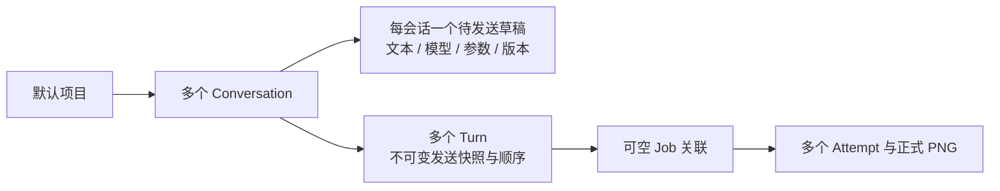

## Context

目前 `apps/frontend/src/Workspace.tsx` 的 generate() 等待草稿保存后调用 generation_submit，提示词保留在输入框；创作主区域继续显示示例或上一张图片。阶段只出现在发送按钮旁，任务页也只有文字步骤。`studio-api.ts` 已有 ExecutionView.stage/step/total，能够表达执行状态。

`StudioService::submit` 在完整模型散列校验后才建立 Job，返回异常也可能发生在 Job 已持久化后的启动阶段。因此“等待返回才画卡”会使校验期间不可见，“catch 就认定没收到”会造成重复发送。现有 SQLite user_version=1，Job 没有 draft_id；不能靠提示词推断草稿与旧任务的归属。

固定 Python worker 的采样回调发生在 mx.eval 之前；第 9 步回调不代表 GPU 已完成，也不代表正式 PNG 已保存。正式 AssetRef/manifest/Succeeded 事务继续作为完成事实。

## Goals / Non-Goals

目标：从发送、等待到完成都在当前创作页可见；已发送文本与新输入隔离，取消和故障可操作；保持已有本地数据和生成安全边界。

范围为默认项目下的多个独立 Conversation，每个会话包含多个 Turn/Job 和一个待发送草稿。侧栏以会话为单位，图片是会话内结果；每个会话的输入、模型、参数和阅读位置隔离。Conversation 是产品身份，不引入 AI 聊天 API 或语言模型上下文。占位卡不伪装成实时采样图像。

## Decisions

### 1. 会话拥有多轮图片，侧栏展示会话

保留顶部页签、窄图标主导航、亮暗主题和工作区表面；将原竖向图片/草稿条替换为约 240px 的文字会话侧栏。顶部“新建会话”创建独立空会话并切入，列表行显示标题、实际生成/清理状态和选中态，支持重命名。按最近一次会话创建、消息接收或用户重命名排序，切换、草稿自动保存、采样刷新和图片加载不反复重排列表。

新会话默认“新会话”，首次持久接收提示词后以首个非空行截取前 24 个 Unicode 字符作为自动标题；用户手动命名后不再自动覆盖，完整提示词仍在消息里。新会话使用应用默认设置生成自己的设置快照，不从当前会话继承瞬时模型/画幅或种子；本阶段尚无持久设置页时，内置默认值为 Z-Image Turbo、1:1、单张、随机种子。不复制提示词或结果，不自动生成。名称长度限制与错误在输入处表达。

主区域只展示当前会话。每轮右侧用户提示词在前、左侧图片响应卡在后；长提示词可展开并保留换行/复制。卡片按目标画幅预留空间，成功前后同一个容器；限制最大高度，长竖图不挤出输入框。960×640 下侧栏可收起，但“打开会话列表”和“新建会话”始终可达。

```text
┌ 会话 ─────────────┬────────────────────────────────────────┐
│ ＋ 新建会话       │ 会话：山湖摄影                          │
│                   │                  用户：清晨的山间湖泊… │
│ ● 山湖摄影  生成中│ Image Studio                            │
│   商品静物        │ ┌──────────────────────────────┐       │
│   建筑灵感        │ │ 图片占位 / 生成结果          │       │
│                   │ │ 正在采样 4/9   ━━━━━── 48%  │       │
│                   │ │                   [停止]   │       │
│                   │ └──────────────────────────────┘       │
│                   │                 用户：日落的山间湖泊…  │
│                   │ ┌──────────────────────────────┐       │
│                   │ │ 第二张图片卡                 │       │
│                   │ └──────────────────────────────┘       │
│                   │ ┌──────────────────────────────────┐   │
│                   │ │ 描述下一张图片……                 │   │
│                   │ │ [画幅/种子]  [Z-Image Turbo ▾][↑] │   │
│                   │ └──────────────────────────────────┘   │
└───────────────────┴────────────────────────────────────────┘
```

模型选择位于底栏右侧、发送/停止正左侧；中间不夹状态文案、复制、思考档或其他控件。画幅、种子等在左侧，当前阶段移入图片卡。菜单显示真实目录与就绪原因及模型中心入口；当前仅正式接入的 Z-Image Turbo，未来型号不伪装成可执行选项。菜单关闭恢复同一会话的编辑焦点；若用户已切会话，旧菜单关闭事件不得抢回焦点。模型选择只更新下一条输入，不加载/下载、不创建任务。

数据所有权：



`ConversationId` 是独立业务身份，不用 AssetId/JobId/首张图片代替。每个会话复用一个现有 Draft 存储已确认待发送输入；DraftParams 增加登记 modelId，与文字、参数共用同一 CAS 版本，避免会话偏好和草稿两处写入。会话表保存 draft_id 唯一映射、title/title_source、created_at/activity_seq 等。项目 active_conversation_id 为活动选择唯一事实，旧 active_draft_id 仅兼容派生，不再作为另一独立选择来源。

会话与消息/偏好归 Rust Library 持久化，前端只持有按 ConversationId 分区的未确认编辑、撤销/组合输入和滚动缓存。任何异步查询/保存/发送确认都核对来源 ConversationId + DraftId + version，旧会话结果不覆盖当前会话。

切换会话前保存已确认输入；写入失败时停留原会话并说明，用户可重试或复制。未确认 IME 不被当成已确认保存。新建/切换不停止另一个会话的生成；该会话列表行显示“生成中/正在取消/清理中”，可进入原卡。整个应用仍一个活动请求，其他会话允许编辑但发送禁用；非运行会话的发送按钮不变成指向别处的停止按钮，另有“查看正在生成的会话”入口。运行会话底栏停止和卡内停止针对同一请求。

空会话仍提供离线示例入口。点击成功卡打开现有适配/缩放/旋转画板并“返回会话”，返回原 ConversationId、阅读锚点和输入；任务页点击图片则先定位其拥有会话与轮次，再打开预览。示例查看不改变会话归属，使用示例只修改明确当前会话的待发送输入。

### 2. 键盘与发送后的编辑边界

非组合态且无修饰键的 Enter 执行发送并阻止插入换行；Shift+Enter 插入换行。Ctrl/Meta/Alt+Enter 不作为额外发送快捷键。处理 nativeEvent.isComposing、每个 textarea 的组合标记、兼容的 keyCode 229 及组合结束同一按键保护，避免候选确认触发发送。粘贴多行不发送；按键重复和双击复用同一发送意图。

快速校验空文本、字节数、参数、模型已知就绪和忙碌状态；失败保留输入并在附近说明。校验通过后，下一次渲染即加入本地“正在发送”消息对，再协调来源草稿保存并发送受限业务请求；本地消息出现不等待草稿 flush、模型散列或启动计算。

发送被宿主持久接收后，清空本次源输入，保留模型/尺寸/种子设置，建立新的输入编辑边界；用户可输入下一条，单活动执行期间其他新发送禁用并解释需等待或取消。会话模型选择可继续修改下一条意图，已发消息保持冻结模型。发送中暂时保留本次源 textarea 并短暂只读，宿主快速接收事务不做模型散列或进程等待；其他会话仍可编辑。若用户切到别的会话，迟到的接收确认只消费来源草稿，不清空当前会话输入、不强行改焦点。

本次发送快照为不可变文本/参数，新输入、撤销或应用示例均不能改写它。用户主动“编辑后重新发送”才复制旧提示词进入输入；如已有新文字，明确选择替换或取消，不能静默覆盖。提交前被拒绝不消费输入；持久接收后的预检/执行失败保留消息及恢复编辑入口。

### 3. 最小持久化发送意图，先快速接收再执行

新增 `conversations` 和最小 `generation_turns` 表升级 SQLite schema v1→v2。Turn 记录 project_id、conversation_id、会话内稳定顺序、submission_key、source_draft_id（旧历史可空）、原始提示词/模型/参数快照、接收时刻、可空 JobId 和预检状态/原因。每个 Turn 永久归属一个 Conversation，每个 Job 最多绑定一个 Turn，关系须核对同项目且唯一。它是图片请求的 UI/发送意图记录，不替代 Job/Attempt/manifest，也不建立语言模型聊天协议。每轮请求与响应卡由该记录及其关联 Job 派生。

新增受限 `conversation_send` 业务入口，只接受 ConversationId、来源草稿版本及登记模型/有限参数，不接受 URL、路径或 SQL。接收在短事务中完成：

前端先绘制本地卡并冻结来源的已确认文本/参数，锁定该来源的此次编辑边界；来源保存队列串行等待已在途旧写入，flush 本次来源快照并取得最新持久版本，再发接收请求。无需等待其他会话草稿后续产生的新编辑。flush 失败则原输入保留、解除来源只读，卡片显示保存失败且不发接收请求。该顺序须覆盖“刚打完字立刻 Enter”与已有保存飞行的情况。

1. 按项目 submissionKey 查询，已接收且会话/文本/模型/参数相同则返回同一 Turn 与当前 Job，不重复消费草稿；相同键换会话或内容拒绝。
2. 检查 Conversation 存在、Draft 确属该会话、版本及已确认文本/模型/参数一致、项目归属及全局单活动请求约束。
3. 原子写入属于该会话的 Pending Turn，消费对应版本的源草稿文字并递增版本，模型和参数保持；更新该会话活动顺序和首次自动标题，返回 ConversationId/TurnId、源草稿新版本和快照。
4. 保存队列按响应版本重新基准化，拒绝旧 ACK/旧保存将已发送文字写回。接收失败事务回滚，不丢失输入。

接收事务不做全模型散列、Python 启动或 GPU 工作。后台串行 preflight 在同一调度约束下核对发送快照的登记 modelId 与 Ready 组合并冻结请求/计划，不允许改为另一型号，再以一个事务创建并关联 Job/Attempt 后启动现有 Controller。Pending Turn 同样占用单活动名额，并与模型安装互斥，避免两次快速发送或安装与预检并发。

宿主拒绝之前前端的本地卡显示明确发送失败，可以关闭或再次发送，输入保持；本地卡不是正式 Job。持久接收之后的校验失败保留 Rejected Turn（无 Job），卡片显示原因与“编辑后重新发送”，已有输入不被覆盖。若持久 Job 已存在，即使启动失败也按其正式 Failed 状态显示，不能退回“未收到”。

响应丢失时按相同 submissionKey 查询/重发，返回同一 Turn；Pending 状态不产生第二个后台执行。来源草稿新版本须先被保存队列采纳，再允许其新编辑写入；网络/IPC 不确定期间该来源保持“确认发送状态”，其他会话和历史可用。

本地发送卡在尚未发出接收 IPC 时停止：撤销本地意图，在已有来源保存完成后解除只读并保留文字/最新版本，不再发出接收。若 IPC 已发出或接收确认不确定，停止显示“确认发送状态并停止”，保留同一 submissionKey；按该 key 和 ConversationId 核对，取得 Turn 后取消该 Turn。查询暂未找到但原请求仍在途时不能认定未接收、清卡或重新创建请求；只有原接收明确拒绝且核对未建立记录才结束为未发送，响应/查询失败继续提供重试核对入口。用户的停止意图在本次核对期间保持，迟到接收确认到达后立即继续同轮取消，不自动当成功发送继续等待。

Pending Turn 可按 TurnId 请求取消；未绑定 Job 的状态至少区分 Pending、CancelRequested、Cancelled、Rejected、Interrupted，绑定后由 Job/Attempt 派生执行状态。取消接受须持久登记 CancelRequested，确认预检停止后登记 Cancelled，后来错误不能覆盖取消意图。后台校验设置合作取消检查，在创建 Job 和启动 Controller 前再次裁决，取消先接受则不创建/启动计算；已关联 Job 则使用原取消门禁。取消完成后才释放活动名额。预检期间应用退出，重启将未接受取消且未绑定 Job 的 Pending Turn 标记为 Interrupted；无 Job 的 CancelRequested 保留取消意图并在确认本地预检不存在后转为 Cancelled，不改成 Interrupted。均不自动恢复执行；用户可重新发送，形成新 Turn，旧记录保留。已绑定 Job 的恢复与重试完全复用现有语义。

### 4. 进度按执行事实推进

进度是“流程阶段刻度”，不是耗时预测，模型加载等阶段没有可计算的文件/算子百分比时保持刻度并显示活动提示；不按计时器涨数字，不估剩余时间。卡片始终显示当前中文阶段。

| 事件或阶段 | 显示刻度 |
|---|---:|
| 本地发送中 / 持久接收 / 完整性预检 | 0% / 2% / 5% |
| loading | 10% |
| encoding | 15% |
| sampling s/9，包含 s=0 | floor(20 + 65 × clamp(s,0,9)/9)，20%–85% |
| decoding | 90% |
| writing / 候选回收与验证 | 95% |
| 宿主正式提交中 | 99% |
| Succeeded 且合法资产预览已解码 | 100%，原位显示正式 PNG |

阶段跳过或一次轮询跨多个阶段时直接显示较新事实，不补播假步骤；同 Attempt 保持非倒退，较旧 Attempt 事件不能推进新卡。需在业务 ExecutionView 暴露 AttemptId，用 JobId+AttemptId 核对进度；worker wire 不变。新 Attempt 明确重置刻度。第 9 步仍显示“采样 9/9 · 正在处理”，直到后续实际阶段。

Cancelled/Failed/Interrupted 停止活动提示，保留最后刻度及明确状态，不补满；正在取消或清理未完成仍可见。Succeeded 后浏览器加载 PNG 期间显示“正在显示图片”；解码失败或外部资产异常显示“任务已完成，图片无法显示”及重载/查看记录，保留真实 manifest，不重新执行推理，也不把缺图当作加载中的生成。

### 5. 原位操作、滚动与恢复

每张活动卡提供停止入口，终态卡提供有意义的重试/编辑、复制提示词、查看制作记录；成功卡提供放大查看与 PNG 导出。相同 Job 的 Failed/Cancelled/Interrupted 重试在原卡中展示新 Attempt 并保留历史入口；修改提示词或成功后再次发送追加新 Turn。无 Job 的 Rejected/Cancelled/Interrupted Turn 重新发送形成新 Turn，旧消息保留。

每会话默认每页 30 轮，按 `(conversation_id, sequence)` 稳定排序，用限定会话的游标加载较早记录；会话列表另行分页。切换会话的历史请求带身份/请求代次，迟到 A 响应不可合并到 B。发送时主动滚到本次消息；用户处于底部 96px 内可跟随新增内容，向上阅读后进度和图片加载不拉回底部，提供“回到最新”。追加前页保持阅读锚点；后台完成不改活动会话或抢输入焦点，不自动把主视图切换为单图画板。

schema v1→v2 在单一可回滚事务迁移：每份旧 Draft 建立一个会话并保留原文字、参数、名称与版本，补默认 modelId。旧 Job 没有可靠草稿归属，因此全部按 `(created_at,rowid)` 稳定排序进入单独“历史生成”会话，绑定原 Job，保留全部 Attempt、manifest 和资产，不猜提示词匹配。历史会话创建独立空输入草稿；无旧 Job 时不创建它。旧活动 Draft 映射为活动会话；旧选中图片记为“历史生成”的查看选择，进入该会话后仍可定位，不覆盖原活动会话输入。新库创建一个空会话及唯一输入草稿。迁移重复启动不得重复导入，失败保持原库而不是清空重建。

退出/重开恢复最近活动会话，从 Conversation/Turn/Job 恢复各自历史、输入、模型/参数和中断状态；从未持久接收的本地卡不被恢复成已发送消息，未消费的草稿仍在。正常关窗继续 flush 已确认新输入；未确认 IME 文本不新增恢复承诺。

## Alternatives Considered

- 只在任务页显示更多文字：不能解决发送后当前页面缺少反馈。
- 全部从内存拼装消息并立即清空输入：接收确认丢失和崩溃时会丢失发送文本，不能保证恢复。
- 等完整 generation_submit 返回才画卡/消费输入：完整性校验阶段仍可能长期不可见。
- 默认项目只有一条全局时间线：不满足用户新增的独立会话需求，已由本版替换。旧草稿转会话，旧 Job 用明确的历史会话保留。
- 将图片缩略图直接当会话：无法表达同一会话多轮图片、独立输入与名称。
- 按时间让进度匀速走到 100%：无法表达真实等待与成功门禁。

## Risks / Validation

新增持久接收阶段必须测试 CAS、保存队列重基准、接收后 ACK 丢失、预检中退出、取消与 Job 关联事务竞争。schema 升级用 v1 fixture 及当前验收根的独立副本验证；不直接用唯一的既有库试错。

前端测试会话新建/切换/重命名、模型紧邻发送的位置、模型按会话保存、真实键盘事件语义、IME、稳定卡身份、进度门禁、滚动与会话隔离。原生验收在既有 M3 Max / 128 GiB 用固定模型完成中英文发送、全过程可视反馈、卡内停止/重试、重启恢复和 PNG 导出，保存每阶段截图或屏幕录制及实际任务记录；不把静态占位图写成真实推理验收。

## Reference Boundary

已只读研究用户指定的本地 ZCode，来源与精确组件见 [研究记录](references/zcode-source-notes.md)。借鉴会话文字列表、稳定 Turn 分组和输入底栏右侧控制簇；Image Studio 按本用户要求让模型直接紧邻发送，不复制 ZCode 的权限、思考档、用量、远程 Host 或 busy 队列。源码观察不等于已运行 ZCode 或完成本项目视觉验收。
