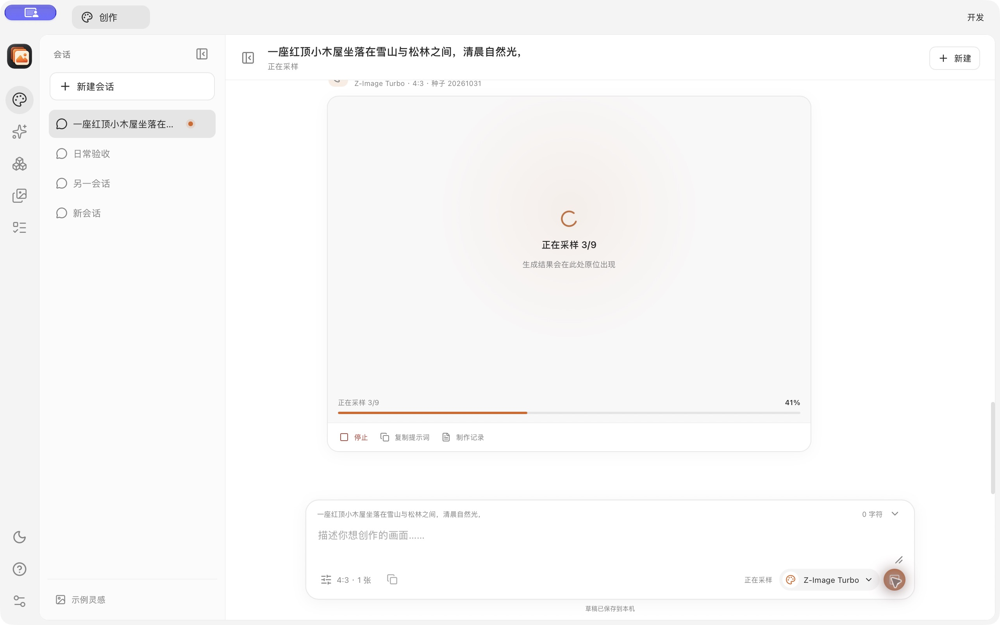
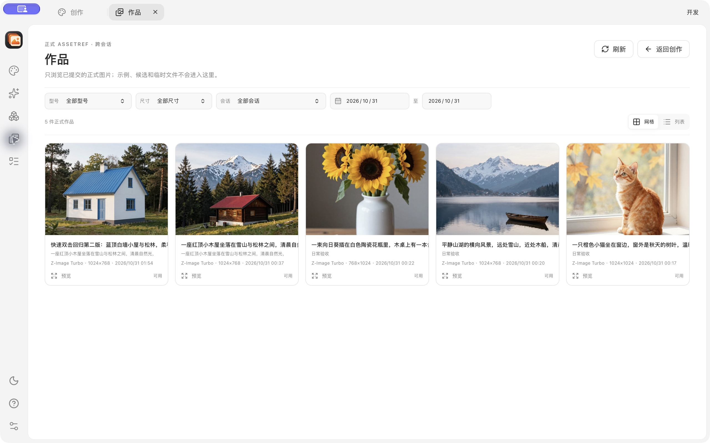
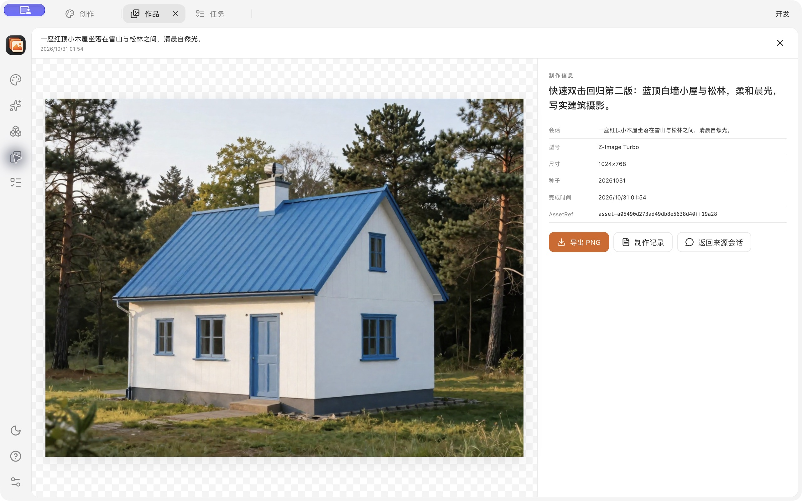
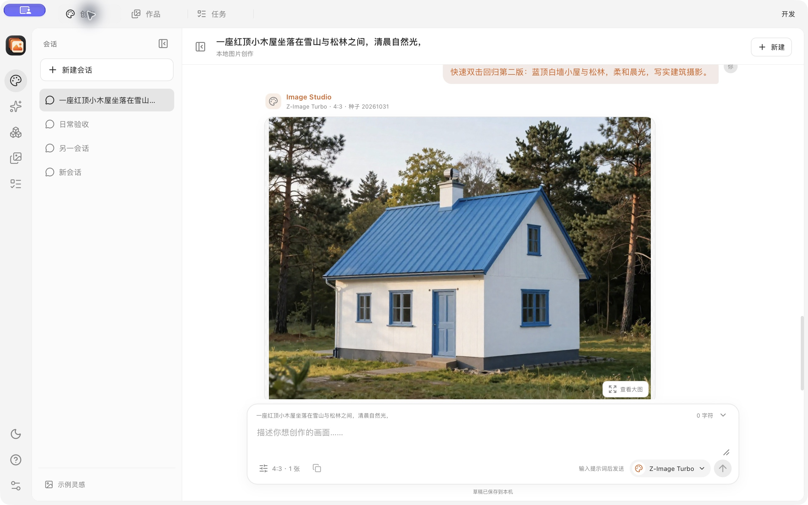
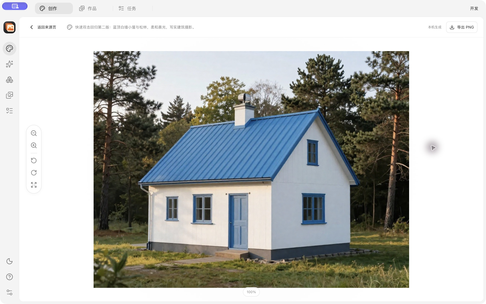

# 日常生成交互修复验收

结论：**PASSED**

- Change：`fix-daily-generation-interactions`
- 原生应用：`target/dev/Image Studio.app`
- 前端：5 个测试文件、29 个测试通过；TypeScript 与 production build 通过
- Rust：fmt、clippy `-D warnings`、workspace test/build 通过；162 通过、2 个既有显式验收 ignored
- Python worker：8/8 通过；验收工具：12/12 通过；OpenSpec strict 通过

## L03 快速双击发送

在隔离回归前，数据库为 5 Job / 5 Attempt / 4 Asset。原生快速双击发送后只新增一个 Job，Attempt 最终 succeeded，未产生新的取消请求：

- Job：`job-9f308c8c9ed94e00b0811dc3b14ee72d`
- Attempt：`attempt-fcfde62ce6ee4e919669abb88d9efb13`
- 最终：6 Job / 6 Attempt / 5 Asset
- 原有 1 个 cancelled Attempt 属于此前 D05，可辨识且未被误算

## D06 作品页首次进入

生成完成后第一次进入作品页，无需点击刷新即显示 5 个正式作品和最新 AssetRef。切换到列表布局后离开再返回，列表布局与当前结果保持。

最新结果：1024×768、种子 20261031、1,259,801 bytes，SHA-256 `6a12c769cc6d381c6a6de042bc8bf354d883ee8cdfe1b00f4808a440f5cbb823`。

## d67 查看器返回

从作品打开最新结果并返回来源页后，在作品、任务、创作标签间往返不会重开旧查看器；再次显式点击会话内图片仍能正常预览。

机器可读结果见 [fix-acceptance.json](fix-acceptance.json)。本修复不改变 I01 冷网络安装和 D03 真实键盘 IME 的阻塞结论。
